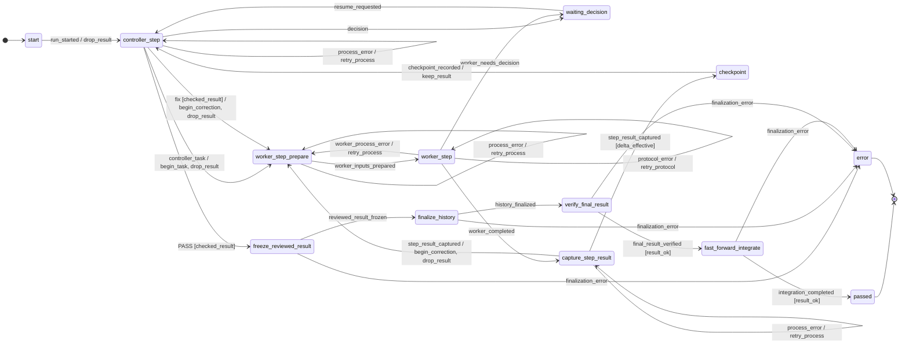
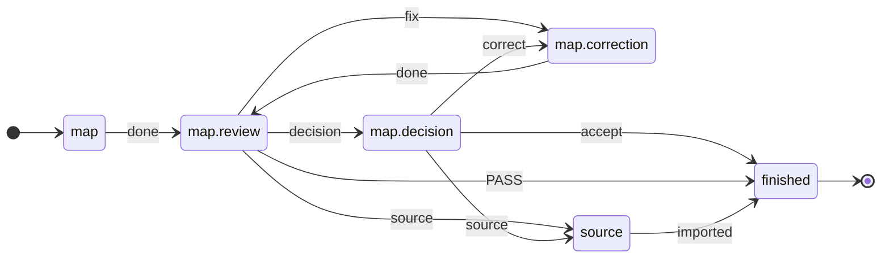

<p align="right"><a href="README.md">Deutsch</a> | English</p>

# ki-dev

**Coding agents do the work; a flow written in TOML decides what happens next.**
Implementation, separate review, correction, integration: no agent
dispatches the next one, no human relays every answer by hand.

🚧 **In development, not ready for production use.** Flow control, the
correction loop and adapters for Claude Code and Codex work. Still missing:
a test gate before integration and budget limits on every path.

## Contents

1. [Why](#why)
2. [Example: one bug, two agents](#example-one-bug-two-agents)
3. [What happens in a run](#what-happens-in-a-run)
4. [Try it without agents](#try-it-without-agents)
5. [Status](#status)
6. [Architecture](#architecture)
7. [Contributing](#contributing)

## Why

Working with coding agents turns you into a messenger: hand over context,
check the result, pass corrections back. On top of that, agents report
"done" when they are not.

ki-dev moves this control into files:

- **Flow** (`flow/*.toml`): who acts when, where `fix` leads, when a human
  decides.
- **Profile** (`.ki-dev/profiles/*.toml`): who fills each role: Claude Code,
  Codex, a human or a mock.
- **Task** (an issue in [Beads](https://github.com/steveyegge/beads)):
  what to do, with acceptance criteria.

Agents work inside a state; ki-dev picks the transition.
Background: workflows with checkpoints instead of free-steering agents
([Anthropic](https://www.anthropic.com/engineering/building-effective-agents));
premature completion and missing verification as typical failures of
multi-agent systems ([MAST](https://arxiv.org/html/2503.13657v3)).

<sub>[↑ Contents](#contents)</sub>

## Example: one bug, two agents

In a small repo, `add(a, b)` returns `a - b`.
Codex should fix it, Claude Code reviews.

**1 · Create the task**

```bash
bd create "add() does not add" \
  --description "add(2, 3) returns -1" \
  --design "fix add.py; do not change test_add.py" \
  --acceptance "add(2, 3) == 5 and add(-1, 1) == 0"
# → calc-7k2, the task ID
```

**2 · Flow: ships with ki-dev.** The part that makes the correction loop,
from [`implement.toml`](src/ki_dev/flow/implement.toml):

```toml
# review says "fix", no rounds left → halt, a human decides
[[statechart.states.active.states.controller_step.transitions]]
event = "fix"
cond = "checked_result"
unless = "changes_rounds_left"
on = [{ raise = { event = "escalation.changes_rounds_exhausted" } }]

# otherwise → back to implementation, round counter +1
[[statechart.states.active.states.controller_step.transitions]]
event = "fix"
cond = "checked_result"
target = "worker_step_prepare"
on = ["begin_correction", "drop_result"]
```

The agent only returns its verdict (`fix` or `PASS`); ki-dev decides which
edge follows. The first matching edge wins.

**3 · Assign roles** in `.ki-dev/profiles/default.toml`:

```toml
workdir = "/home/me/calc-work"          # agents' working worktree
access_profile = "write"

[worker]                                # implements
executor = "codex"
session_id = "019a…"                    # existing Codex session
model = "gpt-5.6-terra"
effort = "high"

[review]                                # reviews, in its own session
executor = "claude"
session_id = "b3f1…"                    # existing Claude Code session
model = "sonnet"
effort = "high"

[[tests]]                               # runs each round, result goes to review
name = "pytest"
argv = [".venv/bin/python", "-m", "pytest", "-q"]

[limits]
changes_rounds = 3                      # then ki-dev asks a human

[finalization]                          # where an accepted result goes
target_workdir = "/home/me/calc"
target_ref = "refs/heads/main"
commit_message = "Fix add()"
data_mode = "file_proposal"
```

**4 · Run**

```bash
ki-dev -f implement calc-7k2         # flow implement, profile default
ki-dev -f implement status RUN_ID    # where is the run?
ki-dev -f implement resume RUN_ID    # continue after a halt
```

**Status of this example:** flow, profile format and commands are real,
the Codex and Claude Code adapters are built. Still open: an accepted run
with real agents, and red tests do not yet stop integration.

<sub>[↑ Contents](#contents)</sub>

## What happens in a run

Trace from a run's `events.jsonl`, shortened. The edges are the same with
agents and with mocks:

```text
controller_step ─controller_task→ worker_step              # task to Codex
worker_step ─worker_completed→ capture_step_result         # Codex made changes
capture_step_result ─step_result_captured→ checkpoint      # diff and pytest as evidence
checkpoint ─checkpoint_recorded→ controller_step           # Claude reviews
controller_step ─fix→ worker_step_prepare                  # round 2
  … same steps …
controller_step ─PASS→ freeze_reviewed_result              # accepted
fast_forward_integrate ─integration_completed→ passed      # fast-forward onto main
```

Every intermediate result is stored as an artifact in the run directory;
a halted run continues with `resume`.

<details>
<summary>The whole flow as a diagram, generated from the TOML</summary>

`ki-dev flow show implement --without-escalations`, without limit and
safety halts:

<!-- ki-dev flow show implement --without-escalations -->


</details>

<sub>[↑ Contents](#contents)</sub>

## Try it without agents

<!-- readme-script: readme-scripts/en/1-setup.sh -->
> ⬜ not run · verify: make readme-check

The demo creates a throwaway repo with a task and a profile; a mock
implementer and a mock review (`fix`, then `PASS`) play through the
example without provider access. The status line above refers to
setup in an empty container.

Needs Python ≥ 3.12, git ≥ 2.32, make, Go and a C compiler:
`make setup` builds [Beads](https://github.com/steveyegge/beads) `bd`
from source into the project venv (a few minutes the first time,
needs network). `$REPLACE_WITH_REPOSITORY_URL` = this repo's clone URL.

```bash
git clone "$REPLACE_WITH_REPOSITORY_URL" ki-dev
cd ki-dev
make setup
make demo
```

Output (shortened, hashes vary):

```text
{
  "run_id": "demo",
  "status": "passed",
  "round_id": 2,
  "detail": "Fast-forward integriert"
}

ad543c6 Geprüfter Abschluss (Demo)
091d542 start
```

`round_id: 2`: one correction round. `passed`: the mock review
accepted, the result is fast-forwarded onto `main`. The mocks only
write a line of text; the demo shows the control flow, not an agent's
work.
<!-- /readme-script -->

<sub>[↑ Contents](#contents)</sub>

## Status

**Works**

- Flows as TOML statecharts on
  [python-statemachine](https://python-statemachine.readthedocs.io/).
  In `implement` every back edge consumes a counter; a
  [test](tests/machine/test_reachability.py) enumerates the state space:
  no cycle without a human runs unbounded.
- `implement` from task to fast-forward integration, with halt and
  `resume`; demonstrated with mock agents.
- Adapters: Claude Code, Codex, human (`manual`, `inbox`), mock.
- Safety halt at context, quota and budget limits for `claude`; `codex`
  without context measurement.
- `step`: shows the handoff to an agent for any state, without starting one.

**In progress**

- Test gate: today a review `PASS` integrates even with red tests.
- One shared executor for `implement` and `step`, so limits apply
  everywhere.
- An accepted run with real agents.

**Goal for V1:** four flows, chained by hand. Map requirements (`map`) →
dependencies (`graph`) → executable tasks (`materialize`) → implementation
(`implement`). The first three exist today as review flows, driven by
hand via `step`.

<!-- readme-script: readme-scripts/en/3-review-gate.sh -->
> ❌ red, expected (spec) · 2026-10-17 · verify: .venv/bin/pytest -q --runxfail tests/test_review_gate_cli.py · [Status](#status)

**When is the test gate done?** When this test is green. It runs
`ki-dev -f implement` against a throwaway repo with a wrong `add.py`
(`a - b`); the tests are red, the mock review still says `PASS`.

```bash
.venv/bin/pytest -q --runxfail tests/test_review_gate_cli.py
```

```text
E   tests.test_review_gate_cli.IntegratedDespiteRedTests: 3e696bb -> d14aedd: Fast-forward integriert
FAILED tests/test_review_gate_cli.py::test_red_tests_and_review_pass_do_not_integrate
1 failed, 4 passed
```

Today the result lands on `main` despite red tests. The four green
cases check the test itself, e.g. green tests plus `PASS` do integrate.
<!-- /readme-script -->

<sub>[↑ Contents](#contents)</sub>

## Architecture

| Part | Job |
| --- | --- |
| `flow/*.toml` | states, edges, guards: what happens after which verdict |
| `runner/` | checks the answer, takes the edge, builds the next handoff |
| `adapter/` | passes the handoff to Claude Code, Codex, a human or the mock |

Shared patterns live once in a catalog. `map`, `graph` and `materialize`
only set parameters on the review pattern
([`map.toml`](src/ki_dev/flow/map.toml)):

<!-- ki-dev flow show map -->


Play it through by hand, without agents:

```bash
ki-dev flow show map                                    # flow as Mermaid
ki-dev -f map step BEAD map                             # handoff to the mapping agent
ki-dev -f map step BEAD map.review map.review=verdict.json  # return verdict, next handoff
```

`ki-dev flow show` generates both diagrams from source; a test compares
them with this README.

<sub>[↑ Contents](#contents)</sub>

## Contributing

Good first tasks, each with a clear finish line:

- **Build the test gate**: done when the red test above is green.
- **Round counter in the review pattern**: `map`, `graph`, `materialize`
  do not count their correction rounds yet.
- **One executor**: move `implement` onto the shared executor.

More: [what the architecture still lacks (German)](docs/ausfuehrer-luecken.de.md).

```bash
make test           # pytest and ruff
make spec-test      # requirement tests; red results are allowed
make readme-check   # README setup in a throwaway container, needs Docker
```

<!-- readme-script: readme-scripts/en/2-runtime.sh -->
> ⬜ not run · verify: make setup-runtime

To develop ki-dev with ki-dev, install it apart from the source tree:
own venv, symlink in `~/.local/bin`. Finish running jobs before an
update ([details, German](docs/self-development.de.md)).

```bash
make setup-runtime
export PATH="$HOME/.local/bin:$PATH"
ki-dev --help
```
<!-- /readme-script -->

Further reading (German): [executor and profiles](docs/ausfuehrer.de.md) ·
[`step` and handoffs](docs/step.de.md) ·
[flow packages](docs/ablaufpakete.de.md) ·
[CLI adapters](docs/cli-adapters.md) ·
[target picture](docs/zielbild.de.md)

Questions, ideas, collaboration: open an issue or contact
[@blaumohn](https://github.com/blaumohn) directly.
License: [MIT](LICENSE).

<sub>[↑ Contents](#contents)</sub>
