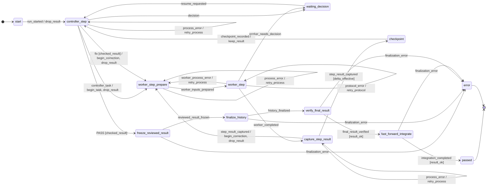
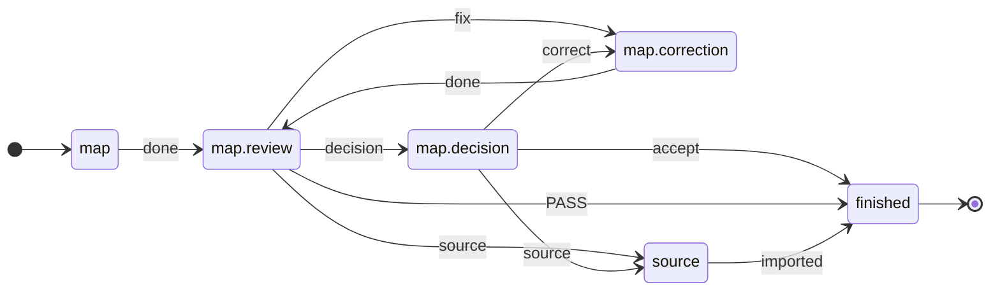

<p align="right"><a href="README.md">Deutsch</a> | English</p>

# ki-dev

**AI agents do the work; a [flow written in TOML](#1-model-the-flow) decides what happens next.**
The flow models a way of working, such as implementation with a separate
review, or [planning](#not-just-code). A profile
[casts the roles](#2-cast-the-roles), the [task](#3-pick-a-task) is any
issue. No agent dispatches the next one, no human relays every answer by
hand.

Built for tight token budgets: code picks the next step, not a supervising
model ([Why](#why)).

🚧 **In development, not ready for production use.** Flow control, the
correction loop and adapters for Claude Code and Codex work. Still missing:
a test gate before integration and budget limits on every path:
[Status](#status) · [Roadmap](#roadmap).

## Contents

1. [Why](#why)
2. [Example: implementer and reviewer as a flow](#example-implementer-and-reviewer-as-a-flow)
   1. [Model the flow](#1-model-the-flow)
   2. [Cast the roles](#2-cast-the-roles)
   3. [Pick a task](#3-pick-a-task)
   4. [Run](#4-run)
3. [What happens in a run](#what-happens-in-a-run)
4. [Try it without agents](#try-it-without-agents)
5. [Layers](#layers)
6. [Not just code](#not-just-code)
7. [Status](#status)
8. [Roadmap](#roadmap)
9. [Contributing](#contributing)

## Why

Working with coding agents turns you into a messenger: hand over context,
check the result, pass corrections back. On top of that, agents report
"done" when they are not.

**Who it is for:** anyone working with a limited token budget. A
supervising model that reads every output costs extra; if you cannot pay
for that, put the control into files. In ki-dev, edge selection, format
checks and limit comparisons are code; models do the work and the
substantive review. Later, AI may tune parameters and calibrate flows
([Roadmap](#roadmap)), as an option, not a prerequisite. The savings are
not measured yet.

Background: workflows with checkpoints instead of free-steering agents
([Anthropic](https://www.anthropic.com/engineering/building-effective-agents));
premature completion and missing verification as typical failures of
multi-agent systems ([MAST](https://arxiv.org/html/2503.13657v3)).

<sub>[↑ Contents](#contents)</sub>

## Example: implementer and reviewer as a flow

What gets modeled is a procedure, not a single task: one agent implements,
a second reviews in its own session, `fix` leads back, after three rounds a
human decides. Each step belongs to its own [layer](#layers).

### 1. Model the flow

**Layer: flow package.** The bundled flow `implement` defines what happens
after which verdict. The correction loop, from
[`implement.toml`](src/ki_dev/flow/implement.toml):

```toml
# review says "fix", no rounds left → halt, a human decides
[[statechart.states.active.states.controller_step.transitions]]
event = "fix"
cond = "checked_result"
unless = "changes_rounds_left"
on = [{ raise = { event = "escalation.changes_rounds_exhausted" } }]

# otherwise → back to implementation, round counter +1
[[statechart.states.active.states.controller_step.transitions]]
event = "fix"
cond = "checked_result"
target = "worker_step_prepare"
on = ["begin_correction", "drop_result"]
```

The flow binds the work behind a state to an op, shortened:

```toml
[op.review]                       # work of the state controller_step
role = "review"                   # a role, not an agent: the profile picks it
do = "review.decide"              # entry in the ops catalog
events = ["PASS", "fix", "decision", "escalate"]   # allowed verdicts
```

The agent only returns its verdict; ki-dev decides which edge follows.
The first matching edge wins. Ops interface:
[bindings (German)](docs/ablaufpakete.de.md#eine-bindung); the ops of
`implement` live in
[`flow_ops/implement/ops.py`](src/ki_dev/flow_ops/implement/ops.py),
shared ops of the scaffold in [`ops/`](src/ki_dev/ops/).

### 2. Cast the roles

**Layer: profile.** Who fills each role, and with which limits, is set in
`.ki-dev/profiles/default.toml`; the flow stays the same:

```toml
workdir = "/home/me/calc-work"          # agents' working worktree
access_profile = "write"

[worker]                                # implements
executor = "codex"                      # adapter from the scaffold
session_id = "019a…"                    # existing Codex session
model = "gpt-5.6-terra"
effort = "high"

[review]                                # reviews, in its own session
executor = "claude"
session_id = "b3f1…"                    # existing Claude Code session
model = "sonnet"
effort = "high"

[[tests]]                               # runs each round, result goes to review
name = "pytest"
argv = [".venv/bin/python", "-m", "pytest", "-q"]

[limits]
changes_rounds = 3                      # then ki-dev asks a human

[finalization]                          # where an accepted result goes
target_workdir = "/home/me/calc"
target_ref = "refs/heads/main"
commit_message = "Fix add()"
data_mode = "file_proposal"
```

A human (`manual`), a mock or another model: only `executor` changes
([adapters](docs/cli-adapters.md)).

### 3. Pick a task

**Layer: work graph** ([Beads](https://github.com/steveyegge/beads)).
The flow fits any issue with acceptance criteria, here a small bug:
`add(a, b)` returns `a - b`.

```bash
bd create "add() does not add" \
  --description "add(2, 3) returns -1" \
  --design "fix add.py; do not change test_add.py" \
  --acceptance "add(2, 3) == 5 and add(-1, 1) == 0"
# → calc-7k2, the task ID
```

Which issue a run gets is a human's choice today; there is no walk
through the bead graph yet ([Roadmap](#roadmap)).

### 4. Run

**Layer: scaffold.** The runner drives the flow to the next halt; the
adapters pass the handoffs to Codex and Claude Code. Halt, resume and
safety limits work the same for every flow
([`run.toml`](src/ki_dev/runner/run.toml)).

```bash
ki-dev -f implement calc-7k2         # flow implement, profile default
ki-dev -f implement status RUN_ID    # where is the run?
ki-dev -f implement resume RUN_ID    # continue after a halt
```

**Status of this example:** flow, profile format and commands are real,
the Codex and Claude Code adapters are built. Still open: an accepted run
with real agents, and red tests do not yet stop integration.

<sub>[↑ Contents](#contents)</sub>

## What happens in a run

The runner writes every transition to `events.jsonl`; the edges come from
the flow ([step 1](#1-model-the-flow)). Shortened, the same with agents and
with mocks:

```text
controller_step ─controller_task→ worker_step              # task to Codex
worker_step ─worker_completed→ capture_step_result         # Codex made changes
capture_step_result ─step_result_captured→ checkpoint      # diff and pytest as evidence
checkpoint ─checkpoint_recorded→ controller_step           # Claude reviews
controller_step ─fix→ worker_step_prepare                  # round 2
  … same steps …
controller_step ─PASS→ freeze_reviewed_result              # accepted
fast_forward_integrate ─integration_completed→ passed      # fast-forward onto main
```

Every intermediate result is stored as an artifact in the run directory;
a halted run continues with `resume`.

<details>
<summary>The whole flow as a diagram, generated from the TOML</summary>

`ki-dev flow show implement --without-escalations`, without limit and
safety halts:

<!-- ki-dev flow show implement --without-escalations -->


</details>

<sub>[↑ Contents](#contents)</sub>

## Try it without agents

<!-- readme-script: readme-scripts/en/1-setup.sh -->
> not run · verify: make readme-check

The demo creates a throwaway repo with a task and a profile; a mock
implementer and a mock review (`fix`, then `PASS`) play through the
example without provider access. The status line above refers to
setup in an empty container.

Needs Python ≥ 3.12, git ≥ 2.32, make, Go and a C compiler:
`make setup` builds [Beads](https://github.com/steveyegge/beads) `bd`
from source into the project venv (a few minutes the first time,
needs network). `$REPLACE_WITH_REPOSITORY_URL` = this repo's clone URL.

```bash
git clone "$REPLACE_WITH_REPOSITORY_URL" ki-dev
cd ki-dev
make setup
make demo
```

Output (shortened, hashes vary):

```text
{
  "run_id": "demo",
  "status": "passed",
  "round_id": 2,
  "detail": "Fast-forward integriert"
}

ad543c6 Geprüfter Abschluss (Demo)
091d542 start
```

`round_id: 2`: one correction round. `passed`: the mock review
accepted, the result is fast-forwarded onto `main`. The mocks only
write a line of text; the demo shows the control flow, not an agent's
work.
<!-- /readme-script -->

<sub>[↑ Contents](#contents)</sub>

## Layers

Each step of the example sits on its own layer:

| Layer | Defines | In the example |
| --- | --- | --- |
| Flow | states, edges, guards: what happens after which verdict | [1](#1-model-the-flow): `implement.toml` |
| Ops | the work behind a state, once in Python | [1](#1-model-the-flow): `[op.review]` |
| Profile | role → agent, limits, tests | [2](#2-cast-the-roles) |
| Work graph | issues with acceptance criteria and dependencies | [3](#3-pick-a-task) |
| Runner (executor) | halt, resume, retries, safety limits | [4](#4-run), [trace](#what-happens-in-a-run) |
| Adapter | handoff to Claude Code, Codex, a human or a mock; measures context and usage | [2](#2-cast-the-roles): `executor` |

Flow and ops form a **flow package**; runner, adapters, shared patterns
and ops form the **scaffold**. The scaffold knows no role or phase names, a
[test](tests/test_schichten.py) rejects them there; dependencies point only
package → scaffold
([scaffold and package, German](docs/ablaufpakete.de.md#gerüst-und-paket)).

More separations:

- **Flow ≠ flow chain:** a flow is one procedure; the chain
  `map` → `graph` → `materialize` → `implement` connects several, by hand
  today.
- **Run ≠ walk through the bead graph:** a run works on one issue; which
  one comes next is a human's choice today.
- **Human as messenger ≠ human as decider:** as a role (`manual`) they
  relay handoffs, in the state `waiting_decision` they decide.
- **Work graph ≠ event log:** Beads holds what is to be done,
  `events.jsonl` what happened when.

<sub>[↑ Contents](#contents)</sub>

## Not just code

Write, review separately, correct, decide: this procedure lives once as a
pattern in the scaffold
([`patterns/review.toml`](src/ki_dev/flow/patterns/review.toml), ops in
[`flow_ops/review/`](src/ki_dev/flow_ops/review/)). The planning flows
`map`, `graph` and `materialize` only set parameters on it, for example
mapping requirements ([`map.toml`](src/ki_dev/flow/map.toml), shortened):

```toml
pattern_catalog = ["ki_dev:review"]   # pattern and its ops from the scaffold
start = "map"

[[phase]]
id = "map"
use = "write_review"                  # write → review → correction → decision
next = "finished"

[phase.role]                          # the same roles as in implement
write = "worker"
review = "review"
correction = "worker"
```

<!-- ki-dev flow show map -->


Play it through by hand, without agents:

```bash
ki-dev flow show map                                    # flow as Mermaid
ki-dev -f map step BEAD map                             # handoff to the mapping agent
ki-dev -f map step BEAD map.review map.review=verdict.json  # return verdict, next handoff
```

The next flow of this kind is already cut into beads: folding planning
sessions and design notes into the overall plan ([Roadmap](#roadmap)).
`ki-dev flow show` generates both diagrams from source; a test compares
them with this README.

<sub>[↑ Contents](#contents)</sub>

## Status

**Works**

- Flows as TOML statecharts on
  [python-statemachine](https://python-statemachine.readthedocs.io/).
  In `implement` every back edge consumes a counter; a
  [test](tests/machine/test_reachability.py) enumerates the state space:
  no cycle without a human runs unbounded.
- `implement` from task to fast-forward integration, with halt and
  `resume`; demonstrated with mock agents.
- Adapters: Claude Code, Codex, human (`manual`, `inbox`), mock.
- Safety halt at context, quota and budget limits for `claude`; `codex`
  without context measurement.
- `step`: shows the handoff to an agent for any state, without starting one.
- Loading flows from a package directory outside the scaffold
  (`KI_DEV_FLOW_PATH`).

**Still missing:** the test gate (below), one runner for all flows so the
limits apply everywhere, and an accepted run with real agents
([Roadmap](#roadmap)).

<!-- readme-script: readme-scripts/en/3-review-gate.sh -->
> ❌ red, expected (spec) · 2026-10-17 · verify: .venv/bin/pytest -q --runxfail tests/test_review_gate_cli.py · [Status](#status)

**When is the test gate done?** When this test is green. It runs
`ki-dev -f implement` against a throwaway repo with a wrong `add.py`
(`a - b`); the tests are red, the mock review still says `PASS`.

```bash
.venv/bin/pytest -q --runxfail tests/test_review_gate_cli.py
```

```text
E   tests.test_review_gate_cli.IntegratedDespiteRedTests: 3e696bb -> d14aedd: Fast-forward integriert
FAILED tests/test_review_gate_cli.py::test_red_tests_and_review_pass_do_not_integrate
1 failed, 4 passed
```

Today the result lands on `main` despite red tests. The four green
cases check the test itself, e.g. green tests plus `PASS` do integrate.
<!-- /readme-script -->

<sub>[↑ Contents](#contents)</sub>

## Roadmap

◆ cut into beads, with acceptance criteria · ◇ target picture, not cut
yet. Bead IDs come from the project's internal database; a public journal
will follow.

**V1: scaffold and flow packages separated.** ki-dev ships the runner,
adapters, shared patterns and ops; flows with their ops, templates and
profiles live in their own package repos
([package outside the scaffold, German](docs/ablaufpakete.de.md#paket-außerhalb-des-gerüsts)).

- ◆ one runner for all flows: `implement` on the review pattern, limits
  and retries in the scaffold (`ige.6.4`, 17 tasks)
- ◆ test gate: red tests stop integration (`ek1`)
- ◆ package repo without a copied runner, scaffold without flow copies
  (`cak`, `ige.6.4.16`)
- ◆ usage protection: own token metering, budget reservation, enforced
  stop (`wu0.10`, 22 tasks)
- ◆ four single flows `map` → `graph` → `materialize` → `implement`,
  chained by hand; round limits in the review pattern too (`ige.6.4.7`)

**After that**

- ◇ flow chain: several flows as one run
- ◇ walk through the bead graph: next ready issue, order by dependencies
- ◆ folding: planning sessions and design notes folded into the overall
  plan, as a flow of its own with review (`urq`, 8 tasks)
- ◆ learning budget forecast: several models estimate a task, compared
  with actual usage (`wu0`)
- ◇ adaptive slicing: the reviewer splits an issue into steps, a size gate
  before the implementer ([target picture, German](docs/zielbild.de.md))
- ◇ AI-assisted calibration of flow and profile, AI-tuned parameters;
  optional, control stays deterministic

<sub>[↑ Contents](#contents)</sub>

## Contributing

Good first tasks, each with a clear finish line:

- **Build the test gate**: done when the red test above is green.
- **Round counter in the review pattern**: `map`, `graph`, `materialize`
  do not count their correction rounds yet.
- **One runner**: move `implement` onto the shared runner.

More: [what the architecture still lacks (German)](docs/ausfuehrer-luecken.de.md).

```bash
make test           # pytest and ruff
make spec-test      # requirement tests; red results are allowed
make readme-check   # README setup in a throwaway container, needs Docker
```

<!-- readme-script: readme-scripts/en/2-runtime.sh -->
> not run · verify: make setup-runtime

To develop ki-dev with ki-dev, install it apart from the source tree:
own venv, symlink in `~/.local/bin`. Finish running jobs before an
update ([details, German](docs/self-development.de.md)).

```bash
make setup-runtime
export PATH="$HOME/.local/bin:$PATH"
ki-dev --help
```
<!-- /readme-script -->

Further reading (German): [executor and profiles](docs/ausfuehrer.de.md) ·
[`step` and handoffs](docs/step.de.md) ·
[flow packages](docs/ablaufpakete.de.md) ·
[CLI adapters](docs/cli-adapters.md) ·
[target picture](docs/zielbild.de.md)

Questions, ideas, collaboration: open an issue or contact
[@blaumohn](https://github.com/blaumohn) directly.
License: [MIT](LICENSE).

<sub>[↑ Contents](#contents)</sub>
