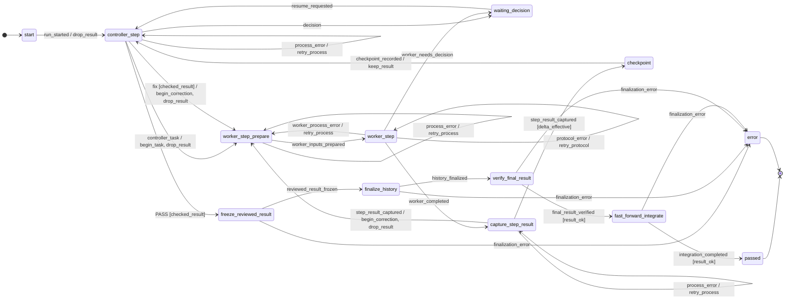
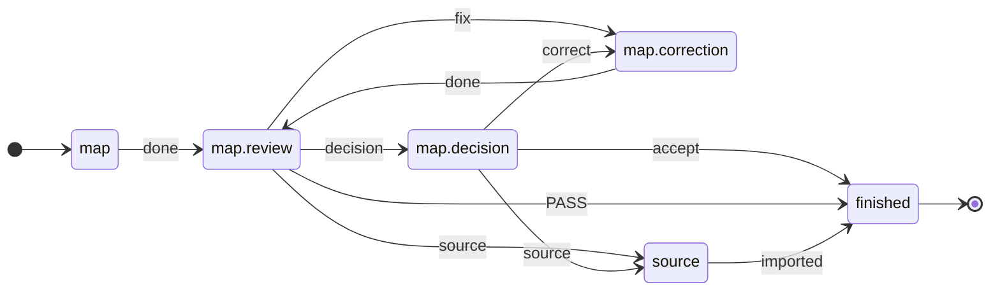

<p align="right"><a href="README.md">Deutsch</a> | English</p>

# ki-dev

**AI agents do the work; a [flow written in TOML](#1-model-the-flow) decides what happens next.**
The flow models a way of working, such as implementation with a separate
review, or [planning](#not-just-code). A profile
[casts the roles](#2-cast-the-roles), the [task](#3-pick-a-task) is any
issue. No agent dispatches the next one, no human relays every answer by
hand.

Built for tight token budgets: code picks the next step, not a supervising
model ([Why](#why)).

🚧 **In development, not ready for production use.** Flow control, the
correction loop and adapters for Claude Code and Codex work. Still missing:
a test gate before integration and budget limits on every path
([Roadmap](#roadmap)).

## Contents

1. [Why](#why)
2. [Example: implementer and reviewer as a flow](#example-implementer-and-reviewer-as-a-flow)
   1. [Model the flow](#1-model-the-flow)
   2. [Cast the roles](#2-cast-the-roles)
   3. [Pick a task](#3-pick-a-task)
   4. [Run](#4-run)
3. [What happens in a run](#what-happens-in-a-run)
4. [Try it without agents](#try-it-without-agents)
5. [Layers](#layers)
6. [Not just code](#not-just-code)
7. [Roadmap](#roadmap)
8. [Contributing](#contributing)

## Why

Working with coding agents turns you into a messenger: hand over context,
check the result, pass corrections back. On top of that, agents report
"done" when they are not.

**Who it is for:** anyone working with a limited token budget. A
supervising model that reads every output costs extra; if you cannot pay
for that, put the control into files. In ki-dev, edge selection, format
checks and limit comparisons are code; models do the work and the
substantive review. Later, AI may tune parameters and calibrate flows
([Roadmap](#roadmap)), as an option, not a prerequisite. The savings are
not measured yet.

Background: workflows with checkpoints instead of free-steering agents
([Anthropic](https://www.anthropic.com/engineering/building-effective-agents));
premature completion and missing verification as typical failures of
multi-agent systems ([MAST](https://arxiv.org/html/2503.13657v3)).

<sub>[↑ Contents](#contents)</sub>

## Example: implementer and reviewer as a flow

What gets modeled is a procedure, not a single task: one agent implements,
a second reviews in its own session, `fix` leads back, after three rounds a
human decides. Each step belongs to its own [layer](#layers).

### 1. Model the flow

**Layer: flow package.** The bundled flow `implement` defines what happens
after which verdict. The correction loop, from
[`implement.toml`](src/ki_dev/flow/implement.toml):

```toml
# review says "fix", no rounds left → halt, a human decides
[[statechart.states.active.states.controller_step.transitions]]
event = "fix"
cond = "checked_result"
unless = "changes_rounds_left"
on = [{ raise = { event = "escalation.changes_rounds_exhausted" } }]

# otherwise → back to implementation, round counter +1
[[statechart.states.active.states.controller_step.transitions]]
event = "fix"
cond = "checked_result"
target = "worker_step_prepare"
on = ["begin_correction", "drop_result"]
```

The statecharts run on
[python-statemachine](https://python-statemachine.readthedocs.io/). In
`implement` every back edge consumes a counter; a
[test](tests/machine/test_reachability.py) enumerates the state space: no
cycle without a human runs unbounded.

What a state does outside, the flow binds to an op; its result comes back
as an event. Shortened:

```toml
[op.review]                       # effect of the state controller_step
role = "review"                   # a role, not an agent: the profile picks it
do = "review.decide"              # entry in the ops catalog
events = ["PASS", "fix", "decision", "escalate"]   # allowed verdicts
```

The agent only returns its verdict; ki-dev decides which edge follows.
The first matching edge wins. Guards (`checked_result`,
`changes_rounds_left`) and actions (`begin_correction`) are Python in the
package ([`machine/model.py`](src/ki_dev/flow_ops/implement/machine/model.py))
and only read or change run data. Ops interface:
[bindings (German)](docs/ablaufpakete.de.md#eine-bindung); the ops of
`implement` live in
[`flow_ops/implement/ops.py`](src/ki_dev/flow_ops/implement/ops.py),
shared ops of the scaffold in [`ops/`](src/ki_dev/ops/).

**Status:** ki-dev loads your own flows from a package directory outside
the scaffold (`KI_DEV_FLOW_PATH`,
[package outside, German](docs/ablaufpakete.de.md#paket-außerhalb-des-gerüsts)).

<sub>[↑ Contents](#contents)</sub>

### 2. Cast the roles

**Layer: profile.** Who fills each role, and with which limits, is set in
`.ki-dev/profiles/default.toml`; the flow stays the same:

```toml
workdir = "/home/me/calc-work"          # agents' working worktree
access_profile = "write"

[worker]                                # implements
executor = "codex"                      # executor from the scaffold
session_id = "019a…"                    # existing Codex session
model = "gpt-5.6-terra"
effort = "high"

[review]                                # reviews, in its own session
executor = "claude"
session_id = "b3f1…"                    # existing Claude Code session
model = "sonnet"
effort = "high"

[[tests]]                               # runs each round, result goes to review
name = "pytest"
argv = [".venv/bin/python", "-m", "pytest", "-q"]

[limits]
changes_rounds = 3                      # then ki-dev asks a human

[finalization]                          # where an accepted result goes
target_workdir = "/home/me/calc"
target_ref = "refs/heads/main"
commit_message = "Fix add()"
data_mode = "file_proposal"
```

A human (`manual`), a mock or another model: only `executor` changes
([executors, German](docs/ausfuehrer.de.md#executoren)).

**Status:** safety halt at context, quota and budget limits with
`claude`; `codex` without context measurement.

<sub>[↑ Contents](#contents)</sub>

### 3. Pick a task

**Layer: work graph** ([Beads](https://github.com/steveyegge/beads)).
The flow fits any issue with acceptance criteria, here a small bug:
`add(a, b)` returns `a - b`.

<!-- readme-script: readme-scripts/en/4-auftrag.sh -->
> not run · verify: make readme-check

In the ki-dev clone after [Try it](#try-it-without-agents): `bd` lives
in the project venv, the task goes into a throwaway repo with its own
Beads project.

```bash
export PATH="$PWD/.venv/bin:$PATH"
cd "$(mktemp -d)" && git init -q
bd init --quiet --prefix calc --stealth --non-interactive
BEAD="$(bd create "add() does not add" \
  --description "add(2, 3) returns -1" \
  --design "fix add.py; do not change test_add.py" \
  --acceptance "add(2, 3) == 5 and add(-1, 1) == 0" \
  --silent)"
echo "$BEAD"
```

`$BEAD` is the task ID, e.g. `calc-7k2`; step 4 uses it.
<!-- /readme-script -->

Which issue a run gets is a human's choice today; there is no walk
through the bead graph yet ([Roadmap](#roadmap)).

<sub>[↑ Contents](#contents)</sub>

### 4. Run

**Layer: scaffold.** The runner drives the flow to the next halt; the
executors pass the handoffs to Codex and Claude Code.
[`run.toml`](src/ki_dev/runner/run.toml) handles halt and resume the same
for every flow; today only `implement` has the safety limits
([Layers](#layers)).

<!-- readme-script: readme-scripts/en/5-starten.sh -->
> not run · verify: make readme-check

```bash
ki-dev -f implement "$BEAD"
ki-dev -f implement status RUN_ID
ki-dev -f implement resume RUN_ID
```

Flow `implement` with the profile `default` from step 2; `status` shows
where the run is, `resume` continues after a halt. `RUN_ID` is in the
output of the first command (`run_id`).
<!-- /readme-script -->

**Status of this example:** flow, profile format and commands are real,
the Codex and Claude Code adapters are built. Still open: an accepted run
with real agents, and red tests do not yet stop integration.

<sub>[↑ Contents](#contents)</sub>

## What happens in a run

The mock run from [Try it](#try-it-without-agents) (`make demo`: flow
`implement`, review says `fix`, then `PASS`) writes one line per transition
to `events.jsonl`, 47 here
([whole file](docs/beispiele/demo-lauf.events.jsonl)). Line 16 is the back
edge from [step 1](#1-model-the-flow), wrapped:

```json
{"line": 16, "region": "ablauf", "seq": 7,
 "ts": "2026-10-17T09:47:00.737137+00:00",
 "flow": "implement", "run": "demo",
 "state": "controller_step", "event": "fix",
 "target": "worker_step_prepare", "cond": ["checked_result"],
 "actions": ["begin_correction", "drop_result"], "escalation": null,
 "actor": "Controller (Review-Sitzung)", "adapter": "mock"}
```

`region` `ablauf`: an edge of the flow TOML, counted by `seq`;
`operation` and `halt`: 31 edges of the runner from
[`run.toml`](src/ki_dev/runner/run.toml), per op
`hold → start → artifact_saved`. `adapter`: who answered, with
the profile from [step 2](#2-cast-the-roles) `claude-cli`
([format, German](docs/ausfuehrer.de.md#ereignisprotokoll-je-übergang)).

The 16 flow lines as a path, transcribed by hand, number = `seq`:


Every intermediate result is stored as an artifact in the run directory;
a halted run continues with `resume`.

<details>
<summary>The whole flow as a diagram, generated from the TOML</summary>

`ki-dev flow show implement --without-escalations`, without limit and
safety halts:

<!-- ki-dev flow show implement --without-escalations -->


</details>

<sub>[↑ Contents](#contents)</sub>

## Try it without agents

<!-- readme-script: readme-scripts/en/1-setup.sh -->
> not run · verify: make readme-check

The demo creates a throwaway repo with a task and a profile; a mock
implementer and a mock review (`fix`, then `PASS`) play through the
example without provider access. Status line and output come from
`make readme-check`, the setup in an empty container.

Needs Python ≥ 3.12, git ≥ 2.32, make, Go and a C compiler:
`make setup` builds [Beads](https://github.com/steveyegge/beads) `bd`
from source into the project venv (a few minutes the first time,
needs network). `$REPLACE_WITH_REPOSITORY_URL` = this repo's clone URL.

```bash
git clone "$REPLACE_WITH_REPOSITORY_URL" ki-dev
cd ki-dev
make setup
make demo
```

`round_id: 2`: one correction round. `passed`: the mock review
accepted, the result is fast-forwarded onto `main`. The mocks only
write a line of text; the demo shows the control flow, not an agent's
work.
<!-- /readme-script -->

<sub>[↑ Contents](#contents)</sub>

## Layers

Each step of the example sits on its own layer, top to bottom:

```text
 ◇ bead graph walk   picks the next ready issue
 ◇ flow chain        joins flows into one run
┄┄┄┄┄┄┄┄┄┄┄┄┄┄┄┄┄┄┄┄┄┄┄┄┄┄┄┄┄┄┄┄┄┄┄┄┄┄┄┄┄┄┄┄┄┄┄┄┄┄┄┄┄┄┄┄┄┄┄┄┄┄┄┄┄

┌─ work graph ───────────────────────────────────────┐
│ Beads     issues with acceptance, dependencies     │  step 3
└────────────────────────────────────────────────────┘
       │ task: one issue per run
       ▼
┌─ flow package ─────────────────────────────────────┐
│ flow      TOML: states, edges, guards, roles       │  step 1
│ handoffs  TOML: template + blocks per state        │
│ templates role texts with placeholders             │
│ ops       Python: own ops, answer → event          │
└────────────────────────────────────────────────────┘
       ▲ fills the roles
       │
┌─ profile ──────────────────────────────────────────┐
│ roles     role → executor, session, model          │  step 2
│ limits    values: rounds, tokens, context          │
│ tests     commands that run every round            │
│ target    where a PASS gets integrated             │
└────────────────────────────────────────────────────┘
       │ picks the executors
       ▼
┌─ scaffold ─────────────────────────────────────────┐
│ runner    run.toml: halt, retries, limits          │  step 4
│ handoff   template + parent bead, criteria, docs   │
│ patterns  review pattern and variants              │
│ ops       catalog: preflight, git wrap-up, context │
│ core      statecharts, loader, schema checks       │
│ executor  claude · codex · manual · inbox · mock   │
└──────┬──────────────────────────────────────▲──────┘
       │ handoff per flow, role and bead      │ answer
       ▼                                      │
   agent or human ────────────────────────────┘
```

Steps in the example: [1](#1-model-the-flow) · [2](#2-cast-the-roles) ·
[3](#3-pick-a-task) · [4](#4-run); ◇ does not exist yet
([Roadmap](#roadmap)).

The sketch shows the agreed architecture
([layers and rules, German](docs/ausfuehrer-luecken.de.md#schichten-und-orte)):
the flow makes domain decisions, the scaffold protects every flow the same
way; the profile sets limit values, the executor measures, a guard
compares. Dependencies point only package → scaffold, the scaffold knows no
roles ([test](tests/test_schichten.py)). Tests: which commands is up to the
profile (review pattern: `pyproject.toml`); when, and what follows, is up to
the flow. Where the code deviates today is listed in the
[Roadmap](#roadmap) under **V1**.

More separations:

- **Op ≠ action:** an op acts outside and ends in an event; an action
  only changes run data during a transition, a guard reads it.
- **Flow ≠ flow chain:** a flow is one procedure; the chain
  `map` → `graph` → `materialize` → `implement` connects several, by hand
  today.
- **Run ≠ walk through the bead graph:** a run works on one issue; which
  one comes next is a human's choice today.
- **Human as messenger ≠ human as decider:** as a role (`manual`) they
  relay handoffs, in the state `waiting_decision` they decide.
- **Work graph ≠ event log:** Beads holds what is to be done,
  `events.jsonl` what happened when.

<sub>[↑ Contents](#contents)</sub>

## Not just code

Write, review separately, correct, decide: this procedure lives once as a
pattern in the scaffold
([`patterns/review.toml`](src/ki_dev/flow/patterns/review.toml), ops in
[`flow_ops/review/`](src/ki_dev/flow_ops/review/)). The planning flows
`map`, `graph` and `materialize` only set parameters on it, for example
mapping requirements ([`map.toml`](src/ki_dev/flow/map.toml), shortened):

```toml
pattern_catalog = ["ki_dev:review"]   # pattern and its ops from the scaffold
start = "map"

[[phase]]
id = "map"
use = "write_review"                  # write → review → correction → decision
next = "finished"

[phase.role]                          # the same roles as in implement
write = "worker"
review = "review"
correction = "worker"
```

<!-- ki-dev flow show map -->


<!-- readme-script: readme-scripts/en/6-map-step.sh -->
> not run · verify: make readme-check

Play it through by hand, without agents, starting in the ki-dev clone:
a throwaway repo with a Beads project, ki-dev's guidelines in it (the
handoffs of `map` carry the target repo's guidelines from
`docs/policies/`), a mapping task with a source (`source_refs`) and the
review's verdict as a file.

```bash
export PATH="$PWD/.venv/bin:$PATH"
POLICIES="$PWD/docs/policies"
cd "$(mktemp -d)" && git init -q
bd init --quiet --prefix calc --stealth --non-interactive
mkdir docs && cp -r "$POLICIES" docs/
BEAD="$(bd create "Map the notes on add()" \
  --description "Source map of notes.md" \
  --acceptance "1. Every section of notes.md is mapped" \
  --metadata '{"handoff": {"source_refs": ["notes.md"]}}' \
  --silent)"
cat >verdict.json <<'EOF'
{"event": "fix", "detail": "Section 2 is not mapped", "requirement_ref": "AC1"}
EOF
ki-dev flow show map
ki-dev -f map step "$BEAD" map
ki-dev -f map step "$BEAD" map.review map.review=verdict.json
```

`flow show` prints the flow as Mermaid (above), the first `step` the
handoff to the mapping agent. The second returns the verdict `fix` and
prints the handoff to the correction (German), here without the line
with the bead ID.
<!-- /readme-script -->

The next flow of this kind is already cut into beads: folding planning
sessions and design notes into the overall plan ([Roadmap](#roadmap)).
`ki-dev flow show` generates both flow diagrams from source; a test
compares them with this README.

<sub>[↑ Contents](#contents)</sub>

## Roadmap

◆ cut into beads, with acceptance criteria · ◇ target picture, not cut
yet · **V1** first release. Bead IDs come from the project's internal
database; a public journal will follow.

**V1: scaffold and flow packages separated.** ki-dev ships the runner,
adapters, shared patterns and ops; flows with their ops, templates and
profiles live in their own package repos
([package outside the scaffold, German](docs/ablaufpakete.de.md#paket-außerhalb-des-gerüsts)).

The **V1** items bring the code to the agreed architecture from
[Layers](#layers); the rebuild follows after publication. Grouped by
layer, top to bottom:

**New upper layers**

- ◇ flow chain: several flows as one run; chained by hand in V1
- ◇ bead graph walk: next ready issue, order by dependencies

**Work graph and flow**

- ◇ adaptive slicing: the reviewer splits an issue into steps, a size gate
  before the implementer ([target picture, German](docs/zielbild.de.md))

**Flow packages**

- ◆ **V1** four single flows `map` → `graph` → `materialize` →
  `implement`; round limits in the review pattern too (`ige.6.4.7`)
- ◆ **V1** package repo without a copied runner, scaffold without flow
  copies (`cak`, `ige.6.4.16`)
- ◆ planning folding: planning sessions and design notes folded into the
  overall plan, as a flow of its own with review (`urq`, 8 tasks)

**Flow and ops**

- ◆ **V1** test gate: red tests stop integration (`ek1`)
- ◆ adaptive parameters, AI steers, code bounds: the reviewer picks the
  test scope of the next round, `PASS` only after a full run; available
  in `step` ([check control, German](docs/step.de.md#antworten-im-review-muster)),
  in runs with agents with `ige.6.4.12`

**Flow and profile**

- ◆ check expected usage per op against the limits at binding (`asr`);
  parameters per layer from TOML instead of Python (`7z3`)
- ◇ calibrating flow parameters from actual runs, AI-assisted too;
  optional, control stays deterministic

**Runner**

- ◆ **V1** one runner for all flows (`ige.6.4`, 17 tasks): `implement`
  without its own executor in the package (`ige.6.4.13`); safety halt,
  metering, budget and retries as edges in `run.toml` instead of Python
  (`ige.6.4.2`–`ige.6.4.5`); git wrap-up in the scaffold catalog
  (`ige.6.4.10`)
- ◆ **V1** usage protection: own token metering, budget reservation,
  enforced stop (`wu0.10`, 22 tasks)
- ◆ adaptive budget forecast: several models estimate a task, learn the
  estimation error from actual usage (`wu0.4`–`wu0.7`)

<sub>[↑ Contents](#contents)</sub>

## Contributing

Good first tasks, each with a clear finish line:

- **Build the test gate**: done when red tests stop integration
  ([`tests/test_review_gate_cli.py`](tests/test_review_gate_cli.py) green).
- **Round counter in the review pattern**: `map`, `graph`, `materialize`
  do not count their correction rounds yet.
- **One runner**: move `implement` onto the shared runner.

More: [what the architecture still lacks (German)](docs/ausfuehrer-luecken.de.md).

<!-- readme-script: readme-scripts/en/7-entwickeln.sh -->
> not run · verify: make readme-check

```bash
make test
make spec-test
make readme-check
```

`make test`: pytest and ruff. `make spec-test`: requirement tests, red
results are allowed. `make readme-check`: every README command in a
throwaway container, sets the status lines, needs Docker.
<!-- /readme-script -->

<!-- readme-script: readme-scripts/en/2-runtime.sh -->
> not run · verify: make readme-check

To develop ki-dev with ki-dev, install it apart from the source tree:
own venv, symlink in `~/.local/bin`. Finish running jobs before an
update ([details, German](docs/self-development.de.md)).

```bash
make setup-runtime
export PATH="$HOME/.local/bin:$PATH"
ki-dev --help
```
<!-- /readme-script -->

Further reading (German): [executor and profiles](docs/ausfuehrer.de.md) ·
[`step` and handoffs](docs/step.de.md) ·
[flow packages](docs/ablaufpakete.de.md) ·
[CLI adapters](docs/cli-adapters.md) ·
[target picture](docs/zielbild.de.md)

Questions, ideas, collaboration: open an issue or contact
[@blaumohn](https://github.com/blaumohn) directly.
License: [MIT](LICENSE).

<sub>[↑ Contents](#contents)</sub>
