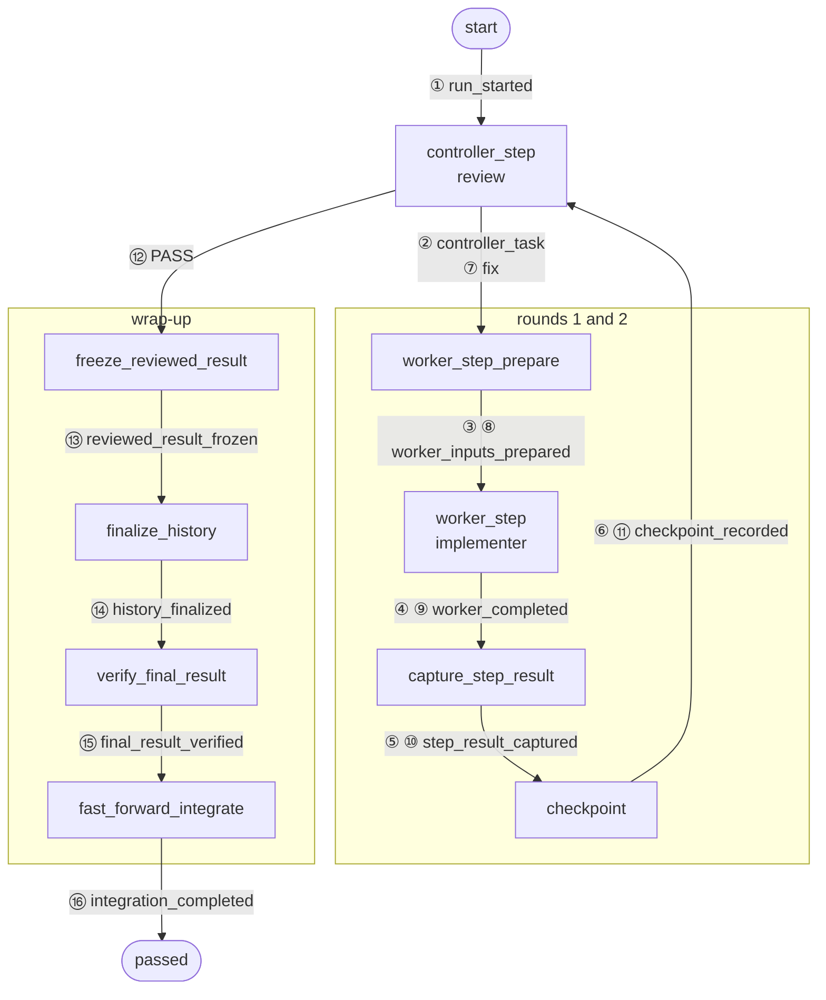
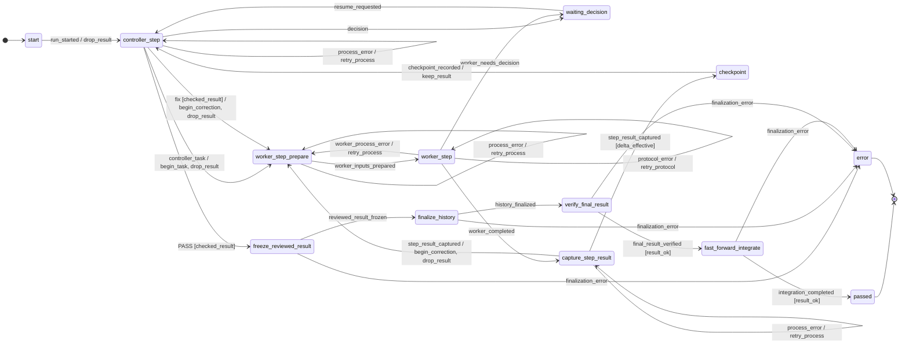
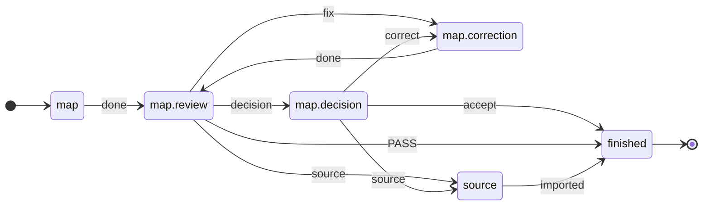

<p align="right"><a href="README.md">Deutsch</a> | English</p>

# ki-dev

**AI agents report "done" even when it is not true.** Premature
termination and missing or incorrect verification form a class of their
own in the [MAST](https://arxiv.org/html/2503.13657v3) failure taxonomy
of multi-agent systems. Without control, a human carries results, review
and rework from agent to agent.

ki-dev puts this procedure into a file: a
[flow written in TOML](#1-flow-built-in) decides what happens after each
agent answer (review in a separate session, a correction round, a halt
for a human); code picks the next step, not a model ([Why](#why)). Built
so far: flows for implementation and
[planning](#the-same-procedure-for-planning), running them up to the next
halt, and connections to Codex and Claude Code
([Layers and locations](#layers-and-locations)). Tests show that no
correction loop of the implementation runs unbounded without a human
([state space](tests/machine/test_reachability.py)) and that the core
knows no flow names ([layers](tests/test_schichten.py)); ki-dev loads
your own flows from a repo of their own
([flow packages, German](docs/ablaufpakete.de.md#paket-außerhalb-des-gerüsts)).

🚧 **Development snapshot:** with placeholder agents the example runs
through to the merge into `main`
([`make demo`](#0-set-up-try-it-without-agents)); no run with real agents
has been tried yet ([Status and known gaps](#status-and-known-gaps)).

## Contents

1. [Example: implementer and reviewer as a flow](#example-implementer-and-reviewer-as-a-flow)
   0. [Set up, try it without agents](#0-set-up-try-it-without-agents)
   1. [Flow (built in)](#1-flow-built-in)
   2. [Create a task](#2-create-a-task)
   3. [Cast the roles](#3-cast-the-roles)
   4. [Run](#4-run)
2. [What happens in a run](#what-happens-in-a-run)
3. [Status and known gaps](#status-and-known-gaps)
4. [Why](#why)
5. [Layers and locations](#layers-and-locations)
6. [The same procedure for planning](#the-same-procedure-for-planning)
7. [Roadmap](#roadmap)
8. [Contributing](#contributing)
9. [License](#license)

## Example: implementer and reviewer as a flow

What gets modeled is a procedure, not a single task: one agent implements,
a second reviews in its own session, `fix` leads back, after three rounds a
human decides. Each step names its
[layer or input](#layers-and-locations). The commands run in order in one
terminal; you only create the task and the profile.

### 0. Set up, try it without agents

<!-- readme-script: readme-scripts/en/1-setup.sh -->
Needs Python ≥ 3.12, git ≥ 2.32, make, Go and a C compiler:
`make setup` builds [Beads](https://github.com/steveyegge/beads) `bd`
from source into the project venv, a few minutes the first time, needs
network.

```bash
git clone https://github.com/blaumohn/ki-dev.git ki-dev
cd ki-dev
make setup                          # venv with ki-dev and bd
export PATH="$PWD/.venv/bin:$PATH"  # ki-dev and bd for the steps below
make demo
```

> ✅ Run in an empty container · [test](tests/readme/test_1_setup.sh)

```text
{
  "run_id": "demo",
  "status": "passed",
  "phase": "passed",
  "round_id": 2,
  "detail": "Fast-forward integriert",
  "operation_id": null
}

Geprüfter Abschluss (Demo)
start
```

`make demo` plays the example through with placeholder agents (mock):
the review first asks for a correction (`fix`) and accepts round 2
(`PASS`); `passed`: the result is fast-forwarded onto `main`, its
commits listed below. The mocks only show the control flow, not an
agent's work.
<!-- /readme-script -->

<sub>[↑ Contents](#contents)</sub>

### 1. Flow (built in)

**[Layer: flow](#layers-and-locations).** Nothing to create here: the
flow `implement` ships with the package and defines what happens after
which verdict. The correction loop, from
[`implement.toml`](src/ki_dev/flow/implement.toml):

```toml
# review says "fix", no rounds left → halt, a human decides
[[statechart.states.active.states.controller_step.transitions]]
event = "fix"
cond = "checked_result"
unless = "changes_rounds_left"
on = [{ raise = { event = "escalation.changes_rounds_exhausted" } }]

# otherwise → back to implementation, round counter +1
[[statechart.states.active.states.controller_step.transitions]]
event = "fix"
cond = "checked_result"
target = "worker_step_prepare"
on = ["begin_correction", "drop_result"]
```

The statecharts run on
[python-statemachine](https://python-statemachine.readthedocs.io/). In
`implement` every back edge consumes a counter; a
[test](tests/machine/test_reachability.py) enumerates the state space: no
cycle without a human runs unbounded.

What a state does outside, the flow binds to an op; its result comes back
as an event. Shortened:

```toml
[op.review]                       # effect of the state controller_step
role = "review"                   # a role, not an agent: the profile picks it
do = "review.decide"              # entry in the ops catalog
events = ["PASS", "fix", "decision", "escalate"]   # allowed verdicts
```

The agent only returns its verdict; ki-dev decides which edge follows.
The first matching edge wins. Guards (`checked_result`,
`changes_rounds_left`) and actions (`begin_correction`) are Python in the
package ([`machine/model.py`](src/ki_dev/flow_ops/implement/machine/model.py))
and only read or change run data. Ops interface:
[bindings (German)](docs/ablaufpakete.de.md#eine-bindung); the ops of
`implement` live in
[`flow_ops/implement/ops.py`](src/ki_dev/flow_ops/implement/ops.py),
shared ops of the scaffold in [`ops/`](src/ki_dev/ops/).

**Status:** ki-dev loads your own flows from a package directory outside
the scaffold (`KI_DEV_FLOW_PATH`,
[package outside, German](docs/ablaufpakete.de.md#paket-außerhalb-des-gerüsts)).

<sub>[↑ Contents](#contents)</sub>

### 2. Create a task

**[Input: task](#layers-and-locations)**, an issue from the work graph
([Beads](https://github.com/steveyegge/beads)). The flow requires a
design and acceptance criteria from the issue
([check](src/ki_dev/flow_ops/implement/commands.py)), here a small bug:
`add(a, b)` returns `a - b`.

<!-- readme-script: readme-scripts/en/3-auftrag.sh -->
Continue in the terminal from [step 0](#0-set-up-try-it-without-agents):

```bash
cd "$(mktemp -d)" && git init -q -b main calc && cd calc  # throwaway repo
git config user.name calc  # identity for this throwaway repo only
git config user.email calc@example.invalid
cat >add.py <<'EOF'
def add(a, b):
    return a - b
EOF
cat >test_add.py <<'EOF'
from add import add

assert add(2, 3) == 5
EOF
printf '.ki-dev/\n.beads.gate.lock\n' >>.git/info/exclude  # ki-dev requires clean worktrees
git add . && git commit -q -m "add()"
git worktree add -q -b work ../calc-work  # the agents' worktree
cd ../calc-work
bd init --quiet --prefix calc --stealth --non-interactive
BEAD="$(bd create "add() does not add" \
  --description "add(2, 3) returns -1" \
  --design "fix add.py; do not change test_add.py" \
  --acceptance "add(2, 3) == 5 and add(-1, 1) == 0" \
  --silent)"
echo "$BEAD"
```

> Not run in the last check · [test](tests/readme/test_3_auftrag.sh)

`$BEAD` is the task ID, e.g. `calc-7k2`.
<!-- /readme-script -->

Which issue a run gets is a human's choice today; there is no walk
through the bead graph yet ([Roadmap](#roadmap)).

<sub>[↑ Contents](#contents)</sub>

### 3. Cast the roles

**[Input: profile](#layers-and-locations).** Who fills each role, and with
which limits, is set in the profile; the flow stays the same. Whether a
human (`manual`), a mock or Codex or Claude Code fills a role is chosen
by `executor` per role
([executors, German](docs/ausfuehrer.de.md#executoren)).

<!-- readme-script: readme-scripts/en/4-rollen.sh -->
Continue in `calc-work`:

```bash
mkdir -p .ki-dev/profiles       # ki-dev looks for profiles where it starts
cat >.ki-dev/profiles/default.toml <<'EOF'
workdir = "."                   # agents' worktree, ki-dev starts here
access_profile = "write"

[worker]                        # implements
executor = "codex"              # executor from the scaffold
session_id = "019a…"            # put your Codex session here
model = "gpt-5.6-terra"
effort = "high"

[review]                        # reviews, in its own session
executor = "claude"
session_id = "b3f1…"            # put your Claude Code session here
model = "sonnet"
effort = "high"

[[tests]]                       # runs each round, result goes to review
name = "test_add"
argv = ["python3", "test_add.py"]

[limits]
changes_rounds = 3              # then ki-dev asks a human

[finalization]                  # where an accepted result goes
target_workdir = "../calc"      # repo from step 2
target_ref = "refs/heads/main"
commit_message = "Fix add()"
data_mode = "file_proposal"
EOF
```

> Not run in the last check · [test](tests/readme/test_4_rollen.sh)
<!-- /readme-script -->

**More limits:** `[safety_limits]` and `budget` per role, defaults if
not set ([consumption guard, German](docs/ausfuehrer.de.md#verbrauchsschutz));
what they do not cover yet: [Status and known gaps](#status-and-known-gaps).

<sub>[↑ Contents](#contents)</sub>

### 4. Run

**[Layers: runner and executor](#layers-and-locations).** The runner
drives the flow to the next halt; the executors pass the handoffs to Codex
and Claude Code.
[`run.toml`](src/ki_dev/runner/run.toml) handles halt and resume the same
for every flow. What a run with real agents still needs:
[Status and known gaps](#status-and-known-gaps).

<!-- readme-script: readme-scripts/en/5-starten.sh -->
Continue in `calc-work`:

```bash
ki-dev -f implement "$BEAD" --run-id add-fix  # flow implement, profile default
ki-dev -f implement status add-fix            # where the run stands
```

> Not run in the last check · [test](tests/readme/test_5_starten.sh)

With the placeholders `019a…` and `b3f1…` the run halts before the
first agent call; for a real run put your own session IDs into the
profile. After a halt, `ki-dev -f implement resume add-fix` continues
the run, with `--answer` when the halt asks for one.
<!-- /readme-script -->

<sub>[↑ Contents](#contents)</sub>

## What happens in a run

The mock run from [step 0](#0-set-up-try-it-without-agents) (`make demo`: flow
`implement`, review says `fix`, then `PASS`) writes one line per transition
to `events.jsonl`, 47 here
([whole file](docs/beispiele/demo-lauf.events.jsonl)). Line 16 is the back
edge from [step 1](#1-flow-built-in), wrapped:

```json
{"line": 16, "region": "ablauf", "seq": 7,
 "ts": "2026-10-17T09:47:00.737137+00:00",
 "flow": "implement", "run": "demo",
 "state": "controller_step", "event": "fix",
 "target": "worker_step_prepare", "cond": ["checked_result"],
 "actions": ["begin_correction", "drop_result"], "escalation": null,
 "actor": "Controller (Review-Sitzung)", "adapter": "mock"}
```

`region` `ablauf`: an edge of the flow TOML, counted by `seq`;
`operation` and `halt`: 31 edges of the runner from
[`run.toml`](src/ki_dev/runner/run.toml), per op
`hold → start → artifact_saved`. `adapter`: who answered, with
the profile from [step 3](#3-cast-the-roles) `claude-cli`
([format, German](docs/ausfuehrer.de.md#ereignisprotokoll-je-übergang)).

The 16 flow lines as a path, transcribed by hand, number = `seq`:



Every intermediate result is stored as an artifact in the run directory;
a halted run continues with `resume`.

<details>
<summary>The whole flow as a diagram, generated from the TOML</summary>

`ki-dev flow show implement --without-escalations`, without limit and
safety halts:

<!-- ki-dev flow show implement --without-escalations -->


</details>

<sub>[↑ Contents](#contents)</sub>

## Status and known gaps

Goal of the first release (V1): run your own flows and profiles with real
AI agents to the end ([Roadmap](#roadmap)).

**What works**

- Without agents from start to end: placeholder agents play the example
  through with one correction round up to the merge into `main`
  ([test](tests/readme/test_1_setup.sh),
  [event log](docs/beispiele/demo-lauf.events.jsonl)).
- Start with a real profile: the run from the example starts and halts
  before the first agent call as long as no real session is filled in
  ([test](tests/readme/test_5_starten.sh)).
- Planning by hand: the planning flows print the handoff to the agent for
  each step and take its verdict as a file
  ([`step`, German](docs/step.de.md), [test](tests/readme/test_6_map_step.sh)).

**What is still missing**

- A complete run with real agents: the Codex and Claude Code connections
  are built ([CLI adapters](docs/cli-adapters.md)) but not yet tried end
  to end; the test stops before the first agent call
  ([test](tests/readme/test_5_starten.sh)).
- Red tests do not stop anything: if the review says "pass", the result
  is taken even when tests fail ([test](tests/test_review_gate_cli.py),
  `ek1` in the [Roadmap](#roadmap)).
- Costs only partly bounded: before each agent call of the implementation
  flow ki-dev checks fixed limits (number of calls, tokens, remaining
  usage quota at the provider) and halts when one is reached or cannot be
  measured; with Codex, how full the context window is goes unmeasured.
  During a call ki-dev does not measure or stop yet
  ([consumption guard, German](docs/ausfuehrer.de.md#verbrauchsschutz),
  `wu0.10` in the [Roadmap](#roadmap)).
- Planning only by hand: only implementation runs automatically with
  agents today; a human carries the planning flows step by step (one
  runner for all flows, `ige.6.4` in the [Roadmap](#roadmap)).
- Chaining flows and picking the next issue, such as planning first, then
  implementing: a human does that today ([Roadmap](#roadmap)).

<sub>[↑ Contents](#contents)</sub>

## Why

- **Approach:** a workflow with checkpoints instead of free-steering
  agents
  ([Anthropic](https://www.anthropic.com/engineering/building-effective-agents)).
  In ki-dev, edge selection, format checks and limit comparisons are code
  ([step 1](#1-flow-built-in)); models implement and review the
  substance.
- **Who it is for:** people working with tight token budgets: code picks
  the next step, so no model reads every intermediate output for that;
  the review checks the result of each round. How much this saves is not
  measured.

<sub>[↑ Contents](#contents)</sub>

## Layers and locations

The sketch has two dimensions:

- **Layer**, a box: who drives whom, top to bottom. Each layer starts the
  one below; the answer comes back as an event.
- **Location**, the row label: the package brings the domain logic
  (what `fix` means, when the human decides), the scaffold what holds the
  same for every flow (halt, safety). Dependencies point only package →
  scaffold ([test](tests/test_schichten.py);
  [package and scaffold, German](docs/ablaufpakete.de.md#gerüst-und-paket)).

<pre>
 <a href="#roadmap">◇ bead graph walk</a>   picks the next issue; a human does it today
 <a href="#roadmap">◇ flow chain</a>        joins flows; by hand today

┌─ <a href="docs/ablaufpakete.de.md">flow</a> ──────────────────────────────────────────────┐
│ package   <a href="src/ki_dev/flow/implement.toml">states, edges</a>, roles, <a href="docs/ablaufpakete.de.md#eine-bindung">one op per state</a>    │  <a href="#1-flow-built-in">step 1</a>
│           <a href="src/ki_dev/flow_ops/implement/machine/model.py">guards, actions</a>: Python, run data only    │
│ scaffold  <a href="src/ki_dev/flow/patterns/review.toml">patterns</a>: review pattern and variants     │
└─────────────────────────┬───────────────────────▲───┘
                          │ op of the state       │ event
┌─ <a href="docs/ablaufpakete.de.md#ausführer">runner</a> ────────────────▼───────────────────────┴───┐
│ scaffold  <a href="src/ki_dev/runner/run.toml">run.toml</a>: halt, retries, safety           │  <a href="#4-run">step 4</a>
│           <a href="docs/ausfuehrer-luecken.de.md#schichten-und-orte">guards: measured value against limit</a>      │
└─────────────────────────┬───────────────────────▲───┘
                          │ starts the op         │ result
┌─ <a href="docs/ablaufpakete.de.md#eine-bindung">effect</a> ────────────────▼───────────────────────┴───┐
│ package   <a href="src/ki_dev/flow_ops/implement/ops.py">own ops</a>, <a href="src/ki_dev/flow/templates">role templates</a>                   │
│ scaffold  <a href="src/ki_dev/ops">ops catalog</a>: preflight, git wrap-up       │
│           <a href="docs/ablaufpakete.de.md#parametrisierte-übergaben">handoff</a>: template + blocks from bead      │
└─────────────────────────┬───────────────────────▲───┘
                          │ handoff               │ answer
┌─ <a href="docs/ausfuehrer.de.md#executoren">executor</a> ──────────────▼───────────────────────┴───┐
│ scaffold  <a href="src/ki_dev/adapter/executors.toml">claude · codex · manual · inbox · mock</a>    │  <a href="#4-run">step 4</a>
│           <a href="docs/ausfuehrer.de.md#verbrauchsschutz">measures context, quota, budget</a>           │
└─────────────────────────┬───────────────────────▲───┘
                          ▼                       │
                       agent or human ────────────┘

 inputs per run, not a layer: <a href="#2-create-a-task">task (step 2)</a> · <a href="#3-cast-the-roles">profile (step 3)</a>
</pre>

◇ does not exist yet ([Roadmap](#roadmap)). The sketch shows the
[agreed architecture, German](docs/ausfuehrer-luecken.de.md#schichten-und-orte);
where the code deviates is listed in the [Roadmap](#roadmap) under **V1**.

- **Input ≠ layer:** executor per role, limit values and tests come from
  the [profile](#3-cast-the-roles); in the review pattern the tests come
  from the target repo's `pyproject.toml`. When they apply and what
  follows is up to the flow. The executor measures, a guard compares.
- **Op ≠ action:** an op acts outside and ends in an event; an action
  only changes run data during a transition, a guard reads it.
- **Human as messenger ≠ human as decider:** as the executor `manual`
  they relay handoffs, in the state `waiting_decision` they decide.

<sub>[↑ Contents](#contents)</sub>

## The same procedure for planning

Write, review separately, correct, decide: the procedure from the
[example](#example-implementer-and-reviewer-as-a-flow) lives once as a
pattern in the scaffold
([`patterns/review.toml`](src/ki_dev/flow/patterns/review.toml), ops in
[`flow_ops/review/`](src/ki_dev/flow_ops/review/)); `implement` still
rebuilds it as a statechart of its own ([Roadmap](#roadmap), `ige.6.4`).
The planning flows `map`, `graph` and `materialize` only set parameters
on the pattern (templates, context, roles), for example mapping
requirements ([`map.toml`](src/ki_dev/flow/map.toml), shortened):

```toml
pattern_catalog = ["ki_dev:review"]   # pattern and its ops from the scaffold
start = "map"

[[phase]]
id = "map"
use = "write_review"                  # write → review → correction → decision
next = "finished"

[phase.role]                          # the same roles as in implement
write = "worker"
review = "review"
correction = "worker"
```

<!-- ki-dev flow show map -->


<!-- readme-script: readme-scripts/en/6-map-step.sh -->
By hand, without agents, in the folder `ki-dev` from
[step 0](#0-set-up-try-it-without-agents):

```bash
POLICIES="$PWD/docs/policies"  # ki-dev's guidelines, for the handoffs
cd "$(mktemp -d)" && git init -q  # throwaway repo with a Beads project
bd init --quiet --prefix calc --stealth --non-interactive
mkdir docs && cp -r "$POLICIES" docs/
BEAD="$(bd create "Map the notes on add()" \
  --description "Source map of notes.md" \
  --acceptance "1. Every section of notes.md is mapped" \
  --metadata '{"handoff": {"source_refs": ["notes.md"]}}' \
  --silent)"  # mapping task with a source
cat >verdict.json <<'EOF'  # the review's verdict as a file
{"event": "fix", "detail": "Section 2 is not mapped", "requirement_ref": "AC1"}
EOF
ki-dev flow show map            # the flow as Mermaid, as above
ki-dev -f map step "$BEAD" map  # handoff to the mapping agent
ki-dev -f map step "$BEAD" map.review map.review=verdict.json
```

> ✅ Run in an empty container · [test](tests/readme/test_6_map_step.sh)

```text
Empfänger: Umsetzer (bisherige Sitzung)

Review-Befund (fix, CHANGES, AC1): Section 2 is not mapped
Bitte beheben. Melde anschließend nur zurück, was aus Diff und Prüfergebnissen nicht hervorgeht, etwa offene Entscheidungen oder Hindernisse.

Zum Schluss genau ein JSON-Objekt: {} oder {"feedback": "…"}. feedback nur, was aus Diff und Prüfergebnissen nicht hervorgeht (offene Entscheidungen, Hindernisse); sonst {}. Der Mensch gibt es als Antwort dieses Zustands an ki-dev weiter.

Hinweis für den Menschen: Zustand map.review; Folgeschritte laut map.toml (Adapter manual, du trägst sie weiter):
- fix → map.correction: Befunde an den Kartierungsagenten (bisherige Sitzung)
```

The second `step` reads the verdict `fix` from `verdict.json` and prints
the handoff to the correction (German), above without the line with the
bead ID.
<!-- /readme-script -->

The next flow of this kind is already cut into beads: folding planning
sessions and design notes into the overall plan ([Roadmap](#roadmap)).
`ki-dev flow show` generates both flow diagrams from source; a
[test](tests/test_flow_diagram.py) compares them with this README.

<sub>[↑ Contents](#contents)</sub>

## Roadmap

◆ cut into beads, with acceptance criteria · ◇ target picture, not cut
yet · **V1** first release. Bead IDs come from the project's internal
database; a public journal will follow.

**V1: scaffold and flow packages separated.** ki-dev ships the runner,
adapters, shared patterns and ops; flows with their ops, templates and
profiles live in their own package repos
([package outside the scaffold, German](docs/ablaufpakete.de.md#paket-außerhalb-des-gerüsts)).

The **V1** items bring the code to the agreed architecture; the rebuild
follows after publication. Grouped like the
[sketch](#layers-and-locations): layers top to bottom, then locations
and inputs.

**New layers**

- ◇ bead graph walk: next ready issue, order by dependencies
- ◇ flow chain: several flows as one run; chained by hand in V1

**Flow**

- ◆ **V1** four single flows `map` → `graph` → `materialize` →
  `implement`; round limits in the review pattern too (`ige.6.4.7`)
- ◆ **V1** test gate: red tests stop integration (`ek1`)
- ◆ adaptive parameters, AI steers, code bounds: the reviewer picks the
  test scope of the next round, `PASS` only after a full run; available
  in `step` ([check control, German](docs/step.de.md#antworten-im-review-muster)),
  in runs with agents with `ige.6.4.12`
- ◆ planning folding: planning sessions and design notes folded into the
  overall plan, as a flow of its own with review (`urq`, 8 tasks)
- ◇ adaptive slicing: the reviewer splits an issue into steps, a size gate
  before the implementer ([target picture, German](docs/zielbild.de.md))

**Runner and executor**

- ◆ **V1** one runner for all flows, `implement` on the review pattern
  (`ige.6.4`, 17 tasks): `implement` without its own executor in the
  package (`ige.6.4.13`); safety halt,
  metering, budget and retries as edges in `run.toml` instead of Python
  (`ige.6.4.2`–`ige.6.4.5`); git wrap-up in the scaffold catalog
  (`ige.6.4.10`)
- ◆ **V1** usage protection: own token metering, budget reservation,
  enforced stop (`wu0.10`, 22 tasks)
- ◆ adaptive budget forecast: several models estimate a task, learn the
  estimation error from actual usage (`wu0.4`–`wu0.7`)

**Locations: package and scaffold**

- ◆ **V1** package repo without a copied runner, scaffold without flow
  copies (`cak`, `ige.6.4.16`)

**Inputs: profile and parameters**

- ◆ check expected usage per op against the limits at binding (`asr`);
  parameters per layer from TOML instead of Python (`7z3`)
- ◇ calibrating flow parameters from actual runs, AI-assisted too;
  optional, control stays deterministic

<sub>[↑ Contents](#contents)</sub>

## Contributing

Three open tasks from the [Roadmap](#roadmap), each with its acceptance
check:

- **Build the test gate** (`ek1`): done when red tests stop integration
  ([`tests/test_review_gate_cli.py`](tests/test_review_gate_cli.py) green,
  without `xfail`).
- **Round limits in the review pattern** (`ige.6.4.7`): `map`, `graph`,
  `materialize` do not count their correction rounds yet; done when the
  `fix` after the last allowed round halts for a human.
- **One runner** (`ige.6.4.13`): done when `ki-dev -f implement` runs to
  the end with placeholder agents on the shared runner, without
  `implement`'s own executor.

More: [what the architecture still lacks (German)](docs/ausfuehrer-luecken.de.md).

<!-- readme-script: readme-scripts/en/7-entwickeln.sh -->
In the folder `ki-dev` from [step 0](#0-set-up-try-it-without-agents):

```bash
make test          # pytest and ruff
make spec-test     # requirement tests, red results are allowed
make readme-check  # README commands in Docker, sets the status lines
```

> ⏳ Not checked: developer commands; make readme-check is this run itself · [test](tests/readme/test_7_entwickeln.sh)
<!-- /readme-script -->

<!-- readme-script: readme-scripts/en/2-runtime.sh -->
To develop ki-dev with ki-dev, install it apart from the source tree,
also in the folder `ki-dev`; finish running jobs before an update
([details, German](docs/self-development.de.md)).

```bash
make setup-runtime                    # own venv, symlink in ~/.local/bin
export PATH="$HOME/.local/bin:$PATH"
ki-dev --help
```

> ✅ Run in an empty container · [test](tests/readme/test_2_runtime.sh)
<!-- /readme-script -->

Further reading (German): [executor and profiles](docs/ausfuehrer.de.md) ·
[`step` and handoffs](docs/step.de.md) ·
[flow packages](docs/ablaufpakete.de.md) ·
[CLI adapters](docs/cli-adapters.md) ·
[target picture](docs/zielbild.de.md)

Questions, ideas, collaboration: open an issue or contact
[@blaumohn](https://github.com/blaumohn) directly.

<sub>[↑ Contents](#contents)</sub>

## License

ki-dev is released under the [MIT License](LICENSE).

<sub>[↑ Contents](#contents)</sub>
