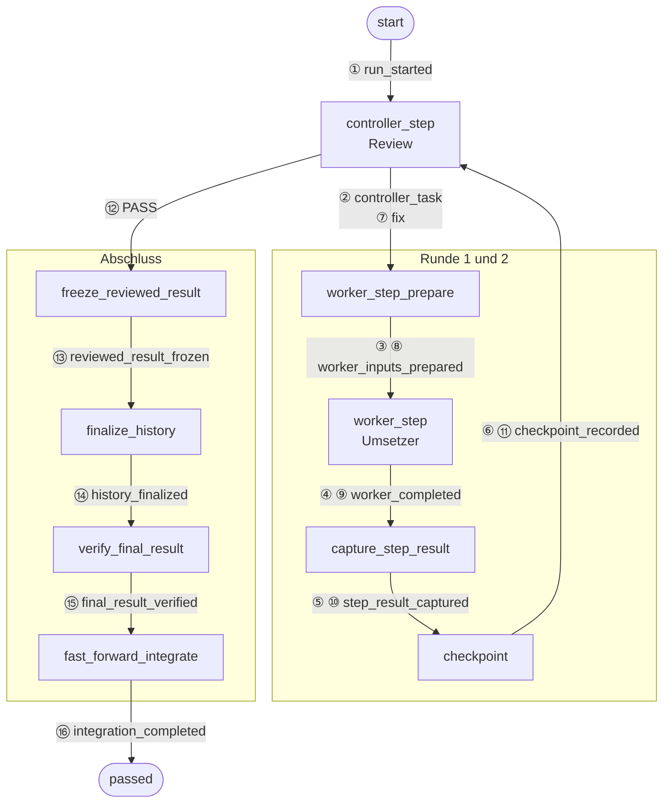
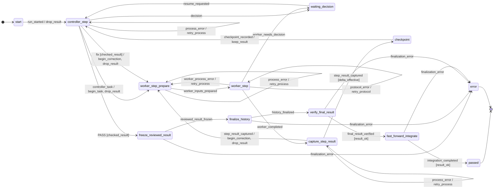
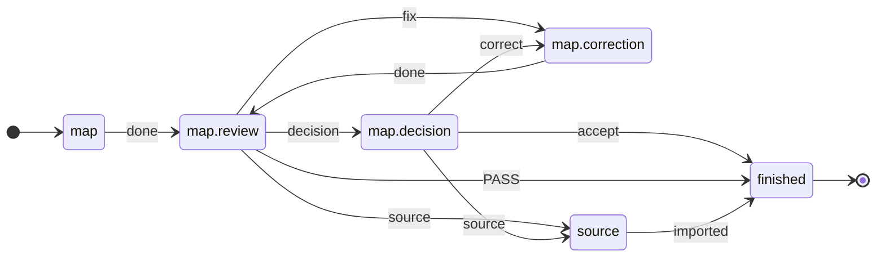

<p align="right">Deutsch | <a href="README.en.md">English</a></p>

# ki-dev

**KI-Agenten arbeiten, ein [Ablauf aus TOML](#1-ablauf-mitgeliefert) entscheidet, was danach passiert.**
Den nächsten Schritt wählt Code, kein Modell; Modelle setzen um und prüfen
fachlich. Ein Ablauf modelliert ein Verfahren, etwa Umsetzung mit
getrenntem Review oder [Planung](#nicht-nur-code); ein Profil besetzt die
[Rollen](#3-rollen-besetzen), der [Auftrag](#2-auftrag-anlegen) ist ein
Vorgang mit Abnahmekriterien.

🚧 **Entwicklungsstand, noch nicht für echte Arbeit nutzbar.** Ziel der
ersten Ausgabe (V1): eigene Abläufe und Profile schreiben und mit echten
KI-Agenten ausführen.

**Was schon geht**

- Mit Platzhalter-Agenten (Mock) durchgespielt: Das Review verlangt eine
  Korrektur, nimmt die zweite Fassung an, das Ergebnis landet in `main`
  ([Schritt 0](#0-einrichten-ohne-agenten-ausprobieren)).
- Mit echtem Profil startet ein Lauf und hält vor dem ersten
  Agentenaufruf an, solange keine echte Sitzung eingetragen ist
  ([Schritt 4](#4-starten)).

**Was noch fehlt**

- Ein vollständiger Lauf mit echten Agenten: Die Anbindung an Codex und
  Claude Code ist gebaut, aber noch nicht bis zum Ende erprobt
  ([Schritt 4](#4-starten)).
- Rote Tests halten nicht auf: Sagt das Review „passt“, wird übernommen,
  auch wenn Tests fehlschlagen ([Test](tests/test_review_gate_cli.py),
  [Mitmachen](#mitmachen)).
- Kostengrenzen nicht überall: Schutzhalte an Kontext-, Kontingent- und
  Budgetgrenzen gibt es nur im Ablauf `implement`, mit Codex ohne
  Kontextmessung ([Schritt 3](#3-rollen-besetzen)).
- Mehrere Abläufe nacheinander, etwa erst planen, dann umsetzen, startet
  heute der Mensch von Hand ([Roadmap](#roadmap)).

## Inhalt

1. [Beispiel: Umsetzer und Reviewer als Ablauf](#beispiel-umsetzer-und-reviewer-als-ablauf)
   0. [Einrichten, ohne Agenten ausprobieren](#0-einrichten-ohne-agenten-ausprobieren)
   1. [Ablauf (mitgeliefert)](#1-ablauf-mitgeliefert)
   2. [Auftrag anlegen](#2-auftrag-anlegen)
   3. [Rollen besetzen](#3-rollen-besetzen)
   4. [Starten](#4-starten)
2. [Was im Lauf passiert](#was-im-lauf-passiert)
3. [Warum](#warum)
4. [Ebenen und Orte](#ebenen-und-orte)
5. [Nicht nur Code](#nicht-nur-code)
6. [Roadmap](#roadmap)
7. [Mitmachen](#mitmachen)
8. [Lizenz](#lizenz)

## Beispiel: Umsetzer und Reviewer als Ablauf

Modelliert wird ein Verfahren, keine einzelne Aufgabe: Ein Agent setzt um,
ein zweiter prüft in eigener Sitzung, `fix` führt zurück, nach drei Runden
entscheidet der Mensch. Jeder Schritt nennt seine
[Ebene oder Eingabe](#ebenen-und-orte). Die Befehle laufen der Reihe nach
in einem Terminal; angelegt werden nur Auftrag und Profil.

### 0. Einrichten, ohne Agenten ausprobieren

<!-- readme-script: readme-scripts/1-setup.sh -->
Braucht Python ≥ 3.12, git ≥ 2.32, make, Go und einen C-Compiler:
`make setup` baut [Beads](https://github.com/steveyegge/beads) `bd` aus
dem Quellcode ins Projekt-venv, beim ersten Mal einige Minuten, mit Netz.

```bash
git clone https://github.com/blaumohn/ki-dev.git ki-dev
cd ki-dev
make setup                          # venv mit ki-dev und bd
export PATH="$PWD/.venv/bin:$PATH"  # ki-dev und bd für die Schritte unten
make demo
```

> ✅ Im leeren Container ausgeführt · [Test](tests/readme/test_1_setup.sh)

```text
{
  "run_id": "demo",
  "status": "passed",
  "phase": "passed",
  "round_id": 2,
  "detail": "Fast-forward integriert",
  "operation_id": null
}

Geprüfter Abschluss (Demo)
start
```

`make demo` spielt das Beispiel mit Platzhalter-Agenten (Mock) durch:
Das Review verlangt erst eine Korrektur (`fix`), dann passt es (`PASS`).
`round_id: 2`: eine Korrekturrunde; `passed`: Das Ergebnis liegt per
Fast-Forward auf `main`. Die Mocks schreiben nur eine Textzeile; die
Demo zeigt die Steuerung, nicht die Arbeit eines Agenten.
<!-- /readme-script -->

<sub>[↑ Inhalt](#inhalt)</sub>

### 1. Ablauf (mitgeliefert)

**[Ebene Ablauf](#ebenen-und-orte).** Hier nichts anzulegen: Der Ablauf
`implement` liegt im Paket und legt fest, was nach welchem Urteil
passiert. Die Korrekturschleife, aus
[`implement.toml`](src/ki_dev/flow/implement.toml):

```toml
# Review sagt „fix“, keine Runde mehr übrig → Halt, der Mensch entscheidet
[[statechart.states.active.states.controller_step.transitions]]
event = "fix"
cond = "checked_result"
unless = "changes_rounds_left"
on = [{ raise = { event = "escalation.changes_rounds_exhausted" } }]

# sonst → zurück zur Umsetzung, Rundenzähler +1
[[statechart.states.active.states.controller_step.transitions]]
event = "fix"
cond = "checked_result"
target = "worker_step_prepare"
on = ["begin_correction", "drop_result"]
```

Die Statecharts laufen auf
[python-statemachine](https://python-statemachine.readthedocs.io/). In
`implement` verbraucht jede Rückkante einen Zähler; ein
[Test](tests/machine/test_reachability.py) zählt den Zustandsraum durch:
Kein Zyklus ohne Mensch läuft unbegrenzt.

Was ein Zustand nach außen tut, bindet der Ablauf an eine Op; ihr Ergebnis
kommt als Ereignis zurück. Gekürzt:

```toml
[op.review]                       # Wirkung des Zustands controller_step
role = "review"                   # eine Rolle, kein Agent: den wählt das Profil
do = "review.decide"              # Eintrag im Ops-Katalog
events = ["PASS", "fix", "decision", "escalate"]   # erlaubte Urteile
```

Der Agent liefert nur sein Urteil; welche Kante folgt, entscheidet ki-dev.
Die erste passende Kante gewinnt. Wächter (`checked_result`,
`changes_rounds_left`) und Aktionen (`begin_correction`) sind Python im
Paket ([`machine/model.py`](src/ki_dev/flow_ops/implement/machine/model.py))
und lesen oder ändern nur Laufdaten. Ops-Schnittstelle:
[Bindungen](docs/ablaufpakete.de.md#eine-bindung); die Ops von `implement`
liegen in [`flow_ops/implement/ops.py`](src/ki_dev/flow_ops/implement/ops.py),
gemeinsame Ops des Gerüsts in [`ops/`](src/ki_dev/ops/).

**Stand:** Eigene Abläufe lädt ki-dev aus einem Paketverzeichnis außerhalb
des Gerüsts (`KI_DEV_FLOW_PATH`,
[Paket außerhalb](docs/ablaufpakete.de.md#paket-außerhalb-des-gerüsts)).

<sub>[↑ Inhalt](#inhalt)</sub>

### 2. Auftrag anlegen

**[Eingabe Auftrag](#ebenen-und-orte)**, ein Vorgang aus dem Arbeitsgraph
([Beads](https://github.com/steveyegge/beads)). Der Ablauf passt zu
jedem Vorgang mit Abnahmekriterien, hier ein kleiner Bug: `add(a, b)`
liefert `a - b`.

<!-- readme-script: readme-scripts/3-auftrag.sh -->
Weiter im Terminal aus [Schritt 0](#0-einrichten-ohne-agenten-ausprobieren):
ein Wegwerf-Repo `calc` mit dem Bug, daneben der Arbeits-Worktree
`calc-work` der Agenten mit dem Auftrag.

```bash
cd "$(mktemp -d)" && git init -q -b main calc && cd calc
cat >add.py <<'EOF'
def add(a, b):
    return a - b
EOF
cat >test_add.py <<'EOF'
from add import add

assert add(2, 3) == 5
EOF
printf '.ki-dev/\n.beads.gate.lock\n' >>.git/info/exclude  # saubere Worktrees
git add . && git commit -q -m "add()"
git worktree add -q -b work ../calc-work && cd ../calc-work
bd init --quiet --prefix calc --stealth --non-interactive
BEAD="$(bd create "add() does not add" \
  --description "add(2, 3) returns -1" \
  --design "fix add.py; do not change test_add.py" \
  --acceptance "add(2, 3) == 5 and add(-1, 1) == 0" \
  --silent)"
echo "$BEAD"
```

> ✅ Im leeren Container ausgeführt · [Test](tests/readme/test_3_auftrag.sh)

`$BEAD` ist die ID des Auftrags, etwa `calc-7k2`. `.ki-dev/` (Profil,
Läufe) und die Sperrdatei von Beads bleiben außerhalb von git: ki-dev
verlangt saubere Worktrees.
<!-- /readme-script -->

Welchen Vorgang ein Lauf bekommt, wählt heute der Mensch; einen Durchgang
durch den Bead-Graphen gibt es noch nicht ([Roadmap](#roadmap)).

<sub>[↑ Inhalt](#inhalt)</sub>

### 3. Rollen besetzen

**[Eingabe Profil](#ebenen-und-orte).** Wer die Rollen übernimmt und mit
welchen Grenzen, steht im Profil; der Ablauf bleibt derselbe. Ein Mensch
(`manual`), ein Mock oder ein anderes Modell: Es wechselt nur `executor`
([Executoren](docs/ausfuehrer.de.md#executoren)).

<!-- readme-script: readme-scripts/4-rollen.sh -->
Weiter in `calc-work`: Das Profil `default` liegt dort, wo ki-dev
startet.

```bash
mkdir -p .ki-dev/profiles
cat >.ki-dev/profiles/default.toml <<'EOF'
workdir = "."                   # Arbeits-Worktree, hier startet ki-dev
access_profile = "write"

[worker]                        # setzt um
executor = "codex"              # Executor aus dem Gerüst
session_id = "019a…"            # eigene Codex-Sitzung eintragen
model = "gpt-5.6-terra"
effort = "high"

[review]                        # prüft, in eigener Sitzung
executor = "claude"
session_id = "b3f1…"            # eigene Claude-Code-Sitzung eintragen
model = "sonnet"
effort = "high"

[[tests]]                       # läuft je Runde, Ergebnis ans Review
name = "test_add"
argv = ["python3", "test_add.py"]

[limits]
changes_rounds = 3              # danach fragt ki-dev den Menschen

[finalization]                  # wohin ein akzeptiertes Ergebnis geht
target_workdir = "../calc"      # Repo aus Schritt 2
target_ref = "refs/heads/main"
commit_message = "Fix add()"
data_mode = "file_proposal"
EOF
```

> ✅ Im leeren Container ausgeführt · [Test](tests/readme/test_4_rollen.sh)
<!-- /readme-script -->

**Stand:** Schutzhalt an Kontext-, Kontingent- und Budgetgrenze mit
`claude`; `codex` ohne Kontextmessung.

<sub>[↑ Inhalt](#inhalt)</sub>

### 4. Starten

**[Ebenen Runner und Executor](#ebenen-und-orte).** Der Runner fährt
den Ablauf bis zum nächsten Halt, die Executoren reichen die Übergaben
an Codex und Claude Code. Halt und Fortsetzen regelt
[`run.toml`](src/ki_dev/runner/run.toml) für jeden Ablauf gleich; die
Schutzgrenzen hat heute nur `implement` ([Roadmap](#roadmap)).

<!-- readme-script: readme-scripts/5-starten.sh -->
Weiter in `calc-work`:

```bash
ki-dev -f implement "$BEAD" --run-id add-fix  # Ablauf implement, Profil default
ki-dev -f implement status add-fix            # wo der Lauf steht
```

> ⏳ Ungeprüft: der erste Agentenaufruf braucht echte Sitzungen; bis dahin ausgeführt · [Test](tests/readme/test_5_starten.sh)

Mit den Platzhaltern `019a…` und `b3f1…` hält der Lauf vor dem ersten
Agentenaufruf an; für einen echten Lauf eigene Sitzungs-IDs ins Profil
eintragen. Nach einem Halt setzt `ki-dev -f implement resume add-fix`
den Lauf fort, mit `--answer`, wenn der Halt eine Antwort verlangt.
<!-- /readme-script -->

**Stand dieses Beispiels:** Ablauf, Profilformat und Befehle sind echt,
die Adapter für Codex und Claude Code gebaut. Noch offen: ein abgenommener
Lauf mit echten Agenten, und rote Tests halten die Integration noch nicht auf.

<sub>[↑ Inhalt](#inhalt)</sub>

## Was im Lauf passiert

Der Mock-Lauf aus [Schritt 0](#0-einrichten-ohne-agenten-ausprobieren) (`make demo`:
Ablauf `implement`, Review erst `fix`, dann `PASS`) schreibt je Übergang
eine Zeile nach `events.jsonl`, hier 47
([ganze Datei](docs/beispiele/demo-lauf.events.jsonl)). Zeile 16 ist die
Rückkante aus [Schritt 1](#1-ablauf-mitgeliefert), umbrochen:

```json
{"line": 16, "region": "ablauf", "seq": 7,
 "ts": "2026-10-17T09:47:00.737137+00:00",
 "flow": "implement", "run": "demo",
 "state": "controller_step", "event": "fix",
 "target": "worker_step_prepare", "cond": ["checked_result"],
 "actions": ["begin_correction", "drop_result"], "escalation": null,
 "actor": "Controller (Review-Sitzung)", "adapter": "mock"}
```

`region` `ablauf`: eine Kante der Ablauf-TOML, `seq` zählt sie;
`operation` und `halt`: 31 Kanten des Runners aus
[`run.toml`](src/ki_dev/runner/run.toml), je Op
`hold → start → artifact_saved`. `adapter`: wer antwortete, mit
dem Profil aus [Schritt 3](#3-rollen-besetzen) `claude-cli`
([Format](docs/ausfuehrer.de.md#ereignisprotokoll-je-übergang)).

Die 16 Ablaufzeilen als Pfad, von Hand übertragen, Nummer = `seq`:



Jeder Zwischenstand liegt als Artefakt im Laufverzeichnis; ein Halt lässt
sich mit `resume` fortsetzen.

<details>
<summary>Ganzer Ablauf als Diagramm, aus der TOML erzeugt</summary>

`ki-dev flow show implement --without-escalations`, ohne Grenz- und Schutzhalte:

<!-- ki-dev flow show implement --without-escalations -->


</details>

<sub>[↑ Inhalt](#inhalt)</sub>

## Warum

- **Problem:** Agenten melden „fertig“, auch wenn es nicht stimmt;
  vorzeitiger Abschluss und fehlende Verifikation sind typische Fehler von
  Mehr-Agenten-Systemen ([MAST](https://arxiv.org/html/2503.13657v3)). Wer
  mehrere Agenten einsetzt, reicht Kontext, Ergebnis und Nachbesserung von
  Hand weiter.
- **Ansatz:** ein Workflow mit Prüfstellen statt frei steuernder Agenten
  ([Anthropic](https://www.anthropic.com/engineering/building-effective-agents)).
  In ki-dev sind Kantenwahl, Formatprüfung und Grenzvergleich Code
  ([Schritt 1](#1-ablauf-mitgeliefert)); Modelle setzen um und prüfen
  fachlich.
- **Für wen:** wer mit knappen Token-Budgets arbeitet und kein
  Aufseher-Modell bezahlen will, das jede Ausgabe liest. Wie viel das
  spart, ist nicht gemessen.

<sub>[↑ Inhalt](#inhalt)</sub>

## Ebenen und Orte

Die Skizze hat zwei Dimensionen:

- **Ebene**, ein Kasten: wer wen steuert, von oben nach unten. Jede
  Ebene startet die darunter, die Antwort kommt als Ereignis zurück.
- **Ort**, die Zeilenbezeichnung: Das
  [Paket](docs/ablaufpakete.de.md#paket-außerhalb-des-gerüsts) bringt
  Fachliches mit (was `fix` bedeutet, wann der Mensch entscheidet), das
  [Gerüst](docs/ablaufpakete.de.md#gerüst-und-paket), was für jeden
  Ablauf gleich gilt (Halt, Schutz). Abhängigkeit nur Paket → Gerüst
  ([Test](tests/test_schichten.py)).

<pre>
 <a href="#roadmap">◇ Bead-Graph-Durchgang</a>   wählt den nächsten Vorgang; heute der Mensch
 <a href="#roadmap">◇ Ablaufkette</a>            verbindet Abläufe; heute von Hand

┌─ <a href="docs/ablaufpakete.de.md">Ablauf</a> ──────────────────────────────────────────┐
│ Paket   <a href="src/ki_dev/flow/implement.toml">Zustände, Kanten</a>, Rollen, <a href="docs/ablaufpakete.de.md#eine-bindung">Op je Zustand</a>   │  <a href="#1-ablauf-mitgeliefert">Schritt 1</a>
│         <a href="src/ki_dev/flow_ops/implement/machine/model.py">Wächter, Aktionen</a>: Python, nur Laufdaten  │
│ Gerüst  <a href="src/ki_dev/flow/patterns/review.toml">Muster</a>: Review-Muster und Varianten       │
└─────────────────────────┬─────────────────────▲───┘
                          │ Op des Zustands     │ Ereignis
┌─ <a href="docs/ablaufpakete.de.md#ausführer">Runner</a> ────────────────▼─────────────────────┴───┐
│ Gerüst  <a href="src/ki_dev/runner/run.toml">run.toml</a>: Halt, Wiederholung, Schutz      │  <a href="#4-starten">Schritt 4</a>
│         <a href="docs/ausfuehrer-luecken.de.md#schichten-und-orte">Wächter: Messwert gegen Grenzwert</a>         │
└─────────────────────────┬─────────────────────▲───┘
                          │ startet die Op      │ Ergebnis
┌─ <a href="docs/ablaufpakete.de.md#eine-bindung">Wirkung</a> ───────────────▼─────────────────────┴───┐
│ Paket   <a href="src/ki_dev/flow_ops/implement/ops.py">eigene Ops</a>, <a href="src/ki_dev/flow/templates">Rollenvorlagen</a>                │
│ Gerüst  <a href="src/ki_dev/ops">Ops-Katalog</a>: Vorlauf, Git-Abschluss       │
│         <a href="docs/ablaufpakete.de.md#parametrisierte-übergaben">Übergabe</a>: Vorlage + Bausteine aus Bead    │
└─────────────────────────┬─────────────────────▲───┘
                          │ Übergabe            │ Antwort
┌─ <a href="docs/ausfuehrer.de.md#executoren">Executor</a> ──────────────▼─────────────────────┴───┐
│ Gerüst  <a href="src/ki_dev/adapter/executors.toml">claude · codex · manual · inbox · mock</a>    │  <a href="#4-starten">Schritt 4</a>
│         <a href="docs/ausfuehrer.de.md#verbrauchsschutz">misst Kontext, Kontingent, Budget</a>         │
└─────────────────────────┬─────────────────────▲───┘
                          ▼                     │
                       Agent oder Mensch ───────┘

 Eingaben je Lauf, keine Ebene: <a href="#2-auftrag-anlegen">Auftrag (Schritt 2)</a> · <a href="#3-rollen-besetzen">Profil (Schritt 3)</a>
</pre>

◇ gibt es noch nicht ([Roadmap](#roadmap)). Die Skizze zeigt die
[vereinbarte Architektur](docs/ausfuehrer-luecken.de.md#schichten-und-orte);
wo der Code abweicht, steht in der [Roadmap](#roadmap) unter **V1**.

- **Eingabe ≠ Ebene:** Executor je Rolle, Grenzwerte und Tests setzt das
  [Profil](#3-rollen-besetzen); im Review-Muster kommen die Tests aus der
  `pyproject.toml` des Ziel-Repos. Wann sie gelten und was folgt,
  entscheidet der Ablauf. Der Executor misst, ein Wächter vergleicht.
- **Op ≠ Aktion:** eine Op wirkt nach außen und endet in einem Ereignis;
  eine Aktion ändert beim Übergang nur Laufdaten, ein Wächter liest sie.
- **Mensch als Bote ≠ Mensch als Entscheider:** als Executor `manual`
  trägt er Übergaben weiter, im Zustand `waiting_decision` entscheidet er.

<sub>[↑ Inhalt](#inhalt)</sub>

## Nicht nur Code

Schreiben, getrennt prüfen, korrigieren, entscheiden: Dieses Verfahren liegt
einmal als Muster im Gerüst
([`patterns/review.toml`](src/ki_dev/flow/patterns/review.toml), Ops in
[`flow_ops/review/`](src/ki_dev/flow_ops/review/)). Die Planungsabläufe
`map`, `graph` und `materialize` setzen nur Parameter darauf, etwa die
Kartierung von Anforderungen ([`map.toml`](src/ki_dev/flow/map.toml),
gekürzt):

```toml
pattern_catalog = ["ki_dev:review"]   # Muster und seine Ops aus dem Gerüst
start = "map"

[[phase]]
id = "map"
use = "write_review"                  # schreiben → Review → Korrektur → Entscheidung
next = "finished"

[phase.role]                          # dieselben Rollen wie in implement
write = "worker"
review = "review"
correction = "worker"
```

<!-- ki-dev flow show map -->


<!-- readme-script: readme-scripts/6-map-step.sh -->
Ohne Agenten von Hand durchspielen, im Ordner `ki-dev` aus
[Schritt 0](#0-einrichten-ohne-agenten-ausprobieren): ein Wegwerf-Repo
mit Beads-Projekt, ein Kartierungsauftrag mit Quelle (`source_refs`) und
das Urteil des Reviews als Datei.

```bash
POLICIES="$PWD/docs/policies"  # Leitlinien von ki-dev, für die Übergaben
cd "$(mktemp -d)" && git init -q
bd init --quiet --prefix calc --stealth --non-interactive
mkdir docs && cp -r "$POLICIES" docs/
BEAD="$(bd create "Map the notes on add()" \
  --description "Source map of notes.md" \
  --acceptance "1. Every section of notes.md is mapped" \
  --metadata '{"handoff": {"source_refs": ["notes.md"]}}' \
  --silent)"
cat >verdict.json <<'EOF'
{"event": "fix", "detail": "Section 2 is not mapped", "requirement_ref": "AC1"}
EOF
ki-dev flow show map
ki-dev -f map step "$BEAD" map
ki-dev -f map step "$BEAD" map.review map.review=verdict.json
```

> ✅ Im leeren Container ausgeführt · [Test](tests/readme/test_6_map_step.sh)

```text
Empfänger: Umsetzer (bisherige Sitzung)

Review-Befund (fix, CHANGES, AC1): Section 2 is not mapped
Bitte beheben. Melde anschließend nur zurück, was aus Diff und Prüfergebnissen nicht hervorgeht, etwa offene Entscheidungen oder Hindernisse.

Zum Schluss genau ein JSON-Objekt: {} oder {"feedback": "…"}. feedback nur, was aus Diff und Prüfergebnissen nicht hervorgeht (offene Entscheidungen, Hindernisse); sonst {}. Der Mensch gibt es als Antwort dieses Zustands an ki-dev weiter.

Hinweis für den Menschen: Zustand map.review; Folgeschritte laut map.toml (Adapter manual, du trägst sie weiter):
- fix → map.correction: Befunde an den Kartierungsagenten (bisherige Sitzung)
```

`flow show` gibt den Ablauf als Mermaid aus (oben), der erste `step` die
Übergabe an den Kartierungsagenten. Der zweite nimmt das Urteil `fix`
zurück und gibt die Übergabe an die Korrektur aus, hier ohne die Zeile
mit der Bead-ID.
<!-- /readme-script -->

Nächster Ablauf dieser Art, schon als Beads geschnitten: Planungssitzungen
und Designnotizen in die Gesamtplanung einarbeiten ([Roadmap](#roadmap)).
Beide Ablaufdiagramme erzeugt `ki-dev flow show` aus der Quelle; ein Test
vergleicht sie mit diesem README.

<sub>[↑ Inhalt](#inhalt)</sub>

## Roadmap

◆ als Beads geschnitten, mit Abnahmekriterien · ◇ Zielbild, noch nicht
geschnitten · **V1** erste Ausgabe. Bead-IDs stammen aus der
projektinternen Datenbank; ein öffentliches Journal folgt.

**V1: Gerüst und Ablaufpakete getrennt.** ki-dev bringt Runner, Adapter,
gemeinsame Muster und Ops; Abläufe mit ihren Ops, Vorlagen und Profilen
liegen in eigenen Paket-Repos
([Paket außerhalb des Gerüsts](docs/ablaufpakete.de.md#paket-außerhalb-des-gerüsts)).

Die **V1**-Punkte bringen den Code auf die vereinbarte Architektur; der
Umbau folgt nach der Veröffentlichung. Gegliedert wie die
[Skizze](#ebenen-und-orte): Ebenen von oben nach unten, dann Orte und
Eingaben.

**Neue Ebenen**

- ◇ Bead-Graph-Durchgang: nächster bereiter Vorgang, Reihenfolge nach
  Abhängigkeiten
- ◇ Ablaufkette: mehrere Abläufe als ein Lauf; in V1 von Hand verkettet

**Ablauf**

- ◆ **V1** vier Einzelabläufe `map` → `graph` → `materialize` →
  `implement`; Rundengrenzen auch im Review-Muster (`ige.6.4.7`)
- ◆ **V1** Test-Tor: rote Tests halten die Integration auf (`ek1`)
- ◆ adaptive Parameter, KI steuert, Code begrenzt: der Reviewer wählt den
  Testumfang der nächsten Runde, `PASS` nur nach Volllauf; in `step`
  vorhanden ([Prüfsteuerung](docs/step.de.md#antworten-im-review-muster)),
  im Lauf mit Agenten mit `ige.6.4.12`
- ◆ Planungs-Abflachung: Planungssitzungen und Designnotizen in die
  Gesamtplanung einarbeiten, als eigener Ablauf mit Review (`urq`,
  8 Aufträge)
- ◇ adaptive Schnitte: der Reviewer teilt einen Vorgang in Schritte, ein
  Größen-Gate vor dem Umsetzer ([Zielbild](docs/zielbild.de.md))

**Runner und Executor**

- ◆ **V1** ein Runner für alle Abläufe (`ige.6.4`, 17 Aufträge): `implement`
  ohne eigenen Ausführer im Paket (`ige.6.4.13`); Schutzhalt, Messung,
  Budget und Wiederholung als Kanten in `run.toml` statt in Python
  (`ige.6.4.2`–`ige.6.4.5`); Git-Abschluss im Gerüst-Katalog (`ige.6.4.10`)
- ◆ **V1** Verbrauchsschutz: eigene Tokenmessung, Budgetreservierung,
  durchgesetzter Stop (`wu0.10`, 22 Aufträge)
- ◆ adaptive Budgetprognose: mehrere Modelle schätzen einen Auftrag,
  Schätzfehler aus dem Ist-Verbrauch lernen (`wu0.4`–`wu0.7`)

**Orte: Paket und Gerüst**

- ◆ **V1** Paket-Repo ohne kopierten Runner, Gerüst ohne Ablaufkopien
  (`cak`, `ige.6.4.16`)

**Eingaben: Profil und Parameter**

- ◆ erwarteter Verbrauch je Op gegen die Grenzen beim Binden prüfen
  (`asr`); Parameter je Ebene aus TOML statt Python (`7z3`)
- ◇ Kalibrierung der Ablaufparameter aus Ist-Läufen, auch KI-gestützt;
  optional, die Steuerung bleibt deterministisch

<sub>[↑ Inhalt](#inhalt)</sub>

## Mitmachen

Gute Einstiege, je mit klarer Abnahme:

- **Test-Tor bauen**: fertig, wenn rote Tests die Integration aufhalten
  ([`tests/test_review_gate_cli.py`](tests/test_review_gate_cli.py) grün).
- **Rundenzähler im Review-Muster**: `map`, `graph`, `materialize` zählen
  ihre Korrekturrunden noch nicht.
- **Ein Runner**: `implement` auf den gemeinsamen Runner umstellen.

Mehr dazu: [Was in der Architektur fehlt](docs/ausfuehrer-luecken.de.md).

<!-- readme-script: readme-scripts/7-entwickeln.sh -->
```bash
make test
make spec-test
make readme-check
```

> ⏳ Ungeprüft: Entwicklerbefehle; make readme-check ist dieser Lauf selbst · [Test](tests/readme/test_7_entwickeln.sh)

`make test`: pytest und ruff. `make spec-test`: Anforderungstests, rote
Ergebnisse sind zulässig. `make readme-check`: alle README-Befehle im
Wegwerf-Container, setzt die Statuszeilen, braucht Docker.
<!-- /readme-script -->

<!-- readme-script: readme-scripts/2-runtime.sh -->
Wer ki-dev mit ki-dev weiterentwickelt, installiert es getrennt vom
Quellbaum: eigenes venv, Symlink in `~/.local/bin`. Vor einem Update
laufende Läufe abschließen ([Details](docs/self-development.de.md)).

```bash
make setup-runtime
export PATH="$HOME/.local/bin:$PATH"
ki-dev --help
```

> ✅ Im leeren Container ausgeführt · [Test](tests/readme/test_2_runtime.sh)
<!-- /readme-script -->

Weiterlesen: [Ausführer und Profile](docs/ausfuehrer.de.md) ·
[`step` und Übergaben](docs/step.de.md) ·
[Ablaufpakete](docs/ablaufpakete.de.md) ·
[CLI-Adapter](docs/cli-adapters.md) ·
[Zielbild](docs/zielbild.de.md)

Fragen, Ideen, Zusammenarbeit: ein Issue öffnen oder
[@blaumohn](https://github.com/blaumohn) direkt ansprechen.

<sub>[↑ Inhalt](#inhalt)</sub>

## Lizenz

ki-dev steht unter der [MIT-Lizenz](LICENSE).

<sub>[↑ Inhalt](#inhalt)</sub>
