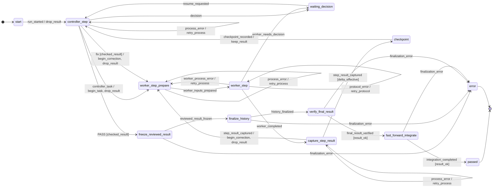
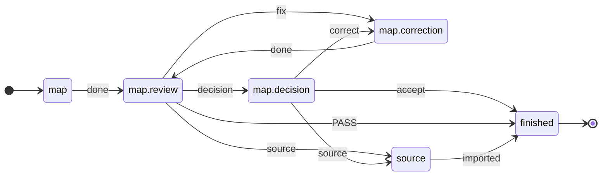

<p align="right">Deutsch | <a href="README.en.md">English</a></p>

# ki-dev

**KI-Agenten in einem prüfbaren Ablauf: Bau → Review → Korrektur, mit
harten Grenzen. Was nach einem Agentenergebnis geschieht, steht im TOML,
nicht im Prompt.**

Für alle, die Claude oder Codex an echten Aufträgen arbeiten lassen und
dabei Zeit, Token und Geld begrenzen müssen.

- **Ablauf als Daten:** jede Schleife ist eine Rückkante, im Bauablauf `implement` mit Zähler → [Beispiel](#eine-schleife-ist-eine-kante-kein-baustein)
- **Deterministische Steuerung:** gleicher Zustand + gleiches Ereignis → gleiche Kante, ohne zusätzlichen Modellaufruf → [Bausteine](#bausteine)
- **Rollen austauschbar:** Claude, Codex, Mensch oder Mock je Rolle → [Zwei Befehle](#zwei-befehle)
- **Durch Tests belegt:** im Bauablauf `implement` läuft kein Zyklus ohne Mensch unbegrenzt → [Prüfstand](#prüfstand)
- **Stand 2026-10-15 (`ab3c441`):** ✅ 6 belegt · ❌ 1 Spezifikation rot · ⬜ 3 offen → [Prüfstand](#prüfstand)

---

## In einer Minute ausprobieren

<!-- readme-script: readme-scripts/1-setup.sh -->
> ⬜ nicht ausgeführt · selbst prüfen: make demo

Ohne Anbieterzugang, mit Mock-Adaptern. Voraussetzungen: Python ≥ 3.12
(mit `venv`), git ≥ 2.32, make, Go und ein C-Compiler. `make setup` legt
venv, ki-dev und [Beads](https://github.com/steveyegge/beads) `bd` (Version
aus `src/ki_dev/tool-versions.json`) im Projekt an, außerhalb ändert es
nichts. `$REPLACE_WITH_REPOSITORY_URL` steht für die Klon-Adresse dieses
Repositorys; sie steht nach der Veröffentlichung fest.

```bash
git clone "$REPLACE_WITH_REPOSITORY_URL" ki-dev
cd ki-dev
make setup
make demo
```

```text
{
  "run_id": "demo",
  "status": "passed",
  "phase": "passed",
  "round_id": 2,
  "detail": null,
  "operation_id": null
}

8ef6356 Geprüfter Abschluss (Demo)
5c02782 start
```

Der Mock-Reviewer antwortet erst `fix` (Urteil `CHANGES`), dann `PASS`.
Der Lauf nimmt also die Rückkante einmal (`round_id: 2`), friert das
geprüfte Ergebnis ein und integriert es per Fast-forward. Bead und
Profil (`profil.toml`) legt das Demo-Skript selbst an.
<!-- /readme-script -->

---

## Prüfstand

Tests sind hier die Spezifikation: rot heißt festgelegt, noch nicht gebaut.

**Legende:** ✅ bestanden · ❌ rot, erwartet (Spezifikation) · ⬜ nicht geprüft

Die Stufen 1–4 beschreiben an einem kleinen Auftrag, was ki-dev leisten
soll: `add()` in `add.py` korrigieren, geprüft durch feste Tests
`add(2, 3) == 5` und `add(-1, 1) == 0`. Gezählt wird nur, was über die
öffentliche CLI tatsächlich ausgeführt wurde; eine fehlende Prüfung steht
als „nicht geprüft“ da. Die ersten sechs Zeilen prüfen die Ablaufdaten und den
Ausführer von innen.

| Fähigkeit | Stand | Selbst prüfen | Mitmachen | Bead |
| --- | --- | --- | --- | --- |
| Bauablauf `implement`: kein Zyklus ohne Mensch läuft unbegrenzt; der ganze Zustandsraum wird aufgezählt (für `map`, `graph`, `materialize` fehlt der Zähler, unten) | ✅ bestanden | `.venv/bin/pytest -q tests/machine/test_reachability.py` | – | – |
| … und das schon an den Daten von `implement.toml`: jeder Zyklus hat eine zählende Kante | ✅ bestanden | `.venv/bin/pytest -q tests/test_flow_implement.py` | – | – |
| `implement`: `PASSED` nur über die geprüfte Integration | ✅ bestanden | `.venv/bin/pytest -q tests/machine/test_reachability.py` | – | – |
| Ablauf und Ausführer sprechen dasselbe Vokabular (`ki_dev.fsm.bind` prüft beim Import) | ✅ bestanden | `.venv/bin/pytest -q tests/test_flow_implement.py tests/test_fsm.py` | – | – |
| Schichten importieren nie rückwärts (transitiv, per AST) | ✅ bestanden | `.venv/bin/pytest -q tests/test_schichten.py` | – | – |
| Der Bote hält den Ausführer, nicht den Ablauf | ✅ bestanden | `.venv/bin/pytest -q tests/test_runner_runtime.py tests/test_runner_cli.py` | – | – |
| Stufe 1 Auftrag: ein Lauf korrigiert `add()`; nur `add.py` ändert sich | ⬜ nicht geprüft: der Mock-Worker hängt nur Text an `MOCK.md` an, ein Test-Executor, der `add.py` ändert, fehlt; die Testorakel selbst sind geprüft (Stufe 2) | – | Spec-Test schreiben | unu, 1nf |
| Stufe 2 Review: rote Tests + Review-`PASS` → keine Integration | ❌ rot, erwartet: `ki-dev -f implement` integriert trotzdem (unten) | `.venv/bin/pytest -q --runxfail tests/test_review_gate_cli.py` | Gate im Ausführer bauen; der Test sagt, wann es fertig ist | ek1 |
| Stufe 3 Grenzen: Kontext 85 000 bei Grenze 80 000 → kein weiterer Agentenaufruf, sichtbarer Halt | ⬜ nicht geprüft: `mock` und `manual` messen nichts, die Wächter greifen dort nicht; die Wächter des alten Ausführers sind nur intern getestet (`tests/test_context_guard.py`, `tests/test_quota_guard.py`, `tests/test_runner_safety.py`) | – | Spec-Test schreiben | v5w, 1nf |
| Stufe 4 Übergabe: Elternauftrag, Rolle und Testbefehl stehen in der Übergabe an den Agenten | ⬜ nicht geprüft: kein Test | – | Spec-Test schreiben | 76e |

Bead: Kurz-IDs der projektinternen Beads-Datenbank (`ki-dev-ablauf-…`); ein öffentliches Journal folgt.

<!-- readme-script: readme-scripts/3-review-gate.sh -->
> ❌ rot, erwartet (Spezifikation) · 2026-10-16 · selbst prüfen: .venv/bin/pytest -q --runxfail tests/test_review_gate_cli.py · [Prüfstand](#prüfstand)

Stufe 2 über die öffentliche CLI: `ki-dev -f implement` mit
Mock-Worker und Mock-Review (`PASS`) gegen ein Wegwerf-Repo mit
`add.py` (falsch: `a - b`) und festem `test_add.py`. Kein
Anbieterzugang; braucht git und `bd` aus `make setup`. Die Kontrollen
prüfen den Test selbst: Orakel rot bei `a - b`, grün bei `a + b`; ein
Collection-Fehler zählt nicht als roter Test; grüne Tests + PASS
integrieren. Der Kernfall ist heute rot und als `xfail(strict=True)`
markiert; `--runxfail` zeigt den Fehlschlag:

```bash
.venv/bin/pytest -q --runxfail tests/test_review_gate_cli.py
```

```text
E   tests.test_review_gate_cli.IntegratedDespiteRedTests: 3e696bb -> d14aedd: Fast-forward integriert
FAILED tests/test_review_gate_cli.py::test_red_tests_and_review_pass_do_not_integrate
1 failed, 4 passed
```

Gekürzt; die Hashes wechseln je Lauf. Der Lauf hat trotz roter Tests
auf `main` integriert. Ohne `--runxfail` meldet derselbe Befehl
`4 passed, 1 xfailed`.
<!-- /readme-script -->

Alles auf einmal:

```bash
.venv/bin/pytest -q && .venv/bin/ruff check .
```

Stand 2026-10-15 (Branch `dev` nach `ab3c441`): 2740 bestanden,
1 erwartet rot (`xfail`, Stufe 2), 1 übersprungen (Docker-Test, ohne
Docker in der Prüfumgebung), 14 abgewählt (Gerüstkontrollen der
Anforderungstests, `make spec-test`); ruff ohne Befund. Mit Mock geprüft
sind außerdem `make demo` und die Testsuite. Nicht geprüft:
`make readme-check` und Läufe mit echten Anbietern (`claude`, `codex`);
ihre Abnahme steht aus.

### Was in der Architektur fehlt

Quelle: [Ausführer-Architektur: was fehlt](docs/ausfuehrer-luecken.de.md)
(Stand 2026-10-14) und der Befund aus Stufe 2.

| Merkmal | heute → Ziel | Mitmachen | Bead |
| --- | --- | --- | --- |
| Review-`PASS` überstimmt keine roten Tests | `ki-dev -f implement` integriert nach Review-`PASS` trotz roter `[[tests]]` → Integration nur mit grünen Prüfungen | wie Stufe 2: Gate bauen, bis der Test grün ist | ek1 |
| Schutzhalt bei Kontext-, Kontingent- und Budgetgrenze | Python-Wächter im alten Ausführer `flow_ops/implement/runtime.py` (`_context_guard`, `_quota_guard`, Budgetbuchung), nur für `-f implement` → Messung im Adapter, Vergleich als Kante in `runner/run.toml` (`measured` mit Wächter `within_limits`), Grenzwert im Profil | Spec-Test zu Stufe 3, dann Kante und Wächter bauen | ige.6.4.1 bis .4 |
| Ein Ausführer | `-f implement` fährt den alten Ausführer, `step` den gemeinsamen `runner/package.py`; dessen Dispatch ruft den Executor ohne Schutzprüfung auf → `-f implement` und `step` auf `runner/package.py`, alter Ausführer entfällt | `-f implement` auf `runner/package.py` umstellen | ige.6.4.13, .14 |
| Wiederholung bei Prozess- und Protokollfehlern, Halt-Notiz, Finalisierung | nur für `-f implement`: Kanten in `implement.toml`, Wirkung im alten Ausführer; der gemeinsame Ausführer hat sie nicht → Gerüst (`run.toml`) bzw. Muster mit Finalisierung | Kanten ins Gerüst bzw. Muster übernehmen | ige.6.4.5, .6, .10 bis .12 |
| Rundengrenzen im Review-Muster (`map`, `graph`, `materialize`) | nur `implement.toml` zählt Runden; die Korrekturkante im Muster hat keinen Zähler → Paket-Wächter im Muster | Zähler an die Korrekturkante im Muster | ige.6.4.7, .8 |

Noch zur Kartierung offen, ohne Test: Sitzungsbindung als Ablaufdatum
(`neu | wie:<zustand>`) und adaptive Schnitte des Controllers
([Zielbild](docs/zielbild.de.md)).

---

## Bausteine

Die drei Bausteine teilen sich die Verantwortung:

| Baustein | Legt fest | Inhalt / Aufgabe |
| --- | --- | --- |
| `flow/*.toml` (`implement`, `map`, `graph`, …) | **Was** passieren darf | Daten: Zustände, Übergänge, Wächter und Aktionen |
| `runner/` | **Wie** der Ablauf ausgeführt wird | Formale Antwort → Ereignis → Kante wählen (python-statemachine) → nächste Eingabe; Datensatz je Schritt, Halt beendet den Prozess |
| `adapter/` | **Wer** die Eingabe bearbeitet | Anbindung von Claude, Codex, einem Menschen (`manual`) oder einer Simulation (`mock`) |

Der Ausführer (`runner/`) liest die Ablaufdatei und ruft den jeweiligen
Adapter auf. Bei `ki-dev -f implement BEAD` geschieht das automatisch.

`ki-dev -f ABLAUF step` ist dieselbe Idee von Hand: genau ein Turn
eines Ablaufs, zustandslos; die Übergabe trägt der Mensch als Bote
weiter.

Kantenwahl, Prüfung der Antwortformate und Grenzvergleiche brauchen
keinen zusätzlichen Modellaufruf; das fachliche Review durch Mensch oder
KI bleibt nötig. Ressourcenarm ist ein Entwurfsziel, keine gemessene
Kostenersparnis.

## Eine Schleife ist eine Kante, kein Baustein

Bau, Review, Korrektur, erneutes Review: das ist keine eigene „Loop“-Schicht,
sondern eine Rückkante im Ablauf. Wann sie endet, entscheiden Wächter; in
`implement` verbraucht jede Rückkante einen Zähler, im Review-Muster von
`map`, `graph` und `materialize` fehlt er noch ([Prüfstand](#was-in-der-architektur-fehlt)).
Auszug aus
[`src/ki_dev/flow/implement.toml`](src/ki_dev/flow/implement.toml):

```toml
# controller_step --fix [cond] / on--> target   (UML-Kante)

# Korrekturbudget erschöpft → Mensch (ohne Ziel: der Lauf hält an,
# der Ablauf bleibt hier)
[[statechart.states.active.states.controller_step.transitions]]
event = "fix"
cond = "checked_result"
unless = "changes_rounds_left"
on = [{ raise = { event = "escalation.changes_rounds_exhausted" } }]

# sonst: neue Runde, Zähler +1
[[statechart.states.active.states.controller_step.transitions]]
event = "fix"
cond = "checked_result"
target = "worker_step_prepare"
on = ["begin_correction", "drop_result"]
```

`[statechart]` ist das native Format von
[python-statemachine](https://python-statemachine.readthedocs.io/)
(SCXML-Semantik): Kanten werden in Dateireihenfolge geprüft, die erste passende
gewinnt; passt keine, ist das Ereignis dort nicht erlaubt. Kantenwahl und
`raise` übernimmt die Bibliothek; der Ausführer kennt nur die Namen der Wächter
und Aktionen, nicht die Topologie. Eine Pause ist Sache des Laufs
(`runner/run.toml`): der Ablauf bleibt, wo er eskaliert hat.

---

## Zwei Befehle

### `ki-dev -f implement`: einen Bead bis zum nächsten Halt fahren

```bash
ki-dev -f implement BEAD                     # Profil .ki-dev/profiles/default.toml
ki-dev -f implement BEAD --profile lokal     # anderes Profil
ki-dev -f implement BEAD --adapter manual    # beide Rollen von Hand
ki-dev -f implement resume -v RUN_ID         # nach Halt; Zustandswechsel live
ki-dev -f implement status RUN_ID            # nur lesen
```

`-f NAME` sucht wie `make -f`: `./NAME.toml`, `$KI_DEV_FLOW_PATH`, dann das
mitgelieferte Paket. Die Ablaufdatei nennt in `ops` das Modul mit ihren
Befehlen. Den Auftrag liefert der Bead, Rollen, Prüfungen und Grenzen das
Profil ([Ausführer](docs/ausfuehrer.de.md)).

Je Rolle wählt das Profil einen Adapter, `--adapter` ersetzt ihn für
`manual` oder `mock`:

| Adapter | Profil | Wer antwortet |
| --- | --- | --- |
| `claude`, `codex` | `executor = "codex"`, `session_id`, `model`, `effort` | vorbereitete Agentensitzung |
| `manual` | `executor = "manual"` | du: Eingabe auf stdout, Antwort auf stdin |
| `mock` | `executor = "mock"`, `answers = ["fix", "PASS"]` | vorgegebene Antworten |

Beim Adapter `manual` antwortest du im selben Prozess; eine leere Antwort
(Strg-D) hält den **Ausführer**, nicht den Ablauf (`awaiting_input`), und
`ki-dev -f implement resume` fragt erneut. Die Antwort durchläuft dieselbe
Prüfung wie bei einem Agenten.

Der Mensch hat damit zwei getrennte Rollen: **Bote** (Adapter `manual`) und
**Entscheider** (Zustände der Art `wait`, z. B. nach `NEEDS_DECISION`).

`ki-dev -f implement` schreibt je Übergang eine Zeile nach
`events.jsonl`, für Ablauf und Lauf (Operation, Halt) je mit ihrer Region
([Ausführer](docs/ausfuehrer.de.md#ereignisprotokoll-je-übergang)).

### `ki-dev -f ABLAUF step`: ein Turn von Hand

```bash
ki-dev -f materialize step BEAD materialize          # Übergabe an den Schreibagenten
ki-dev -f materialize step BEAD materialize.review   # Übergabe an das Review
ki-dev -f materialize step BEAD materialize.review \
  materialize.review=antwort.json                    # Antwort → nächste Übergabe
```

Der Zustand steht im Aufruf, Antworten kommen als Dateien je Zustand;
gespeichert wird nichts. Braucht eine Übergabe Daten von weiter vorn,
nennt der Ablauf ihre Herkunft, und step meldet, welche Antwort fehlt.

`step` fährt den gewählten Ablauf (`map`, `graph`, `materialize`,
`implement_review` oder einen eigenen) ab dem genannten Zustand auf dem
einen Ausführer (`runner/package.py`, Executor `manual`) bis zur nächsten
Übergabe (`turn`/`ask`), in einem Lauf nur für diesen Aufruf; nur
`implement_review` bindet den Vorlauf `implement.preflight`.
`implement_review` und `implement` sollen ein Ablauf werden.

Echte Ausgabe (gekürzt, Bead-ID durch `BEAD` ersetzt) für einen Bead dieses Repositorys:

```text
Schritt: materialize
Bead: BEAD - Vor GitHub: begrenzte Reviewer-Prüfsteuerung in step anschließen
…
Hinweis für den Menschen: Zustand materialize; Folgeschritte laut materialize.toml (Adapter manual, du trägst sie weiter):
- done → materialize.review: `ki-dev -f materialize step BEAD materialize.review`
```

Ein Review vergibt je Befund eine Klasse. Die stärkste Klasse bestimmt die
Kante:

| Klasse | Urteil | Weiter |
| --- | --- | --- |
| `fix` | `CHANGES` | derselbe Schreibagent korrigiert |
| `source` | `NEEDS_DECISION` | Planungssitzung, dann **bestehende** Karte ergänzen |
| `decision` | `NEEDS_DECISION` | der Mensch entscheidet |

---

## Die zwei Abläufe

Jeder Ablauf lässt sich als Diagramm ausgeben:
`ki-dev flow show implement --without-escalations` (Mermaid).

**Umsetzungsablauf** ([`implement.toml`](src/ki_dev/flow/implement.toml), ohne
Grenz- und Schutzhalte, also ohne Kanten mit `escalation`):

<!-- ki-dev flow show implement --without-escalations -->


**Kartierung** ([`map.toml`](src/ki_dev/flow/map.toml), vollständig;
`graph` und `materialize` sind gleich gebaut, `implement_review` hat
vor jedem Review den Vorlauf `implement.preflight`):

<!-- ki-dev flow show map -->


Beide Diagramme sind aus der Quelle erzeugt (`ki-dev flow show`,
`scripts/render-flow-diagrams.py`); ein Test vergleicht sie mit der Ausgabe.

---

## Grenzen, genau genommen

- **Schutz nur, wo gemessen wird:** Die Grenzen wirken nur in
  `ki-dev -f implement` und nur für Executoren, die die Messung
  deklarieren ([`adapter/executors.toml`](src/ki_dev/adapter/executors.toml)):
  `claude` misst Kontext, Kontingent und Budget; `codex` Kontingent und
  Budget, **keine Kontextgrenze**; `mock` und `manual` messen nichts,
  dort greift keine Grenze, auch nicht `max_agent_calls`.
- **Vor dem nächsten Aufruf:** `runner/safety.py` prüft Aufruf-, Token-
  und Kostengrenzen *vor dem nächsten* Aufruf; ein einzelner Aufruf kann
  `max_total_tokens` überschreiten, Cache-Lesen zählt voll. Innerhalb
  eines Aufrufs begrenzt nur Claude (`--max-budget-usd`, `--max-turns`),
  Codex nicht.
- **`step`:** misst keine Token (Executor `manual`) und gleicht nichts
  mit dem Repo ab; der Mensch verantwortet, welche Antworten er
  mitgibt. PASS in `implement_review` braucht die Tatsachen des Vorlaufs
  (Wächter `full_checks`, Eingabe aus `implement.preflight`).
- **Zugriff:** Das Zugriffsprofil im Auftrag ist Prompttext, keine
  Sperre; isoliert wird im [Agent-Container](docker/agent/README.md).

---

## Installation

Voraussetzungen und Einrichtung: siehe [oben](#in-einer-minute-ausprobieren);
das `Makefile` ist kurz und lesbar.

<!-- readme-script: readme-scripts/2-runtime.sh -->
> ⬜ nicht ausgeführt · selbst prüfen: make setup-runtime

Für Entwicklung an ki-dev: separates Betriebs-venv und Symlink in
`~/.local/bin` (XDG_DATA_HOME wird berücksichtigt).
Vor jedem Update aktive und pausierte Läufe abschließen.
Details: [Entwicklung am eigenen Repo](docs/self-development.de.md).

```bash
make setup-runtime
export PATH="$HOME/.local/bin:$PATH"
ki-dev --help
```
<!-- /readme-script -->

```bash
make test           # pytest und ruff
make readme-check   # README-Einrichtung im Wegwerf-Container (braucht Docker)
```

`readme-check` verwendet pro Lauf ein neues Arbeitsverzeichnis auf der Platte
und entfernt es anschließend. Go-Module, Go-Build-Ergebnisse und pip-Downloads
werden unter `.local/cache/readme-check/` über mehrere Läufe wiederverwendet.
Fehlende Pakete und Versionsprüfungen können weiterhin Netzwerkzugriffe auslösen.
Für einen Lauf mit leerem Cache dieses Verzeichnis vorher entfernen.

Oder der Agent-Container mit bd, Codex und Claude Code:
`./scripts/agent-container shell` ([docker/agent/README.md](docker/agent/README.md)).

---

## Aufbau

```text
src/ki_dev/
  fsm.py       Gerüst auf python-statemachine: Namen prüfen, strikt,
               Datensatz (Konfiguration, History)
  flow/        model.py (Schema, Prüfung), statechart.py ([statechart] ↔
               flache Sicht), pattern.py (Muster), diagram.py (Mermaid),
               templates/ (Rollentexte), patterns/ (gemeinsame Muster),
               implement.toml, map.toml, graph.toml, materialize.toml,
               implement_review.toml
  runner/      Gerüst ohne Rollen- und Phasennamen: run.toml +
               protocol.py (Lauf: Regionen ablauf, operation, halt),
               package.py (gemeinsamer Ausführer), bound.py
               (Bindungen), planning.py (Lauf je Bead mit Halt bei
               turn/ask), turns.py (jede Übergabe aus ihrer
               Deklaration), events.py (Protokoll), safety.py
               (Kontext-, Kontingent-, Aufrufgrenzen)
  flow_ops/    Pakete: implement/ (Ops, Rollenprofil, eigener Ausführer
               runtime.py, entfällt mit dem einen Ausführer)
  ops/         checks/ (Vorlauf), context/ (Bead-Eingabe, Leitlinien,
               Grenzen, Kontextbausteine); kennt weder runner noch adapter
  adapter/     contract.py, agent.py, manual.py, mock.py (transportieren nur),
               executors.toml + registry.py (Executor = Transport + measures),
               executors/ (Claude- und Codex-CLI, Transkripte, Messung)
  step/        ein Turn eines Paketablaufs mit dem Executor manual,
               zustandslos: Bedienung, Eingaben mit Herkunft,
               Quellenimport
  pilot/, safety_profile/   abgelegt, noch nicht angebunden
```

Weiterführend: [Ausführer und Laufzeit](docs/ausfuehrer.de.md) ·
[ki-dev am eigenen Repo entwickeln](docs/self-development.de.md) ·
[Bindungen und Muster](docs/ablaufpakete.de.md) ·
[`step` im Detail](docs/step.de.md) ·
[CLI-Adapter](docs/cli-adapters.md) ·
[Sitzungen lesen](docs/session.de.md) ·
[Zielbild und Hintergrund](docs/zielbild.de.md)

---

## Hintergrund

### Warum ki-dev

Für meine Anforderungen an eine ressourcenarme, deterministische
Steuerung von KI-Entwicklungsabläufen habe ich keine passende einsetzbare
Open-Source-Lösung gefunden. Daraus entstand ki-dev. Verwandte Forschung
(unten) unterstützt den Ansatz und informiert die weitere Entwicklung.

Der Ressourcenentwurf: Ein Überwachungsmodell, das zehn Agentenausgaben
mit je 10 000 Token einmal vollständig liest, verbraucht 100 000
Eingabetoken, bevor es selbst antwortet. ki-dev entscheidet formale
Ereignisse, Antwortformate und Grenzwerte im Code; die vollständigen
Texte bleiben als Artefakte zur Einsicht. Was das tatsächlich spart,
hängt von Modell, Cache und Kontextauswahl ab und ist nicht gemessen.

### Bootstrap-Problem

Die Arbeit, aus der ki-dev entstand, lief nicht mit ki-dev-Abläufen:
Ganze Epics wurden in wenigen Chats mit KI-Agenten geplant und
umgesetzt. Das Ergebnis waren wiederholte Überraschungen und
Erfolgsmeldungen, obwohl ausdrücklich vorgegebene Haupt- und
Architekturanforderungen übergangen waren. Die Abläufe, die das verhindern sollen, entstehen also mit den
Mitteln, die sie ersetzen sollen. Bis sie tragen, gilt von Hand: Aufträge
in einer Größe schneiden, die in den Kontext eines Agenten passt,
Anforderungen ausdrücklich machen und getrennt prüfen, wie in den
Lehrstufen oben.

### Nach der Veröffentlichung: V1

V1 stellt die Einzelabläufe `map`, `graph`, `materialize` und
`implement` fertig. Die Kette map → graph → materialize → Umsetzung
wird in V1 von Hand verkettet, jeder Ablauf mit seinen Rollen, Reviews
und Halten; eine vollautomatische Gesamtkette ist kein V1-Ziel.
Beispiel: `map` hält die Anforderung „Schutz vor jedem Agentenaufruf“
fest, `graph` ordnet Profil → Messung → Wächter → Anschluss,
`materialize` schneidet daraus begrenzte Aufträge mit Grenzfall-Abnahme,
die Umsetzung prüft am neuen Ausführer: Messwert 85 000 bei Grenze
80 000 → kein Agentenaufruf, protokollierter Schutzhalt. Getrennt davon
und optional später: KI-gestützte Kalibrierung von Abläufen und Profilen,
kleine lokale Modelle.

### Forschung und Verwandtes

- [Why Do Multi-Agent LLM Systems Fail?](https://arxiv.org/html/2503.13657v3)
  (Cemri et al., 2025) leitet aus einer empirischen Studie die
  Fehlertaxonomie MAST ab, darunter vorzeitiger Abschluss (FM-3.1),
  fehlende oder unvollständige (FM-3.2) und falsche Verifikation
  (FM-3.3). In den Fallstudien verbesserten bei gleichem Modell klarere
  Rollen, ein geänderter Ablauf und eine zusätzliche Prüfung des
  Gesamtziels die Erfolgsquote (höchstens +15,6 %), die dennoch niedrig
  blieb. Strukturierte Abläufe und Verifikation sind damit ein empirisch
  gestützter Ansatz; ob ki-dev diese Fehler verhindert, ist nicht
  gemessen.
- [Building effective agents](https://www.anthropic.com/engineering/building-effective-agents)
  (Anthropic, 2024) unterscheidet Workflows mit vordefinierten Codepfaden
  von Agenten, die ihren Weg selbst steuern, und beschreibt
  programmatische Prüfungen („gates“) zwischen Schritten. ki-dev legt die
  Steuerung auf die Workflow-Seite; Agenten arbeiten innerhalb eines
  Zustands.
- [Gas City](https://github.com/gastownhall/gascity) arbeitet ebenfalls
  mit Beads: ein austauschbarer `beads.Store` (bd, Datei, Speicher,
  exec; [beads.md](https://github.com/gastownhall/gascity/blob/main/engdocs/architecture/beads.md))
  und ein Controller, der Formeln als Graph aus Step- und Control-Beads
  ausführt ([nine-concepts.md](https://github.com/gastownhall/gascity/blob/main/engdocs/architecture/nine-concepts.md);
  beide gelesen am 2026-10-15). In beiden Projekten bleibt Beads das
  Domänen- und Zustandsmodell der Arbeit. Ein Kosten- oder
  Funktionsvergleich ist hier nicht gemacht.

## Einordnung und Nicht-Ziele

Claude Code und Codex führen die Arbeit aus, python-statemachine wählt die
Kanten, Beads tragen den Arbeitsgraphen. Der eigene Beitrag ist der Ablauf als Daten
und ein Ausführer ohne eigene Topologie.

Nicht das Ziel: ein Chatbot, der „irgendwie das Repository erledigt“; eine
unbegrenzte Agentenschleife; große Mengen Kontext in jedem Prompt; eine zweite
Quelltextwahrheit neben Git; Fachlogik, die an einer bestimmten Claude- oder
Codex-Sitzung hängt.

> **Nicht mehr KI für die Verwaltung von KI-Arbeit einsetzen als nötig.**
