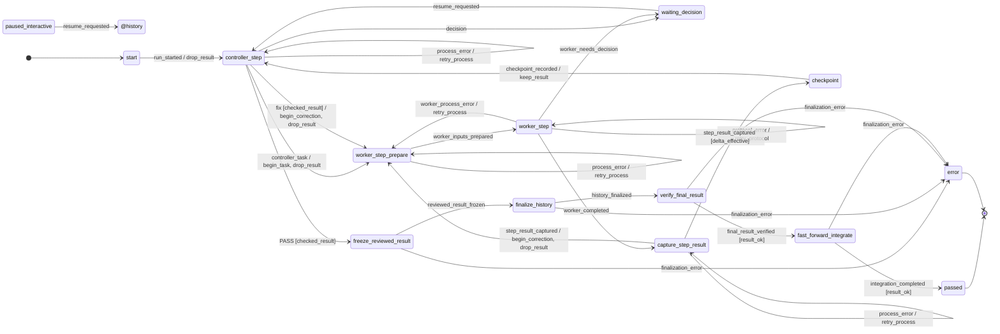

<p align="right">Deutsch | <a href="README.en.md">English</a></p>

# ki-dev

**Agentenarbeit als deklarativer Ablauf: Zustände und Übergänge stehen in
TOML, ein Ausführer fährt sie, Adapter sprechen mit Claude, Codex oder einem
Menschen.**

Die KI schreibt Code und urteilt über Ergebnisse. Was danach gilt (noch eine
Korrekturrunde, Halt für eine Entscheidung, geprüfte Integration), steht nicht
im Prompt und nicht im Python-Code, sondern im Ablauf.

```text
 flow/delivery.toml · planning.toml     WAS   Zustände, Übergänge, Wächter, Aktionen     Daten
        │ wird gelesen von
  runner/           ki-dev run      WIE   formale Antwort → Ereignis → Wächter       LangGraph:
        │ ruft                            → Kantenaktion → nächste Eingabe           Checkpoint, Halt
 adapter/  claude · codex · manual · mock                                           WER
```

`ki-dev step` ist dieselbe Idee von Hand: genau ein Übergang des
Planungsablaufs, die Übergabe trägt der Mensch als Bote weiter.

---

## Eine Schleife ist eine Kante, kein Baustein

Bau, Review, Korrektur, erneutes Review: das ist keine eigene „Loop“-Schicht,
sondern eine Rückkante im Ablauf. Wann sie endet, entscheiden Wächter, und
jede Rückkante verbraucht einen Zähler. Auszug aus
[`src/ki_dev/flow/delivery.toml`](src/ki_dev/flow/delivery.toml):

```toml
# controller_step --fix [cond] / actions--> target   (UML-Kante)

[[transition]]                     # Korrekturbudget erschöpft → Mensch
source = "controller_step"
event = "fix"
cond = ["checked_result", "!changes_rounds_left"]
escalation = "changes_rounds_exhausted"
target = "paused_interactive"

[[transition]]                     # sonst: neue Runde, Zähler +1
source = "controller_step"
event = "fix"
cond = ["checked_result"]
actions = ["begin_correction", "drop_result"]
target = "worker_step_prepare"
```

Kandidaten werden in Dateireihenfolge geprüft, der erste passende Wächter
gewinnt. Passt keiner, ist das Ereignis dort nicht erlaubt. Die Begriffe folgen
UML-Zustandsmaschinen bzw. SCXML (`event`, `cond`, `target`, `@history`); der
Ausführer kennt nur das Vokabular, nicht die Topologie.

---

## In einer Minute ausprobieren

Ohne Anbieterzugang, mit Mock-Adaptern (braucht `git` und `bd`):

```bash
scripts/demo-mock-lauf.sh
```

```text
{
  "run_id": "demo",
  "status": "passed",
  "phase": "passed",
  "round_id": 2,
  "detail": null,
  "operation_id": null
}

8ef6356 Geprüfter Abschluss (Demo)
5c02782 start
```

Der Mock-Reviewer antwortet erst `fix` (Urteil `CHANGES`), dann `PASS`. Der Lauf nimmt also
die Rückkante einmal (`round_id: 2`), friert das geprüfte Ergebnis ein und
integriert es per Fast-forward. Die Konfiguration schreibt das Skript nach
`lauf.json`.

---

## Zwei Befehle

### `ki-dev run`: den Bauablauf bis zum nächsten Halt fahren

```bash
ki-dev run --config lauf.json       # neuer Lauf
ki-dev run resume RUN_ID            # nach Halt (Antwort, Bote, Pause)
ki-dev run status RUN_ID            # nur lesen
```

Je Rolle wählt die Konfiguration einen Adapter:

| Adapter | Konfiguration | Wer antwortet |
| --- | --- | --- |
| `claude`, `codex` | `{"executor": "codex", "session_id": "…", "model": "…", "effort": "high"}` | vorbereitete Agentensitzung |
| `manual` | `{"executor": "manual"}` | du trägst die Eingabe in eine Sitzung deiner Wahl |
| `mock` | `{"executor": "mock", "answers": ["fix", "PASS"]}` | vorgegebene Antworten |

Beim Adapter `manual` hält der **Ausführer**, nicht der Ablauf. Der Lauf
bleibt in `worker_step` und meldet `awaiting_input`. Die Eingabe liegt in
`<runs>/<RUN_ID>/inbox/…input.md`. Die Antwort kommt als `…answer.md`
daneben, dann `ki-dev run resume`. Sie durchläuft dieselbe Prüfung wie bei
einem Agenten.

Der Mensch hat damit zwei getrennte Rollen: **Bote** (Adapter `manual`) und
**Entscheider** (Zustände der Art `wait`, z. B. nach `NEEDS_DECISION`).

### `ki-dev step`: ein Übergang des Planungsablaufs von Hand

```bash
ki-dev step BEAD --step map | graph | materialize | build | review
ki-dev step BEAD --step review --next-turn --decision-file antwort.json
```

Echte Ausgabe (gekürzt) für einen Bead dieses Repositorys:

```text
Schritt: materialize
Bead: ki-dev-ablauf-5we - Vor GitHub: begrenzte Reviewer-Prüfsteuerung in step anschließen
…
Hinweis für den Menschen: Zustand materialize; Folgeschritte laut planning.toml (Adapter manual, du trägst sie weiter):
- done → materialize.review: `ki-dev step ki-dev-ablauf-5we --step review --review-of materialize`
```

Ein Review vergibt je Befund eine Klasse. Die stärkste Klasse bestimmt die
Kante:

| Klasse | Urteil | Weiter |
| --- | --- | --- |
| `fix` | `CHANGES` | derselbe Schreibagent korrigiert |
| `source` | `NEEDS_DECISION` | Planungssitzung, dann **bestehende** Karte ergänzen |
| `decision` | `NEEDS_DECISION` | der Mensch entscheidet |

---

## Die zwei Abläufe

Jeder Ablauf lässt sich als Diagramm ausgeben:
`ki-dev flow show delivery --without-escalations` (Mermaid).

**Lieferablauf** ([`delivery.toml`](src/ki_dev/flow/delivery.toml), ohne
Grenz- und Schutzhalte, also ohne Kanten mit `escalation`):

<!-- ki-dev flow show delivery --without-escalations -->


**Planungsablauf** ([`planning.toml`](src/ki_dev/flow/planning.toml),
vollständig):

```mermaid
stateDiagram-v2
    direction LR
    state "map.review" as map_review
    state "map.correction" as map_correction
    state "map.decision" as map_decision
    state "graph.review" as graph_review
    state "graph.correction" as graph_correction
    state "graph.decision" as graph_decision
    state "materialize.review" as materialize_review
    state "materialize.correction" as materialize_correction
    state "materialize.decision" as materialize_decision
    state "implement.review" as implement_review
    state "implement.correction" as implement_correction
    state "implement.decision" as implement_decision
    state "implement.preflight" as implement_preflight
    [*] --> map
    map_review --> map_correction: fix
    map_review --> source: source
    map_review --> map_decision: decision
    map_decision --> graph: accept
    map_decision --> map_correction: correct
    map_decision --> source: source
    map --> map_review: done
    map_correction --> map_review: done
    map_review --> graph: PASS
    graph_review --> graph_correction: fix
    graph_review --> source: source
    graph_review --> graph_decision: decision
    graph_decision --> materialize: accept
    graph_decision --> graph_correction: correct
    graph_decision --> source: source
    graph --> graph_review: done
    graph_correction --> graph_review: done
    graph_review --> materialize: PASS
    materialize_review --> materialize_correction: fix
    materialize_review --> source: source
    materialize_review --> materialize_decision: decision
    materialize_decision --> implement: accept
    materialize_decision --> materialize_correction: correct
    materialize_decision --> source: source
    materialize --> materialize_review: done
    materialize_correction --> materialize_review: done
    materialize_review --> implement: PASS
    implement_review --> implement_correction: fix
    implement_review --> source: source
    implement_review --> implement_decision: decision
    implement_decision --> finished: accept
    implement_decision --> implement_correction: correct
    implement_decision --> source: source
    implement --> implement_preflight: done
    implement_correction --> implement_preflight: done
    implement_preflight --> implement_review: checks_passed
    implement_preflight --> implement_review: checks_partial
    implement_preflight --> implement_correction: checks_failed
    implement_review --> finished: PASS [full_checks]
    source --> map: imported
    finished --> [*]
```

<!-- ki-dev flow show planning -->


Beide Diagramme sind aus der Quelle erzeugt (`ki-dev flow show`,
`scripts/render-flow-diagrams.py`); ein Test vergleicht sie mit der Ausgabe.

---

## Was die Tests belegen

| Behauptung | Nachweis |
| --- | --- |
| Kein Zyklus ohne Mensch läuft unbegrenzt | `tests/machine/test_reachability.py` zählt den ganzen Zustandsraum auf |
| … und das schon an den Daten | `tests/test_flow_delivery.py`: jeder Zyklus hat eine zählende Kante |
| `PASSED` nur über die geprüfte Integration | `tests/machine/test_reachability.py` |
| Ablauf und Ausführer sprechen dasselbe Vokabular | `bind()` prüft beim Import; `tests/test_flow_delivery.py` |
| Schichten importieren nie rückwärts | `tests/test_schichten.py` (transitiv, per AST) |
| Der Bote hält den Ausführer, nicht den Ablauf | `tests/test_runner_runtime.py`, `tests/test_runner_cli.py` |

```bash
.venv/bin/pytest -q && .venv/bin/ruff check .
```

---

## Installation

Python ≥ 3.12, git ≥ 2.32, [Beads](https://github.com/steveyegge/beads) `bd`
**1.3.0** (Go und C-Compiler für `go install`):

```bash
python3 -m venv .venv && .venv/bin/pip install -e '.[test]'
CGO_ENABLED=1 go install -tags gms_pure_go github.com/steveyegge/beads/cmd/bd@v1.3.0
```

Oder der Agent-Container mit bd, Codex und Claude Code:
`./scripts/agent-container shell` ([docker/agent/README.md](docker/agent/README.md)).

---

## Aufbau

```text
src/ki_dev/
  flow/        model.py (Schema, Prüfung), pattern.py (Muster), diagram.py
               (Mermaid), templates/ (Rollentexte), delivery.toml, planning.toml
  runner/      interpreter.py (bindet Vokabular, wählt Kanten), machine/ (Wächter,
               Aktionen, advance), runtime.py (LangGraph-Graph aus delivery.toml),
               planning.py (Planungsschleife), events.py (Protokoll), cli.py,
               safety.py (Kontext-, Kontingent-, Aufrufgrenzen)
  adapter/     contract.py, prompts.py, agent.py, manual.py, mock.py,
               executors/ (Claude- und Codex-CLI, Transkripte, Messung)
  step/        Adapter manual für den Planungsablauf: Übergaben, Vorlauf,
               Leitlinien, Laufzustand je Bead
  pilot/, safety_profile/   abgelegt, noch nicht angebunden (urq, wu0.10.5)
```

Weiterführend: [Ausführer und Laufzeit](docs/ausfuehrer.de.md) ·
[`ki-dev step` im Detail](docs/step.de.md) ·
[CLI-Adapter](docs/cli-adapters.md) ·
[Sitzungen lesen](docs/session.de.md) ·
[Zielbild und Hintergrund](docs/zielbild.de.md)

---

## Stand und offene Punkte

- **Benutzbar:** `ki-dev step` (Planungsablauf von Hand), `ki-dev run` mit
  allen vier Adaptern (Bauablauf).
- **Planungsablauf:** `step` fährt `planning.toml` über den Ausführer
  (`runner/planning.py`) bis zum nächsten `turn`/`ask`; `map`, `graph` und
  `materialize` laufen ohne Vorlauf (Stub), `implement` mit
  `implement.preflight`.
- **Laufzustand je Bead:** `ki-dev step BEAD_ID` ohne `--step` setzt den
  gespeicherten Halt fort (`.local/handoff/steps/`), je Übergang steht eine
  Zeile in `events.jsonl`.
- **Beobachtbar:** `ki-dev run` schreibt je Übergang eine Zeile nach
  `events.jsonl` ([Ausführer](docs/ausfuehrer.de.md#ereignisprotokoll-je-übergang)).
- **Zur Kartierung offen:** Sitzungsbindung als Ablaufdatum
  (`neu | wie:<zustand>`), adaptive Schnitte des Controllers
  ([Zielbild](docs/zielbild.de.md)).

## Einordnung und Nicht-Ziele

Claude Code und Codex führen die Arbeit aus, LangGraph trägt Persistenz und
Halt, Beads den Arbeitsgraphen. Der eigene Beitrag ist der Ablauf als Daten
und ein Ausführer ohne eigene Topologie.

Nicht das Ziel: ein Chatbot, der „irgendwie das Repository erledigt“; eine
unbegrenzte Agentenschleife; große Mengen Kontext in jedem Prompt; eine zweite
Quelltextwahrheit neben Git; Fachlogik, die an einer bestimmten Claude- oder
Codex-Sitzung hängt.

> **Nicht mehr KI für die Verwaltung von KI-Arbeit einsetzen als nötig.**
