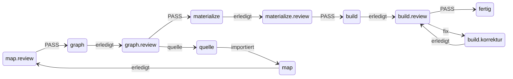
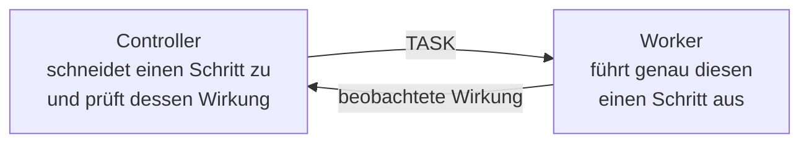
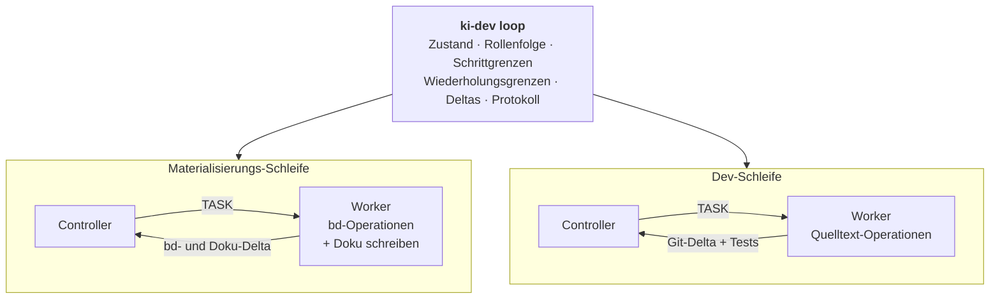
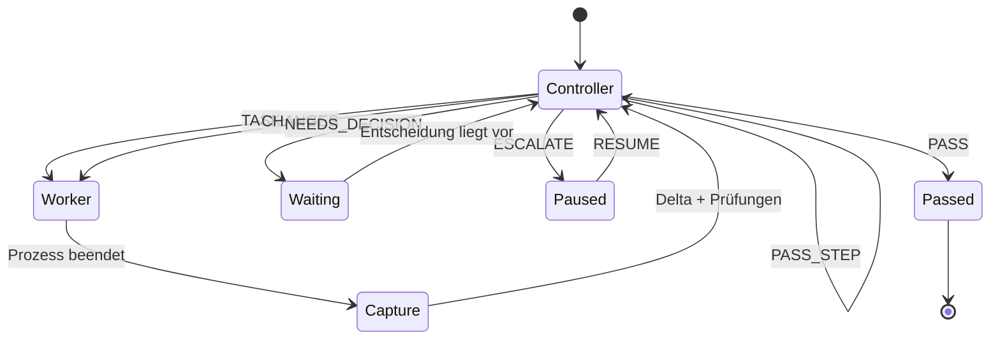
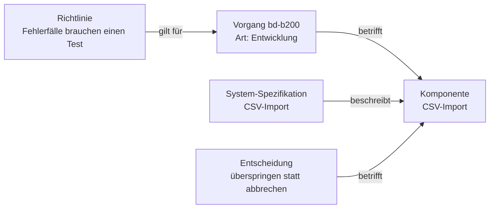
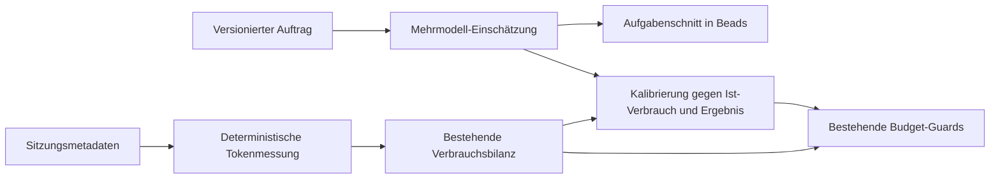
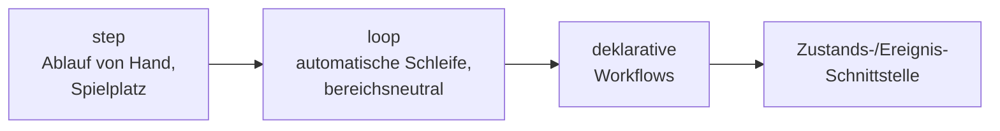

<p align="right">Deutsch | <a href="README.en.md">English</a></p>

---

# ki-dev

**Ein deterministischer Orchestrator für KI-gestützte Entwicklungs- und
Projektarbeit in kleinen Teams.**

Die Maschine hält Zustand, Rollenfolge, Schrittgrenzen und Änderungsnachweise.
Die KI schreibt Quelltext und urteilt über Ergebnisse.

> **Status: aktive Entwicklung.**
> Heute nutzbar ist [`ki-dev step`](#ki-dev-step-der-ablauf-von-hand): derselbe
> Ablauf von Hand, als Spielplatz für jede Funktion, die später automatisch
> laufen soll. Als Nächstes folgt die automatisierte Schleife (`ki-dev loop`).
> Alles Weitere ist Entwurf und unten als **Zielbild** gekennzeichnet.

<!-- mdman:toc:start -->
- [In der Praxis](#in-der-praxis)
- [`ki-dev step`: der Ablauf von Hand](#ki-dev-step-der-ablauf-von-hand)
- [Die Orchestrierungsparameter](#die-orchestrierungsparameter)
- [Wofür](#wofür)
- [Warum nicht einfach ein Agent mit Subagenten?](#warum-nicht-einfach-ein-agent-mit-subagenten)
- [Zwei Strecken auf derselben Schleife](#zwei-strecken-auf-derselben-schleife)
- [Die Schleife im Detail](#die-schleife-im-detail)
- [Worauf die Schleife läuft: LangGraph](#worauf-die-schleife-läuft-langgraph)
- [Was der Controller tatsächlich sieht](#was-der-controller-tatsächlich-sieht)
- [Strecke: Planung → Materialisierung (Zielbild)](#strecke-planung--materialisierung-zielbild)
- [Strecke: Umsetzung (Zielbild)](#strecke-umsetzung-zielbild)
- [Warum eine Maschine und nicht ein längerer Prompt](#warum-eine-maschine-und-nicht-ein-längerer-prompt)
- [Der erste Go-live](#der-erste-go-live)
- [Die Parameter als Messfläche](#die-parameter-als-messfläche)
- [Tokenmessung und Estimatoren (Zielbild)](#tokenmessung-und-estimatoren-zielbild)
- [Richtung danach](#richtung-danach)
- [Einordnung und Nicht-Ziele](#einordnung-und-nicht-ziele)
<!-- mdman:toc:end -->

---

## In der Praxis

Zwei vorbereitete Agentensitzungen, ein Befehl:

```bash
ki-dev loop --controller-session ctl-7f2a --worker-session wrk-91b4
```

```text
RUN  r-0c31   bd-b200  CSV-Import: fehlerhafte Zeile überspringen
              base  a1b2c3d   ·   bd  dolt@4471f9

[1] CONTROLLER  codex/sol/high      Restarbeit grob geschnitten
    A  Fehlertyp und Erkennung ungültiger Datumswerte
    B  Überspringen und Protokollieren in der Importschleife
    C  Import-Ergebnis um Zähler erweitern

[2] CONTROLLER  codex/sol/high      TASK  ·  Schnitt A
    InvalidRowError einführen, Datumsprüfung in parse_row ergänzen.
    Signatur von parse_row nicht ändern.
    Schätzung  2 Definitionen · max. 18 Zeilen     ok  (Grenze 5 / 24)

[3] WORKER      claude/sonnet/high  Turn beendet   exit 0 · 48s
    git   a1b2c3d → e4f5a6b    2 Dateien, +31 −4
    bd    keine Änderung
    pytest ✓   ruff ✓

[4] CONTROLLER  codex/sol/high      CHANGES  ·  Runde 1 von 5
    Test für die ungültige Zeile fehlt.
    Richtlinie: Fehlerfälle brauchen einen Test.

[5] WORKER      claude/sonnet/high  Turn beendet   exit 0 · 31s
    git   e4f5a6b → 9c8d7e2    1 Datei, +22 −0
    pytest ✓   ruff ✓

[6] CONTROLLER  codex/sol/high      PASS_STEP  ·  Schnitt A
    Restarbeit neu beurteilt: B bleibt, C entfällt —
    das Ergebnisobjekt zählt übersprungene Zeilen bereits.

[7] CONTROLLER  codex/sol/high      TASK  ·  Schnitt B
    Schätzung  7 Definitionen · max. 40 Zeilen     zu groß (Grenze 5 / 24)
    → Zerlegung verlangt, kein Worker-Start

[8] CONTROLLER  codex/sol/high      TASK  ·  Schnitt B1
    Nur die Importschleife: ungültige Zeile überspringen und mit
    Zeilennummer protokollieren.
    Schätzung  3 Definitionen · max. 21 Zeilen     ok

[9] WORKER      claude/sonnet/high  Turn beendet   exit 0 · 52s
    git   9c8d7e2 → 3f10a4c    2 Dateien, +34 −6
    pytest ✓   ruff ✓

[10] CONTROLLER codex/sol/high      PASS_STEP  ·  Schnitt B1
     Restarbeit: B2 — Zähler im Import-Ergebnis führen.

     …   TASK B2   ·   Worker   ·   PASS_STEP B2

[14] CONTROLLER codex/sol/high      PASS
     Keine Restarbeit mehr.

PASS  r-0c31   4 Worker-Turns · 1 Korrekturrunde · 5 Commits
               geprüft  7b21e0d  →  integriert (fast-forward)
```

Das Wichtigste daran steht in Schritt `[1]`, `[6]` und `[7]`: **ein Vorgang ist
nicht ein `TASK`.** Der Controller schneidet ihn zu, beurteilt nach jedem
angenommenen Schnitt die Restarbeit neu — und ein zu großer Schnitt kommt gar
nicht beim Worker an.

Kein Mensch zwischen den beiden Sitzungen. Genau das ist der erste Nutzen.

> Ausgabe- und Befehlsformat sind der Zielzustand der Schleife und noch nicht
> eingefroren.

---

## `ki-dev step`: der Ablauf von Hand

Bevor die Schleife die Sitzungen selbst verbindet, macht das der Mensch:
`ki-dev step` gibt für jeden Schritt eine kurze, geprüfte Übergabe aus, du
fügst sie in eine Claude- oder Codex-Sitzung ein und gibst die Antwort
weiter. Jede Regel, die später automatisch greifen soll, lässt sich so erst
von Hand erproben. Der Befehl startet keinen Agenten.

Jede Phase hat eigene Zustände. Sie stehen als Daten in
[`src/ki_dev/step-flow.toml`](src/ki_dev/step-flow.toml), nicht im Code; ein
Test prüft, dass jeder Zustand das Ende erreicht.



Ein Review sagt nicht nur `CHANGES`. Jeder Befund trägt eine Klasse, und die
Klasse bestimmt den Weg:

| Klasse | Urteil | Weiter |
| --- | --- | --- |
| `fix` | `CHANGES` | derselbe Schreibagent korrigiert |
| `quelle` | `NEEDS_DECISION` | Planungssitzung, dann **bestehende** Karte ergänzen |
| `entscheidung` | `NEEDS_DECISION` | der Mensch entscheidet |

Ein echter Fall aus diesem Repository (6.10.2026, Commit `8f88c98`, Bead
`ki-dev-ablauf-5we`, gekürzt). Die Review-Übergabe führt zuerst den
deterministischen Vorlauf aus; hier ist eine Prüfung begründet ausgelassen:

```bash
ki-dev step ki-dev-ablauf-5we --step review --preflight-skip 'lint=nur Doku geändert'
```

```text
Schritt: review
Reviewziel: build
Bead: ki-dev-ablauf-5we - Vor GitHub: begrenzte Reviewer-Prüfsteuerung in step anschließen
…
requirement_ref: AC1, AC2, AC3, AC4 (nummerierte Zeilen „N.“ in acceptance_criteria; …)

Hinweis für den Menschen: Zustand build.review; Folgeschritte laut step-flow.toml (nichts läuft automatisch):
- PASS → fertig: Schließen entscheidest du (`bd close ki-dev-ablauf-5we`)
- fix → build.korrektur: Befunde an den Bau-Agenten (bisherige Sitzung)
- quelle → quelle: offene Fragen in einer Planungssitzung klären
- entscheidung → build.entscheidung: du entscheidest: annehmen, korrigieren oder quelle
PRUEFBERICHT vorlauf-start=2026-10-06T05:46:24Z
- tests: PASS ======== 2272 passed, 1 skipped in 62.39s ======== […]
- lint: SKIPPED ausgelassen per --preflight-skip: nur Doku geändert [argv=./.venv/bin/ruff check .]
TEILLAUF: … Abweichend von der Rolle ist PASS ausgeschlossen; Ausgabe: CHANGES | NEEDS_DECISION. …
```

Die Review-Sitzung endet mit einem JSON-Objekt; das gleiche Format prüft auch
die Schleife. Mit einer Beispielantwort:

```bash
echo '{"action": "CHANGES", "detail": "Test für leere preflight_skip-Map fehlt",
       "requirement_ref": "AC2", "preflight_args": {"tests": "-k decision"}}' \
  | ki-dev step ki-dev-ablauf-5we --step review --next-turn --decision-file -
```

```text
Empfänger: Bau-Agent (bisherige Sitzung)
Bead: ki-dev-ablauf-5we - Vor GitHub: begrenzte Reviewer-Prüfsteuerung in step anschließen

Review-Befund (CHANGES, AC2): Test für leere preflight_skip-Map fehlt
…
- fix → build.korrektur: Befunde an den Bau-Agenten (bisherige Sitzung)

Prüfsteuerung des Reviewers (nicht angewendet; Teillauf ohne PASS), nach der Korrektur auszuführen:
ki-dev step ki-dev-ablauf-5we --step review --next-turn --preflight-args 'tests=-k decision'
```

Verweist `CHANGES` auf kein bestehendes Abnahmekriterium, geht die Antwort als
`NEEDS_DECISION` an den Menschen statt an den Bau-Agenten.

Auch die Planung lief so. Ein Graph-Review vom 5.10.2026 meldete zwei
`CHANGES` und ein `NEEDS_DECISION`: Die Karte war nicht erneut geprüft. Die
Planungssitzung nahm sie im Auftrag des Menschen an (`ACCEPTED_BY_DECISION`,
kein PASS; delegierte Entscheidung, Bestätigung durch den Menschen
ausstehend). Die
Planungssitzung mit den Antworten wurde als neue Quelle eingelesen
(`ki-dev step map --agent claude --session …`) und ergänzte den bestehenden
Graphen um einen Vorgang, statt einen zweiten anzulegen. Einzelheiten:
[docs/handoff.de.md](docs/handoff.de.md).

---

## Die Orchestrierungsparameter

Alles, was den Lauf oben bestimmt, steht in `.ki-dev/config.toml` — nicht im
Prompt und nicht in der Entscheidung eines Agenten:

```toml
[roles.controller]
executor = "codex"       # welche lokale CLI die Rolle ausführt
model    = "sol"
effort   = "high"

[roles.worker]
executor = "claude"      # Rollen dürfen verschiedene Werkzeuge nutzen
model    = "sonnet"
effort   = "high"

[limits]
max_changes           = 5   # Korrekturrunden je Schnitt, dann ESCALATE
max_protocol_attempts = 3   # Rückkopplung bei ungültiger Ausgabe
max_process_retries   = 2   # abgebrochene CLI-Prozesse

[worker_step]
max_estimated_definitions      = 5    # wie groß ein Schnitt sein darf
max_estimated_definition_lines = 24
review_boundary                = "worker_turn"

[git]
history_policy = "preserve"  # Schrittcommits bleiben erhalten
```

Drei Dinge folgen daraus unmittelbar:

```text
Rolle ≠ Werkzeug     Dieselbe CLI kann im einen Lauf Worker sein,
                     im anderen Controller.

Grenzen sind Zahlen  Runde 6 von 5 findet nicht statt, weil die Maschine
                     zählt — nicht weil der Agent es bemerkt.

Schnittgröße wird    Der Controller schätzt sie vor jedem TASK; der
gemessen             Orchestrator vergleicht sie mit der Grenze und
                     verlangt sonst eine neue Zerlegung.
```

Kein gestarteter Agent darf diese Werte verändern.

---

## Wofür

Ein kleines Team oder ein Open-Source-Projekt hat meist kein
Produktmanagement, keine eigene technische Leitung und keinen festen
Review-Prozess. Diese Arbeit fällt auf dieselben zwei, drei Entwickler zurück.
Coding-Agenten nehmen sie nicht ab — sie verschieben den Engpass vom Tippen
zum Steuern:

```text
Planung
→ gültige Projektdokumentation
→ sinnvoll geschnittene Vorgänge
→ Abhängigkeiten
→ richtiger Arbeitskontext
→ kontrollierte Umsetzung
→ Prüfung
→ Rückführung neuer Erkenntnisse
```

`ki-dev` deckt diese Arbeit dazwischen ab — in zwei Strecken:

```text
Planung / Materialisierung
  Planungssitzung  →  Materialisierungs-Schleife  →  Doku + Vorgänge in bd

Dev / Umsetzung
  bd-Vorgang + geltender Kontext  →  Dev-Schleife  →  Quelltext in Git
```

---

## Warum nicht einfach ein Agent mit Subagenten?

Das ist die naheliegende Alternative, und sie funktioniert. Der Unterschied
liegt darin, **wer bestimmt, welche Rolle als Nächstes läuft** — und wo der
Zustand liegt, wenn der Prozess endet:

```text
                        Rollenfolge bestimmt   Zustand lebt in
────────────────────────────────────────────────────────────────────────
Agent mit Subagenten    der Agent selbst       der Agentensitzung
Ralphex                 ein Agent im Lauf      Plan-Datei + Lauf
LangGraph / CrewAI      dein eigener Code      dem Graphzustand
ki-dev                  der Orchestrator       Graphzustand + bd + Git
```

Ein Agent, der sich selbst reviewt, entscheidet auch selbst, ob er noch eine
Runde dreht. Von außen ist nicht sichtbar, dass gerade Runde fünf läuft, und
wenn die Sitzung endet, endet der Ablaufzustand mit ihr.

```text
Claude entscheidet:   Wie löse ich das?
Codex entscheidet:    Ist das richtig?
ki-dev entscheidet:   Wer ist jetzt dran? Wie groß darf der Schnitt sein?
                      Wie viele Runden bleiben? Was hat sich wirklich geändert?
```

Gegenüber LangGraph und CrewAI Flows ist `ki-dev` kein Wettbewerber, sondern
ein Aufsatz: LangGraph liefert die Ablaufmechanik, `ki-dev` den fachlichen
Vertrag darüber — Vorgangsbindung, Schnitt-Gates, Wirkungsnachweis, geltender
Kontext.

Ob äußere feingranulare Steuerung im Ergebnis wirklich besser ist als ein
Agent mit Subagenten, ist offen — siehe
[Die Parameter als Messfläche](#die-parameter-als-messfläche).

---

## Zwei Strecken auf derselben Schleife

Eine **Strecke** ist eine Arbeitsart mit eigener Rollenbesetzung, eigenem
Wirkungsnachweis und eigener Abschlussbedingung. Jede Strecke läuft als
eigener `ki-dev`-Lauf. Materialisierung und Umsetzung sind zwei getrennte
Strecken, kein durchgehender Fluss — aber beide sind dieselbe Schleife:



Was sich unterscheidet, ist die Besetzung — nicht der Mechanismus:



| | Materialisierungs-Schleife | Dev-Schleife |
| --- | --- | --- |
| Eingang | freigegebener Planungsstand | ein `bd`-Vorgang + geltender Kontext |
| Worker macht | `bd`-Operationen, Doku schreiben | Funktionen, Klassen, Tests |
| Wirkung sichtbar über | `bd`-Delta (Dolt) + `git diff` der Doku | `git diff` + Tests |
| Controller prüft | Trägt der Arbeitsgraph die Planung? | Ist die Umsetzung richtig? |
| Fertig, wenn | Doku und Vorgänge konsistent stehen | Vorgang integriert und geschlossen |

Zeitlich hängen die Strecken zusammen, technisch nicht:

```text
Planungssitzung (Mensch ↔ Planer)
        ↓  freigegebener Stand
Materialisierungs-Schleife                    eigener Lauf
        ↓  Doku + Vorgänge in bd
        ⋮   später, unabhängig, je Vorgang
Dev-Schleife                                  eigener Lauf
        ↓  Quelltext in Git
```

Materialisierung ist dabei kein mechanisches Zerlegen von Text in Vorgänge.
Sie muss den **bestehenden** Graphen mitlesen: Welche Vorgänge bleiben gültig?
Welche Annahme ist durch die neue Planung überholt? Welche Abhängigkeit ändert
sich? Genau deshalb braucht sie dieselbe Kontrollschleife wie die Umsetzung.

Deshalb wird zuerst die Schleife gebaut und erst danach die beiden Strecken,
die auf ihr laufen.

---

## Die Schleife im Detail



Der Controller hat je Zug genau ein Ergebnis, mehr gibt es nicht:

```text
TASK             der zugeschnittene Auftrag für den nächsten Schnitt
CHANGES          nachbessern, derselbe Schnitt
PASS_STEP        dieser Schnitt ist angenommen — Restarbeit neu beurteilen
NEEDS_DECISION   fachliche Entscheidung fehlt → Mensch
ESCALATE         automatisch nicht sicher fortsetzbar → Mensch
PASS             der ganze Vorgang ist fertig
```

Vier Regeln machen daraus eine Maschine statt eines Gesprächs.

### Der Controller schneidet den Vorgang zu

Ein Vorgang wird nur dann unmittelbar zum `TASK`, wenn er schon
Schnittgröße hat. Sonst gilt:

```text
Vorgang
  ↓  grobe Orientierung, veränderbar
A · B · C
  ↓  genau einen Schnitt bestimmen
TASK + Größenschätzung
  ↓  Orchestrator prüft gegen die Grenze
Worker
  ↓  PASS_STEP
Restarbeit neu beurteilen  →  nächster Schnitt
```

Die Grenze zwischen zwei Schnitten ist nicht Datei, Funktion oder Zeilenzahl,
sondern der zusammenhängende prüfbare Vertrag:

```text
Teil A und Teil B

A ohne B ergibt keinen prüfbaren Vertrag   →  zusammenlassen
A kann unabhängig PASS_STEP oder
CHANGES erhalten                           →  trennen
```

Der Vorteil kleiner Schnitte ist nicht Sparsamkeit, sondern begrenzter
struktureller Schaden: Ein großer offener Auftrag kann eine ungünstige
Grundstruktur erzeugen, auf der alle späteren Korrekturen dann aufbauen.

Dasselbe Prinzip gilt eine Ebene höher, aber getrennt: Wie grob die
Materialisierung Vorgänge schneidet, ist ein anderer Regler als die
Schnittgröße innerhalb eines Vorgangs.

### Der Prozess-Exit ist die Schrittgrenze

Ein Agenten-Turn ist ein synchroner CLI-Aufruf. Die Alternativen wären, ein
Terminalfenster fernzusteuern und die Bildschirmausgabe abzuschöpfen, oder den
Agenten sagen zu lassen „ich bin fertig“. Das erste hängt an PTY- und
Darstellungsdetails, das zweite ist wieder eine Selbstauskunft.

Ein Prozessende ist dagegen eine Tatsache mit Exitcode — nichts zu parsen,
keine Mitwirkung des Agenten nötig. Und erst eine eindeutige Grenze macht das
Delta überhaupt wohldefiniert:

```text
Referenz vor dem Start  →  Prozess läuft  →  Referenz nach dem Exit
                                              └ Delta = genau dieser Schritt
```

Ohne diese Grenze wüsste die Maschine nicht, welche Änderungen zu welchem
Schnitt gehören — und damit auch nicht, was der Controller gerade beurteilt.
Bei einer Wiederaufnahme gilt dasselbe: Der Prozess ist gelaufen oder nicht.

### Gezählt wird die Wirkung, nicht die Selbstauskunft

Der Worker beschreibt sein Ergebnis normalerweise gar nicht. `ki-dev` merkt
sich vor dem Schritt die Referenz und bildet danach das Delta:

```text
Git   base_commit  →  Worker  →  head_commit  →  git diff
bd    Dolt-Ref     →  Worker  →  Dolt-Ref     →  bd-Delta
```

Nur Sonderfälle meldet der Worker selbst: `NEEDS_DECISION` und `ESCALATE`.

### Jede Schleife hat eine Obergrenze

Korrekturrunden, Protokollfehler, Prozess-Retries — jeder wiederholbare Weg
verbraucht einen begrenzten Zähler. Ist er erschöpft, eskaliert die Maschine.

---

## Worauf die Schleife läuft: LangGraph

**Entscheidung: die Ablauf-Laufzeit ist LangGraph.** `ki-dev` baut dafür keine
eigene persistente Agentenlaufzeit.

Gebraucht wird nicht nur „welche Zustände gibt es“, sondern Persistenz,
Checkpoints, Unterbrechung und Wiederaufnahme über Prozessenden hinweg — genau
LangGraphs Gegenstand. CrewAI Flows wäre technisch ebenfalls geeignet; seine
zusätzlichen Crew- und Delegations-Abstraktionen braucht `ki-dev` nicht, weil
die Rollen ohnehin festgelegt sind.

```text
LangGraph liefert            ki-dev liefert
─────────────────────────    ─────────────────────────────────
Graphzustand                 Controller-/Worker-Vertrag
Knoten und Übergänge         adaptive Worker-Schnitte
Schleifen                    Größen-Gates
Checkpoints                  Git-/bd-Wirkungsnachweis
Unterbrechung / Resume       PASS_STEP vs. PASS
                             Zähler und Eskalationsregeln
                             sichere Integration
```

Ein Durchlauf besteht überwiegend aus gewöhnlichen Python-Knoten — nur zwei
brauchen einen KI-Executor:

```text
CONTROLLER          KI       codex CLI
  ↓ TASK
WORKER              KI       claude CLI
  ↓ Prozessende
CAPTURE_GIT_DELTA   Python
CAPTURE_BD_DELTA    Python
RUN_TESTS           Python
RUN_LINT            Python
  ↓
CONTROLLER          KI       codex CLI
```

Eine Grenze bleibt ausdrücklich bei `ki-dev`:

```text
LangGraph beantwortet:        Wo stand der Ablauf?
LangGraph beantwortet nicht:  Darf diese äußere Wirkung erneut ausgeführt
                              werden?
```

Nachricht zugestellt, Commit erzeugt, `bd` verändert, integriert, Vorgang
geschlossen — bei einer Wiederaufnahme darf keine dieser Wirkungen blind
wiederholt werden. Erwarteten Ausgangszustand prüfen, Wirkung identifizierbar
machen, bereits erfolgte Wirkung erkennen: das bleibt `ki-dev`-Fachlogik.

---

## Was der Controller tatsächlich sieht

Schritt `[4]` aus dem Lauf oben. Der Controller bekommt keinen langen
Rollen-Prompt, sondern einen Zustand mit sichtbarem Aktionsraum:

```text
Vorgang: bd-b200  CSV-Import: fehlerhafte Zeile überspringen
Schnitt: A — Fehlertyp und Erkennung ungültiger Datumswerte

Runde: 1 von 5

Auftrag dieses Schnitts:
  InvalidRowError einführen, Datumsprüfung in parse_row ergänzen.
  Signatur von parse_row nicht ändern.

Aktuelle Änderung:
  src/csv/import.py   +27 −4
  src/csv/errors.py   +4  −0
  <git diff a1b2c3d..e4f5a6b>

Prüfungen:
  pytest ✓   ruff ✓

Geltender Kontext:
  Richtlinie      Fehlerfälle brauchen einen Test
  Entscheidung    überspringen statt abbrechen

Arbeitsgraph:
  [ ] Vorgang bleibt richtig geschnitten
  [ ] Graphänderung erforderlich
  [ ] Graphverbesserung sinnvoll

Zulässige Urteile:
  PASS_STEP · CHANGES · NEEDS_DECISION · ESCALATE
```

Drei Dinge daran sind Absicht:

- **Geprüft wird der Schnitt, nicht der ganze Vorgang.** `PASS_STEP` beendet A,
  nicht `bd-b200`.
- **Die Frage nach dem Arbeitsgraphen wird gestellt**, nicht nur erwähnt. Ein
  Controller darf feststellen, dass der Vorgang selbst falsch geschnitten ist —
  dafür braucht er einen Zustand, der ihn danach fragt.
- **In Runde 5 von 5 fehlt `CHANGES` in der Liste.** Die Maschine bietet nur
  an, was der Zustand erlaubt — und prüft die Antwort danach trotzdem noch
  einmal.

---

## Strecke: Planung → Materialisierung (Zielbild)

```bash
ki-dev plan "CSV-Import soll fehlerhafte Zeilen überspringen"
```

```text
Planer:   Soll die übersprungene Zeile nur protokolliert oder auch
          gesammelt zurückgemeldet werden?
Mensch:   Protokollieren reicht. Fehlerfälle brauchen bei uns immer einen Test.
Planer:   Vorschlag: Zeile überspringen, WARN-Log mit Zeilennummer,
          Import-Ergebnis meldet die Anzahl übersprungener Zeilen.
Mensch:   WRITE
```

`WRITE` friert den bestätigten Stand ein und startet damit die
Materialisierungs-Schleife. Aus dem Gespräch entstehen unterschiedliche
dauerhafte Aussagen:

```text
System-Spezifikation  →  welches Verhalten das System besitzen muss
Entscheidung          →  warum Überspringen dem Abbruch vorgezogen wurde
Richtlinie            →  „Fehlerfälle brauchen einen Test“
Vorgang               →  welche Arbeit konkret auszuführen ist
Nachweisbeziehung     →  welcher Test das belegt
```

Erst nach ausdrücklicher Freigabe des Gesamtplans entstehen Vorgänge:

```text
PASS  bd-a1b2
      docs/spec/csv-import.md      geändert
      docs/decisions/csv-rows.md   neu
      bd-b200  CSV-Import: fehlerhafte Zeile überspringen
      bd-b201  Import-Ergebnis meldet übersprungene Zeilen
      bd-b201 → bd-b200

Nächste Aktion: ki-dev ready
```

Ein einzelnes großes „Planungsdokument“ muss so nicht dauerhaft gleichzeitig
Architektur, Entscheidungssammlung, Ablaufbeschreibung und Aufgabenliste sein.

---

## Strecke: Umsetzung (Zielbild)

```bash
ki-dev ready
```

```text
READY
bd-b200  P2  CSV-Import: fehlerhafte Zeile überspringen
```

```bash
ki-dev run bd-b200      # ein Vorgang
ki-dev run --loop       # bis nichts mehr ready ist oder ein Gate stoppt
ki-dev status           # aktive Phase, Bead, Branch, nächste Aktion
ki-dev resume bd-b200   # nach Abbruch oder Eskalation
```

Der Dev-Controller bekommt den Vorgang **plus den dafür geltenden Kontext** —
nicht das ganze Repository:



Ein Pokerspieler bekommt nicht das ganze Kartenspiel mit der Auflage, sich zu
merken, welche Karten gerade gelten. Er bekommt die Karten für diesen Zug.

Nach `PASS` integriert `ki-dev` per Fast-forward und schließt den Vorgang. Wird
die Historie dabei kompakter geschrieben, muss der Zielcommit denselben
Dateibaum tragen wie der Commit, den der Controller geprüft hat — sonst
Abbruch statt Reparatur.

---

## Warum eine Maschine und nicht ein längerer Prompt

Eine Regel ist nicht durchgesetzt, nur weil sie im Prompt steht.

```text
1. Information irgendwo im Prompt      Der Agent könnte sie beachten.
2. im richtigen Zustand hervorgehoben  Der Agent wird darauf gestoßen.
3. zulässige Züge begrenzt             Unpassendes wird nicht angeboten.
4. Ausgabe strukturell geprüft         Ungültige Antwort wird zurückgewiesen.
5. Wirkung unabhängig beobachtet       Diff und Tests statt Selbstauskunft.
6. Grenze maschinell erzwungen         Nach Runde 5 gibt es keine sechste.
```

`ki-dev` verschiebt wichtige Bedingungen so weit wie möglich von Stufe 1 nach
unten. Vollständige, geprüfte Ergebnisse bleiben das Ziel; gemessener
Tokenverbrauch hilft zusätzlich, Aufgabenschnitt und Verbrauchsschutz zu steuern.

```text
Maschine   Zustand · zulässige Übergänge · Rollenfolge · Schrittgrenzen
           Wiederholungsgrenzen · Nachrichtenform · Deltas · geltender Kontext

KI         Wie setze ich das um? · Ist diese Umsetzung richtig?
           Welche Lösung passt? · Trägt die Annahme des Vorgangs noch?
```

---

## Der erste Go-live

Ziel ist die **Grundlage**, auf der die weiteren Ausbaurichtungen reibungslos
entstehen können — nicht die vollständige Zustandsmenge.

```text
enthalten                            noch nicht enthalten
─────────────────────────────────    ─────────────────────────────────
Controller- und Worker-Rolle         automatische Sitzungsvorbereitung
lokale claude-/codex-CLIs direkt     automatische Vorgangsauswahl aus bd
executor + model + effort je Rolle   vollständiges Planning + MATERIALIZE
ein Turn = ein synchroner Prozess    regelgeleitete Kontextableitung
Git- und bd-Delta je Schritt         Pages-PM-Integration
adaptive Schnitte + Größen-Gate      automatische Modellwahl
geprüfter Nachrichtenvertrag         Anbieter-APIs, Schlüsselverwaltung
begrenzte Zähler + Eskalation
LangGraph: Checkpoints + resume
```

Keine eigenen API-Schlüssel, keine Abrechnungsschicht, kein zusätzlicher
Orchestrierungsdienst:

```text
lokal angemeldete Claude- oder Codex-CLI
+ lokaler ki-dev-Orchestrator
```

Der abgenommene Nachweis ist ein echter kleiner Entwicklungsvorgang, der
`TASK → Änderung → Delta → CHANGES → Änderung → PASS_STEP → PASS` vollständig
durchläuft.

---

## Die Parameter als Messfläche

Die Werte aus `config.toml` sind nicht nur Einstellungen, sondern ein
Parameterraum. Und weil die Maschine ihre Läufe ohnehin protokolliert, liefert
derselbe Aufbau die Messwerte gleich mit.

Vergleichbare Profile über dieselben Aufgaben:

```text
Profil A   grobe Schnitte, seltene Rückkopplung
           max_estimated_definitions = 20
           review_boundary = "worker_turn"

Profil B   kleine Schnitte, häufige Rückkopplung
           max_estimated_definitions = 5
           review_boundary = "worker_turn"

Profil C   kleine Schnitte, Rückkopplung je Schreibvorgang
           review_boundary = "write_op"

Profil D   wie B, aber Controller und Worker auf demselben Executor
```

Gemessen wird, was der Lauf schon festhält:

```text
Ergebnis        gelöste Vorgänge · Regressionen · falsche PASS
Aufwand         Worker-Turns · Controller-Turns · CHANGES-Runden
Struktur        Schnittzahl · Änderungsgröße je Schnitt · verworfene Arbeit
Mensch          NEEDS_DECISION · ESCALATE
Kosten          Tokens und Laufzeit, soweit der Executor sie zuverlässig meldet
```

Die offene Frage lautet damit nicht „ist `ki-dev` besser“, sondern:

> Welche dieser Parameter haben überhaupt eine Wirkung auf das Ergebnis — und
> ab welcher Feinheit kippt der Nutzen zusätzlicher Rückkopplung in bloße
> Kosten?

Zwei Randbedingungen dazu:

```text
Messmodell vor den Vergleichsläufen festlegen
→ sonst wird nachträglich die günstige Kennzahl ausgewählt

Manueller Messabgleich vor dem nächsten echten Loop
→ /status und deterministische Messung müssen nachvollziehbar zusammenpassen

Vollständiger Estimator-Ausbau ist kein Blocker für diesen Messabgleich
→ neue Prognosen zunächst beobachten und gegen reale Ergebnisse kalibrieren
```

Solange keine eigenen Ergebnisse vorliegen, steht hier eine Hypothese und kein
Befund.

---

## Tokenmessung und Estimatoren (Zielbild)

Tokenverbrauch ist ein Betriebssignal des Orchestrators. Er wird zusammen mit
Fortschritt, vollständiger Umsetzung und Nacharbeit bewertet. Die ohnehin
nötige Einschätzung bei der Materialisierung von Beads-Aufgaben dient zugleich
der Verbrauchsprognose: Mehrere Modelle beurteilen denselben Aufgabenstand
unabhängig und helfen, einen passenden Schnitt zu finden.



Gesucht wird die Balance: Große Vorgänge können unvollständig bleiben und viel
Nacharbeit verlangen; zu kleine Vorgänge wiederholen Kontextaufnahme und
Übergaben. Der Vergleich zählt daher auch Schätzung, Review, Reparaturen und
sämtliche Teilaufgaben. Unvollständige Umsetzung ist kein günstiges Ergebnis.

**Roh-Sitzungen gehören nicht vollständig in den Agentenkontext.** Werkzeuge
extrahieren nur benötigte JSON-Metadaten; die Messung braucht keine Modellaufrufe.
Vor dem nächsten Loop-Nachweis ist der manuelle Abgleich mit `/status`
erforderlich. Exakte Tokenzählung wird zusätzlich mit bekannten strukturierten
Verbrauchsereignissen geprüft. Eine feste Umrechnung von Kontingentprozent in
Tokens wird nicht vorausgesetzt.

Messadapter, Laufbilanz und Schutzgrenzen existieren bereits. Mehrmodell-
Schätzung, Kalibrierung und vorausschauende Freigabe sind Erweiterungen im
Beads-Epic **ki-dev-ablauf-wu0**. Der
[Systementwurf](docs/architecture/tokenmessung-estimatoren.de.md) beschreibt
Modulgrenzen, bewertete Alternativen und technische Herausforderungen.

---

## Richtung danach



Keine feste Versionsliste, sondern benannte Etappen:

- **step:** der heutige Stand. Jede Regel wird zuerst von Hand erprobt.
- **loop:** verbindet die Sitzungen selbst und spart das Kopieren. Ob
  Planung, Materialisierung oder Umsetzung läuft, entscheidet die Übergabe,
  nicht die Schleife.
- **Workflows:** Abläufe als Daten. `step-flow.toml` ist die erste
  Vorstufe; die Schleife kann dieselbe Tabelle lesen.
- **Zustand/Ereignis:** eine Schnittstelle für Laufzustand und Ereignisse.
  Der Arbeitsgraph in Beads ist dafür kein Ersatz.

Der Grundsatz: kein allgemeines Agentensystem auf Vorrat bauen, sondern jeden
nächsten deterministischen Baustein aus einem echten Arbeitsproblem ableiten.

Der lebende Arbeitsstand steht nicht hier, sondern im Beads-Arbeitsgraphen; im
geklonten Repository etwa über `bv`, für eine teilbare statische Ansicht
`bv --pages`.

---

## Einordnung und Nicht-Ziele

```text
Claude Code / Codex   führen die Entwicklungsarbeit aus
LangGraph             trägt den persistenten Ablauf — verwendete Laufzeit
CrewAI Flows          geprüfte Alternative dazu
Ralphex               automatisiert Implementierung und Review-Schleifen
OpenHands             umfassendere Coding-Agenten-Laufzeit
bd (Beads)            versionierter Arbeitsgraph
```

Der eigene Beitrag liegt daneben: Zustand, Rollenfolge, Schnittgrenzen,
Änderungsnachweise und später der geltende Projektkontext bleiben **außerhalb**
der Agentensitzung. Vorhandene CLIs bleiben ausführende Werkzeuge.

Was `ki-dev` ausdrücklich nicht werden soll:

- ein Chatbot, der „irgendwie das Repository erledigt“;
- ein unbegrenzter Agentenloop, der bis zum Erfolg weiterläuft;
- ein Vorwand, große Mengen Projektkontext in jeden Prompt zu laden;
- eine zweite Quelltextwahrheit neben Git;
- ein anbieterspezifischer Ablauf, dessen Fachlogik von einer bestimmten
  Claude- oder Codex-Sitzung abhängt.

> **Nicht mehr KI für die Verwaltung von KI-Arbeit einsetzen als nötig.
> Struktur, Zustand und Kontext maschinell begrenzen — und die KI für die
> eigentliche Entwicklungs- und Prüfarbeit verwenden.**

Quellen zur Einordnung: [Ralphex](https://github.com/umputun/ralphex),
[LangGraph](https://docs.langchain.com/oss/python/langgraph/overview),
[CrewAI](https://docs.crewai.com/),
[OpenHands](https://docs.openhands.dev/sdk),
[Beads](https://github.com/gastownhall/beads).
