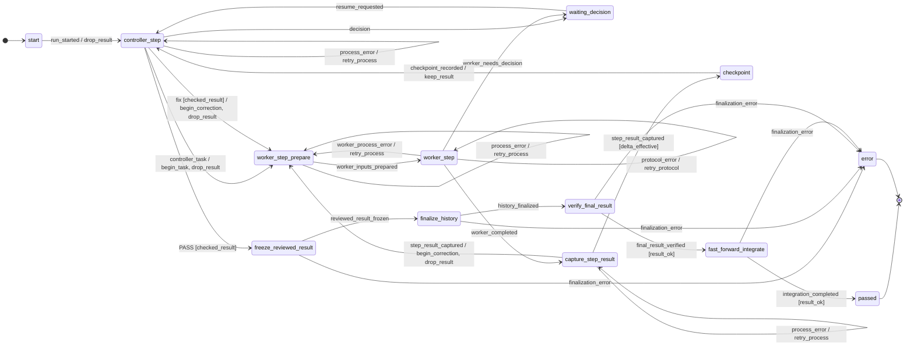
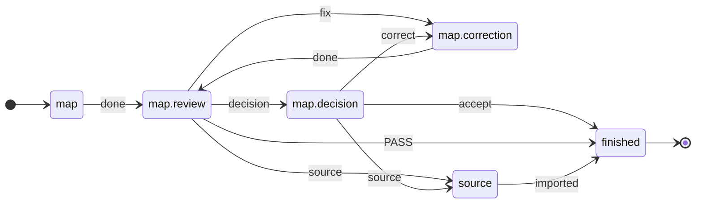

<p align="right">Deutsch | <a href="README.en.md">English</a></p>

# ki-dev

**Coding-Agenten arbeiten, ein Ablauf aus TOML entscheidet, was danach passiert.**
Umsetzung, getrenntes Review, Korrektur, Integration: Kein Agent beauftragt
den nächsten, kein Mensch reicht jede Antwort von Hand weiter.

🚧 **In Entwicklung, noch nicht betriebsbereit.** Ablaufsteuerung,
Korrekturschleife und Adapter für Claude Code und Codex laufen. Es fehlen
noch das Test-Tor vor der Integration und Budgetgrenzen auf allen Pfaden.

## Inhalt

1. [Warum](#warum)
2. [Beispiel: ein Bug, zwei Agenten](#beispiel-ein-bug-zwei-agenten)
3. [Was im Lauf passiert](#was-im-lauf-passiert)
4. [Ausprobieren ohne Agenten](#ausprobieren-ohne-agenten)
5. [Stand](#stand)
6. [Aufbau](#aufbau)
7. [Mitmachen](#mitmachen)

## Warum

Wer mit Coding-Agenten arbeitet, wird zum Boten: Kontext geben, Ergebnis
prüfen, Nachbesserung zurückreichen. Dazu melden Agenten „fertig“, auch
wenn es nicht stimmt.

ki-dev legt diese Steuerung in Dateien:

- **Ablauf** (`flow/*.toml`): wer wann dran ist, wohin `fix` führt, wann
  der Mensch entscheidet.
- **Profil** (`.ki-dev/profiles/*.toml`): wer die Rollen übernimmt, also
  Claude Code, Codex, ein Mensch oder ein Mock.
- **Auftrag** (ein Vorgang in [Beads](https://github.com/steveyegge/beads)):
  was zu tun ist, mit Abnahmekriterien.

Agenten arbeiten innerhalb eines Zustands; den Übergang wählt ki-dev.
Hintergrund: Workflows mit Prüfstellen statt frei steuernder Agenten
([Anthropic](https://www.anthropic.com/engineering/building-effective-agents));
vorzeitiger Abschluss und fehlende Verifikation als typische Fehler von
Mehr-Agenten-Systemen ([MAST](https://arxiv.org/html/2503.13657v3)).

<sub>[↑ Inhalt](#inhalt)</sub>

## Beispiel: ein Bug, zwei Agenten

In einem kleinen Repo liefert `add(a, b)` das Ergebnis `a - b`.
Codex soll es beheben, Claude Code prüft.

**1 · Auftrag anlegen**

```bash
bd create "add() addiert nicht" \
  --description "add(2, 3) liefert -1" \
  --design "add.py korrigieren; test_add.py nicht ändern" \
  --acceptance "add(2, 3) == 5 und add(-1, 1) == 0"
# → rechner-7k2, die ID des Auftrags
```

**2 · Ablauf: mitgeliefert.** Der Teil, der die Korrekturschleife ausmacht,
aus [`implement.toml`](src/ki_dev/flow/implement.toml):

```toml
# Review sagt „fix“, keine Runde mehr übrig → Halt, der Mensch entscheidet
[[statechart.states.active.states.controller_step.transitions]]
event = "fix"
cond = "checked_result"
unless = "changes_rounds_left"
on = [{ raise = { event = "escalation.changes_rounds_exhausted" } }]

# sonst → zurück zur Umsetzung, Rundenzähler +1
[[statechart.states.active.states.controller_step.transitions]]
event = "fix"
cond = "checked_result"
target = "worker_step_prepare"
on = ["begin_correction", "drop_result"]
```

Der Agent liefert nur sein Urteil (`fix` oder `PASS`); welche Kante folgt,
entscheidet ki-dev. Die erste passende Kante gewinnt.

**3 · Rollen festlegen** in `.ki-dev/profiles/default.toml`:

```toml
workdir = "/home/me/rechner-arbeit"     # Arbeits-Worktree der Agenten
access_profile = "write"

[worker]                                # setzt um
executor = "codex"
session_id = "019a…"                    # bestehende Codex-Sitzung
model = "gpt-5.6-terra"
effort = "high"

[review]                                # prüft, in eigener Sitzung
executor = "claude"
session_id = "b3f1…"                    # bestehende Claude-Code-Sitzung
model = "sonnet"
effort = "high"

[[tests]]                               # läuft je Runde, Ergebnis ans Review
name = "pytest"
argv = [".venv/bin/python", "-m", "pytest", "-q"]

[limits]
changes_rounds = 3                      # danach fragt ki-dev den Menschen

[finalization]                          # wohin ein akzeptiertes Ergebnis geht
target_workdir = "/home/me/rechner"
target_ref = "refs/heads/main"
commit_message = "add() korrigiert"
data_mode = "file_proposal"
```

**4 · Starten**

```bash
ki-dev -f implement rechner-7k2      # Ablauf implement, Profil default
ki-dev -f implement status RUN_ID    # wo steht der Lauf?
ki-dev -f implement resume RUN_ID    # nach einem Halt weiter
```

**Stand dieses Beispiels:** Ablauf, Profilformat und Befehle sind echt,
die Adapter für Codex und Claude Code gebaut. Noch offen: ein abgenommener
Lauf mit echten Agenten, und rote Tests halten die Integration noch nicht auf.

<sub>[↑ Inhalt](#inhalt)</sub>

## Was im Lauf passiert

Spur aus `events.jsonl` eines Laufs, gekürzt. Die Kanten sind mit Agenten
und mit Mocks dieselben:

```text
controller_step ─controller_task→ worker_step              # Auftrag an Codex
worker_step ─worker_completed→ capture_step_result         # Codex hat geändert
capture_step_result ─step_result_captured→ checkpoint      # Diff und pytest als Nachweis
checkpoint ─checkpoint_recorded→ controller_step           # Claude prüft
controller_step ─fix→ worker_step_prepare                  # Runde 2
  … dieselben Schritte …
controller_step ─PASS→ freeze_reviewed_result              # akzeptiert
fast_forward_integrate ─integration_completed→ passed      # Fast-Forward auf main
```

Jeder Zwischenstand liegt als Artefakt im Laufverzeichnis; ein Halt lässt
sich mit `resume` fortsetzen.

<details>
<summary>Ganzer Ablauf als Diagramm, aus der TOML erzeugt</summary>

`ki-dev flow show implement --without-escalations`, ohne Grenz- und Schutzhalte:

<!-- ki-dev flow show implement --without-escalations -->


</details>

<sub>[↑ Inhalt](#inhalt)</sub>

## Ausprobieren ohne Agenten

<!-- readme-script: readme-scripts/1-setup.sh -->
> ⬜ nicht ausgeführt · selbst prüfen: make readme-check

Die Demo legt ein Wegwerf-Repo mit Auftrag und Profil an; Mock-Umsetzer
und Mock-Review (`fix`, dann `PASS`) spielen das Beispiel ohne
Anbieterzugang durch. Die Statuszeile oben gilt der Einrichtung im
leeren Container.

Braucht Python ≥ 3.12, git ≥ 2.32, make, Go und einen C-Compiler:
`make setup` baut [Beads](https://github.com/steveyegge/beads) `bd` aus
dem Quellcode ins Projekt-venv (beim ersten Mal einige Minuten, mit Netz).
`$REPLACE_WITH_REPOSITORY_URL` = Klon-Adresse dieses Repos.

```bash
git clone "$REPLACE_WITH_REPOSITORY_URL" ki-dev
cd ki-dev
make setup
make demo
```

Ausgabe (gekürzt, Hashes wechseln):

```text
{
  "run_id": "demo",
  "status": "passed",
  "round_id": 2,
  "detail": "Fast-forward integriert"
}

ad543c6 Geprüfter Abschluss (Demo)
091d542 start
```

`round_id: 2`: eine Korrekturrunde. `passed`: das Mock-Review hat
akzeptiert, das Ergebnis liegt per Fast-Forward auf `main`. Die Mocks
schreiben nur eine Textzeile; die Demo zeigt die Steuerung, nicht die
Arbeit eines Agenten.
<!-- /readme-script -->

<sub>[↑ Inhalt](#inhalt)</sub>

## Stand

**Läuft**

- Abläufe als TOML-Statecharts auf
  [python-statemachine](https://python-statemachine.readthedocs.io/).
  In `implement` verbraucht jede Rückkante einen Zähler; ein
  [Test](tests/machine/test_reachability.py) zählt den Zustandsraum durch:
  kein Zyklus ohne Mensch läuft unbegrenzt.
- `implement` vom Auftrag bis zur Fast-Forward-Integration, mit Halt und
  `resume`; vorgeführt mit Mock-Agenten.
- Adapter: Claude Code, Codex, Mensch (`manual`, `inbox`), Mock.
- Schutzhalt bei Kontext-, Kontingent- und Budgetgrenze für `claude`;
  `codex` ohne Kontextmessung.
- `step`: zeigt für jeden Zustand die Übergabe an einen Agenten, ohne
  einen zu starten.

**Im Bau**

- Test-Tor: Heute integriert ein Review-`PASS` auch bei roten Tests.
- Ein gemeinsamer Ausführer für `implement` und `step`, damit die Grenzen
  überall greifen.
- Ein abgenommener Lauf mit echten Agenten.

**Ziel V1:** vier Abläufe, von Hand verkettet. Anforderungen kartieren
(`map`) → Abhängigkeiten (`graph`) → ausführbare Aufträge (`materialize`) →
Umsetzung (`implement`). Die ersten drei gibt es heute als Review-Abläufe,
bedient von Hand über `step`.

<!-- readme-script: readme-scripts/3-review-gate.sh -->
> ❌ rot, erwartet (Spezifikation) · 2026-10-17 · selbst prüfen: .venv/bin/pytest -q --runxfail tests/test_review_gate_cli.py · [Stand](#stand)

**Wann ist das Test-Tor fertig?** Wenn dieser Test grün ist. Er startet
`ki-dev -f implement` gegen ein Wegwerf-Repo mit falschem `add.py`
(`a - b`); die Tests sind rot, das Mock-Review sagt trotzdem `PASS`.

```bash
.venv/bin/pytest -q --runxfail tests/test_review_gate_cli.py
```

```text
E   tests.test_review_gate_cli.IntegratedDespiteRedTests: 3e696bb -> d14aedd: Fast-forward integriert
FAILED tests/test_review_gate_cli.py::test_red_tests_and_review_pass_do_not_integrate
1 failed, 4 passed
```

Heute landet das Ergebnis trotz roter Tests auf `main`. Die vier grünen
Fälle prüfen den Test selbst, etwa: grüne Tests plus `PASS` integrieren.
<!-- /readme-script -->

<sub>[↑ Inhalt](#inhalt)</sub>

## Aufbau

| Teil | Aufgabe |
| --- | --- |
| `flow/*.toml` | Zustände, Kanten, Wächter: was nach welchem Urteil passiert |
| `runner/` | prüft die Antwort, nimmt die Kante, baut die nächste Übergabe |
| `adapter/` | gibt die Übergabe an Claude Code, Codex, einen Menschen oder den Mock |

Gemeinsame Muster liegen einmal im Katalog. `map`, `graph` und
`materialize` setzen nur Parameter auf das Review-Muster
([`map.toml`](src/ki_dev/flow/map.toml)):

<!-- ki-dev flow show map -->


Ohne Agenten von Hand durchspielen:

```bash
ki-dev flow show map                                    # Ablauf als Mermaid
ki-dev -f map step BEAD map                             # Übergabe an den Kartierungsagenten
ki-dev -f map step BEAD map.review map.review=urteil.json  # Urteil zurück, nächste Übergabe
```

Beide Diagramme erzeugt `ki-dev flow show` aus der Quelle; ein Test
vergleicht sie mit diesem README.

<sub>[↑ Inhalt](#inhalt)</sub>

## Mitmachen

Gute Einstiege, je mit klarer Abnahme:

- **Test-Tor bauen**: fertig, wenn der rote Test oben grün ist.
- **Rundenzähler im Review-Muster**: `map`, `graph`, `materialize` zählen
  ihre Korrekturrunden noch nicht.
- **Ein Ausführer**: `implement` auf den gemeinsamen Ausführer umstellen.

Mehr dazu: [Was in der Architektur fehlt](docs/ausfuehrer-luecken.de.md).

```bash
make test           # pytest und ruff
make spec-test      # Anforderungstests; rote Ergebnisse sind zulässig
make readme-check   # README-Einrichtung im Wegwerf-Container, braucht Docker
```

<!-- readme-script: readme-scripts/2-runtime.sh -->
> ⬜ nicht ausgeführt · selbst prüfen: make setup-runtime

Wer ki-dev mit ki-dev weiterentwickelt, installiert es getrennt vom
Quellbaum: eigenes venv, Symlink in `~/.local/bin`. Vor einem Update
laufende Läufe abschließen ([Details](docs/self-development.de.md)).

```bash
make setup-runtime
export PATH="$HOME/.local/bin:$PATH"
ki-dev --help
```
<!-- /readme-script -->

Weiterlesen: [Ausführer und Profile](docs/ausfuehrer.de.md) ·
[`step` und Übergaben](docs/step.de.md) ·
[Ablaufpakete](docs/ablaufpakete.de.md) ·
[CLI-Adapter](docs/cli-adapters.md) ·
[Zielbild](docs/zielbild.de.md)

Fragen, Ideen, Zusammenarbeit: ein Issue öffnen oder
[@blaumohn](https://github.com/blaumohn) direkt ansprechen.
Lizenz: [MIT](LICENSE).

<sub>[↑ Inhalt](#inhalt)</sub>
