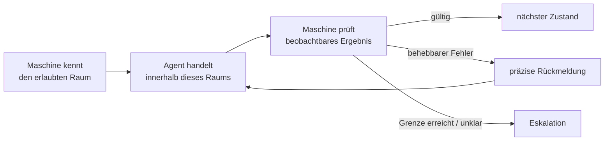
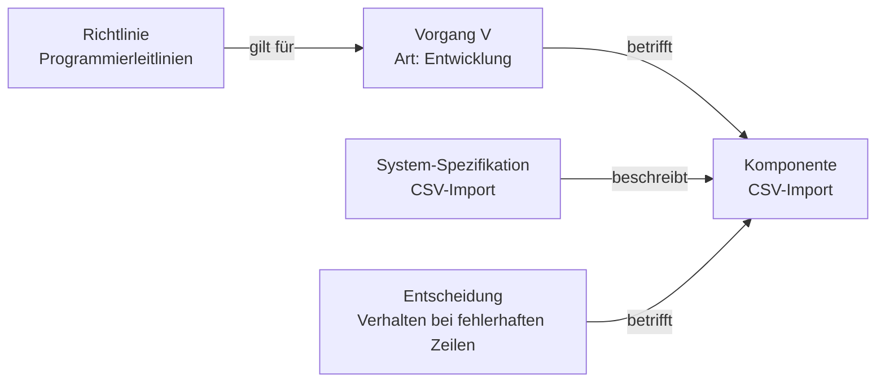
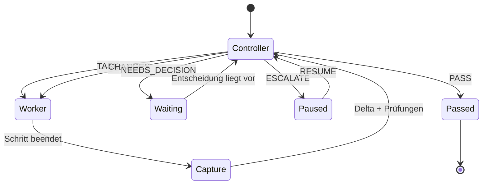
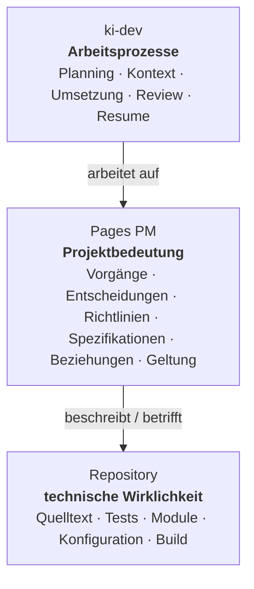
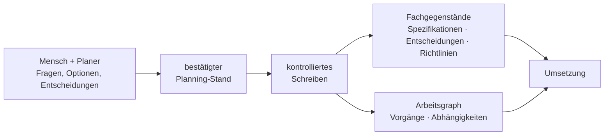
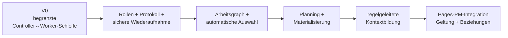

<p align="right">Deutsch | <a href="README.en.md">English</a></p>

---

# ki-dev

<!-- mdman:toc:start -->
- [ki-dev in 30 Sekunden](#ki-dev-in-30-sekunden)
- [Stand heute](#stand-heute)
- [Für wen – und welche Arbeit fehlt](#für-wen--und-welche-arbeit-fehlt)
- [Vom Hinweis zur erzwungenen Regel](#vom-hinweis-zur-erzwungenen-regel)
- [Was es bereits gibt](#was-es-bereits-gibt)
- [Die deterministische Arbeitsumgebung](#die-deterministische-arbeitsumgebung)
- [Vom Vorgang zum Arbeitskontext](#vom-vorgang-zum-arbeitskontext)
- [Controller und Worker](#controller-und-worker)
- [Repository – Pages PM – ki-dev](#repository--pages-pm--ki-dev)
- [Von Planung zu Projektwissen](#von-planung-zu-projektwissen)
- [Bootstrap und Zielrichtung](#bootstrap-und-zielrichtung)

---
<!-- mdman:toc:end -->


## ki-dev in 30 Sekunden

`ki-dev` schafft eine kontrollierte Entwicklungsumgebung für KI-gestützte
Projektarbeit. Es verbindet Planung, gezielten Arbeitskontext, Umsetzung,
Prüfung und Projektzustand über einen deterministischen Orchestrator.

> **Projektbedeutung → deterministisch zugeschnittener Arbeitsraum → KI-Urteil**

Die Maschine trägt, was sich zuverlässig festlegen lässt:

```text
Zustand · zulässige Übergänge · Rollenfolge · Schrittgrenzen
Wiederholungsgrenzen · Nachrichtenform · Änderungsnachweise
geltender Kontext
```

Die KI urteilt dort, wo tatsächlich Urteil nötig ist:

```text
Wie setze ich das um? · Ist diese Umsetzung richtig?
Welche technische Lösung passt? · Trägt die Annahme des Vorgangs noch?
```

> **Status: aktive Entwicklung (Bootstrap).**
> Arbeitsgraph und Entwurfsstand bestehen bereits; der erste ausführbare
> `ki-dev`-Kern wird derzeit aufgebaut. Das in diesem README beschriebene
> Zielsystem ist **noch nicht umgesetzt**.

---

## Stand heute

Dieses README erklärt eine Architektur, die bewusst weiter reicht als der
heutige Umsetzungsstand. Die folgende Grenze gilt für alles Weitere:

**Heute vorhanden:**

```text
Entwurfs- und Planungsstand   → schriftlich festgehalten
bd                            → gegenwärtiger Arbeitsgraph
Git                           → tatsächlicher technischer Bestand
erster ausführbarer
Controller↔Worker-Kern        → im Aufbau
```

**Zielbild, noch nicht umgesetzt:**

```text
weitergehendes Planning
Materialisierung von Planungsergebnissen
regelgeleitete Kontextableitung
spätere Pages-PM-Integration
```

Der lebende Arbeitsstand wird hier deshalb nicht als Vorgangsliste
nachgeschrieben. Er liegt im Beads-Arbeitsgraphen.

Im geklonten Repository lässt er sich beispielsweise mit `bv` ansehen.[^bv]

[^bv]: Zum Beispiel: `cd <repository>`, dann `bv`. Für eine statische, teilbare
    Ansicht: `bv --pages`.

Die ausführlichere Bootstrap- und Zielrichtungserklärung folgt weiter unten
unter [Bootstrap und Zielrichtung](#bootstrap-und-zielrichtung).

---

## Für wen – und welche Arbeit fehlt

`ki-dev` richtet sich besonders an kleine Teams und Open-Source-Projekte, in
denen Planung, Projektpflege, Umsetzung und Prüfung bei denselben wenigen
Beteiligten zusammenkommen.

Ein wesentlicher Engpass liegt dort oft nicht nur in der Programmierarbeit,
sondern in der Arbeit dazwischen:

```text
Planung
→ gültige Projektdokumentation
→ sinnvoll geschnittene Vorgänge
→ Abhängigkeiten
→ richtiger Arbeitskontext
→ kontrollierte Umsetzung
→ Prüfung
→ Rückführung neuer Erkenntnisse
```

In größeren Organisationen verteilt sich diese Zwischenarbeit auf
Produktmanagement, technische Leitung, Projektmanagement und feste
Review-Prozesse. Im kleinen Projekt fällt sie auf dieselben Entwickler zurück.

Coding-Agenten reduzieren Implementierungsarbeit, beseitigen diese
Zwischenarbeit aber nicht. Bei mehreren Agentenläufen entsteht zusätzlich
Steuerungs- und Rückführungsarbeit: Sitzung öffnen, Zusammenhang erklären,
Ergebnis prüfen, Erkenntnis zurücktragen.

---

## Vom Hinweis zur erzwungenen Regel

Eine Regel ist nicht zuverlässig durchgesetzt, nur weil sie irgendwo im Prompt
steht.

```text
nur Prompt:

„Denke daran, bei einer Graphabweichung zu eskalieren.“

→ Die Regel ist Text.
→ Der Agent muss sie gerade beachten.


ki-dev:

aktueller Zustand
→ Die Maschine stellt die Graphprüfung ausdrücklich.
→ Mögliche Antworten werden sichtbar gemacht.
→ Das Ergebnisformat wird geprüft.
→ Der Übergang wird maschinell erzwungen.
```

Daraus folgt der Leitgedanke des Entwurfs:

> **Wichtige Bedingungen werden möglichst von passivem Kontext in aktive,
> prüfbare Ablaufbedingungen überführt.**

Das lässt sich stufen:

```text
1. Information irgendwo im Prompt
   → Der Agent könnte sie beachten.

2. Information im richtigen Zustand aktiv hervorgehoben
   → Der Agent wird darauf aufmerksam gemacht.

3. zulässige Antworten begrenzt
   → Es werden nur passende Züge angeboten.

4. Ausgabe strukturell geprüft
   → Eine ungültige Antwort wird zurückgewiesen.

5. Wirkung unabhängig beobachtet
   → Diff, Tests, Schemaprüfung statt Selbstauskunft.

6. Grenze maschinell erzwungen
   → nach fünf Korrekturrunden keine sechste normale Runde.
```

Geringerer Tokenverbrauch ist eine Folge davon – nicht die Architekturidee.

---

## Was es bereits gibt

`ki-dev` erfindet weder deterministische Orchestrierung noch autonome
Coding-Agenten. Beides existiert bereits.

```text
Coding-Agenten (Claude Code, Codex)
→ führen Entwicklungsarbeit aus

Ralphex
→ automatisiert Implementierung und umfangreiche Review-Schleifen
  mit mehreren Prüfagenten und begrenzbaren Iterationen

LangGraph / CrewAI Flows
→ allgemeine Bausteine für zustandsbehaftete Agentenabläufe

OpenHands
→ umfassendere Coding-Agenten-Laufzeit

ki-dev
→ verbindet solche Agentenläufe mit Projektbedeutung,
  gezieltem Kontext und einem expliziten Entwicklungsvertrag
```

`ki-dev` zielt nicht auf eine neue Agentenlaufzeit. Es hält Zustände,
Übergänge, Grenzen, Änderungsnachweise und später auch die Ableitung des
geltenden Projektkontexts außerhalb der Agentensitzung fest. Vorhandene
Claude- und Codex-CLIs bleiben ausführende Werkzeuge.

Quellen zur Einordnung: [Ralphex](https://github.com/umputun/ralphex),
[LangGraph](https://docs.langchain.com/oss/python/langgraph/overview),
[CrewAI](https://docs.crewai.com/),
[OpenHands](https://docs.openhands.dev/sdk).

---

## Die deterministische Arbeitsumgebung

Ab hier tauchen drei Begriffe durchgehend auf:

```text
Controller → Rolle, die einen begrenzten Arbeitsschritt bestimmt und
             anschließend dessen Wirkung prüft
Worker     → Rolle, die genau diesen einen begrenzten Arbeitsschritt ausführt
Executor   → technisches Werkzeug, das eine solche Rolle ausführt,
             z. B. die Claude CLI oder die Codex CLI
```

Controller und Worker sind Rollen im Ablauf; ein Executor ist das Werkzeug, mit
dem eine Rolle besetzt wird. Dieselbe CLI kann in einem Lauf den Worker geben
und in einem anderen den Controller – Rolle und Werkzeug sind nicht dasselbe.

Die Controller↔Worker-Dynamik hat dabei eine feste Grundform:

```text
Controller → TASK
Worker     → Änderung
Maschine   → Delta / Prüfungen
Controller → PASS | CHANGES | NEEDS_DECISION | ESCALATE
```

Der Controller schneidet einen Schritt zu, der Worker führt ihn aus, die
Maschine macht die Änderung unabhängig sichtbar, der Controller urteilt über das
beobachtete Ergebnis. Der ausführliche Zustandsablauf folgt unter
[Controller und Worker](#controller-und-worker).

Ohne eine solche äußere Orchestrierung muss ein Agentenlauf leicht mehrere
Aufgaben gleichzeitig übernehmen:

1. die Fachaufgabe zu lösen,
2. den Projektzustand zusammenzusuchen,
3. den Arbeitsablauf zu verwalten,
4. den Stand der Korrekturrunden im Blick zu behalten,
5. Nachrichtenformate zu erraten,
6. Änderungen zu rekonstruieren und
7. zu entscheiden, welche Übergänge erlaubt sind.

Die Punkte 2 bis 7 sollen, soweit sie strukturell bestimmbar sind, nicht jedes
Mal von der KI rekonstruiert werden.

Man kann diese Umgebung wie ein begrenztes Spiel verstehen: Der Orchestrator
kennt Zustand, Regeln und erlaubte Züge; der Agent entscheidet innerhalb dieses
Raums, und die Maschine prüft anschließend wieder die Grenzen.



Schemaprüfung, Auswahlbegrenzung, Rundenbegrenzung und Deltaerfassung sind
nicht vier lose Funktionen, sondern vier Anwendungen derselben Regel:

- ungültiges Nachrichtenschema → genaue Fehlermeldung → erneuter, **begrenzter**
  Versuch;
- Controller-Zustand → nur die gerade zulässigen Urteile werden angeboten;
- Korrekturrunde 5 von 5 → keine sechste normale Runde;
- Graphprüfung → im passenden Zustand ausdrücklich gestellt;
- Worker behauptet nichts über seine Änderung → die Maschine erzeugt Git- und
  Dolt-Deltas.

**Die Maschine begrenzt Schleifen.** Ein Agent darf eine Korrektur erneut
versuchen, aber nicht unbegrenzt. Ein Prompt kann immer wieder „Versuch es noch
einmal“ sagen; der Orchestrator kennt Runde und Obergrenze und erzwingt danach
einen sicheren Ausstieg nach `ESCALATE`. Der Agent soll nicht selbst bemerken
müssen, dass bereits die fünfte gleichartige Korrekturrunde erreicht ist.

**Die Wirkung zählt, nicht die Selbstauskunft.** Ein Worker soll nicht erklären
müssen, was er geändert hat. `ki-dev` beobachtet es: für Quelltext über
`git diff` zwischen den Commits vor und nach dem Schritt, für den Arbeitsgraphen
`bd` über dessen Dolt-Versionierung.

```text
Worker behauptet etwas
≠
System beobachtet eine Änderung
```

---

## Vom Vorgang zum Arbeitskontext

Ein konkreter Fall:

> **Vorgang V:** Der CSV-Import soll bei Fehler X – einer Zeile mit ungültigem
> Datumsformat – die betroffene Zeile überspringen und protokollieren, statt den
> gesamten Import abzubrechen.

Dazu gibt es bereits eine Programmierrichtlinie (*Fehlerfälle brauchen einen
Test*), eine System-Spezifikation für das CSV-Import-Modul, eine Entscheidung
über das Verhalten bei fehlerhaften Zeilen sowie bestehenden Quelltext und
Tests.

Ohne zusätzliche Struktur bekäme ein Agent das ganze Repository samt vieler
Projektdokumente und müsste selbst suchen. `ki-dev` schneidet den Arbeitsraum
entlang von Beziehungen zu:



Daraus kann regelhaft folgen:

```text
Kontext für Vorgang V
=
Vorgang
+ geltende Programmierrichtlinien
+ relevanter Teil der CSV-Import-Spezifikation
+ maßgebliche Entscheidung zu Fehler X
```

Ein Pokerspieler bekommt nicht das ganze Kartenspiel mit der Auflage, sich zu
merken, welche Karten wohl gelten. Er bekommt die Karten, mit denen dieser Zug
gespielt wird.

---

## Controller und Worker

Controller und Worker wurden oben als Rollen eingeführt; im Ablauf hat jede eine
genauere Ausprägung. Der **Worker** verändert Quelltext, Tests oder
Arbeitsbestand und meldet nur außergewöhnliche Situationen semantisch – etwa
eine fehlende Entscheidung. Der **Controller** bestimmt oder prüft den Auftrag,
beurteilt die tatsächlich entstandene Wirkung, fordert Änderungen an oder nimmt
den Stand an – und prüft auch, ob der Arbeitsgegenstand selbst noch sinnvoll
geschnitten ist.



Für Vorgang V sieht der Controller keinen langen Rollen-Prompt, sondern einen
Zustand mit sichtbarem Aktionsraum:

```text
Vorgang: Verhalten des CSV-Imports bei Fehler X

Runde: 2 von 5

Offene Beanstandung:
Test für Fehler X fehlt.

Aktuelle Änderung:
<Git-Schrittdelta der letzten Worker-Runde>

Arbeitsgraph:
[ ] Vorgang bleibt richtig
[ ] Graphänderung erforderlich
[ ] Graphverbesserung sinnvoll

Zulässige Urteile:
- PASS
- CHANGES
- NEEDS_DECISION
- ESCALATE
```

Das ist schwerer zu übersehen als ein Satz auf Seite 17 eines Rollen-Prompts.
Die Auswahl hilft beim Urteil; die Maschine prüft die Antwort trotzdem erneut.

Wie fein diese äußere deterministische Steuerung sinnvollerweise sein sollte,
ist eine offene empirische Entwurfsfrage von `ki-dev`. Zunächst setzt `ki-dev`
praktisch auf begrenzte, beobachtbare Worker-Schnitte mit anschließender
erneuter Controller-Steuerung. Ob diese Form gegenüber gröberer Ausführung oder
einer klassischen Worker→Reviewer-Schleife tatsächlich bessere Ergebnisse
liefert, soll später vergleichend untersucht werden.

---

## Repository – Pages PM – ki-dev

Damit der Kontextzuschnitt regelhaft möglich wird, braucht es eine Ebene, die
Projektbedeutung führt. Langfristig gehören drei Ebenen zusammen, ohne dieselbe
Aufgabe zu haben.



Das **Repository** bleibt die technische Wirklichkeit. Dort liegt, *was gebaut
ist*.

**Pages PM** führt die strukturierte Bedeutung darüber: Welche Gegenstände gibt
es, wie hängen sie zusammen, was gilt für was, welche Entscheidung ist noch
gültig, welche Herkunft gehört dazu? Genau daraus lässt sich der Arbeitskontext
für Vorgang V ableiten, statt ihn von Hand zusammenzustellen.

**`ki-dev`** verwendet diese Bedeutung im Ablauf: Welche Arbeit läuft jetzt,
welcher Kontext gilt dafür, welche Rolle arbeitet, was wurde tatsächlich
geändert, was prüft der Controller, welcher Übergang ist erlaubt?

> **Pages PM bestimmt langfristig, welche Projektinformation gilt und wie sie
> zusammenhängt.
> `ki-dev` bestimmt, wie ein konkreter KI-gestützter Arbeitsprozess darauf
> abläuft.**

```text
Repository → was technisch existiert
Pages PM   → was projektfachlich gilt
ki-dev     → wie darauf gearbeitet wird
```

`ki-dev` ist daher kein Ersatz für das Repository, keine zweite
Quelltextwahrheit neben Git und langfristig kein zweites
Projektinformationssystem neben Pages PM.

---

## Von Planung zu Projektwissen

`ki-dev` soll nicht nur fertige Umsetzungsvorgänge ausführen. Zum Zielbild
gehört ein kontrollierter Weg von menschlich geführter Planung zu dauerhafter
Projektinformation.



Die Planung darf offen und dialogisch sein. Die Materialisierung soll es nicht
sein. Aus einem Gespräch wie „Ein einzelner Zeilenfehler darf den CSV-Import
nicht abbrechen; die Zeile soll übersprungen und protokolliert werden, dafür
brauchen wir einen Test“ entstehen unterschiedliche dauerhafte Aussagen:

```text
System-Spezifikation → welches Verhalten das System besitzen muss
Entscheidung         → warum das Überspringen dem Abbruch vorgezogen wurde
Richtlinie           → welche allgemeine Entwicklungsregel gilt
Vorgang              → welche Arbeit konkret auszuführen ist
Nachweisbeziehung    → welche Umsetzung und welcher Test das belegen
```

Ein einzelnes großes „Planungsdokument“ muss dann nicht auf Dauer gleichzeitig
Architektur, Entscheidungssammlung, Ablaufbeschreibung und Aufgabenliste sein.

---

## Bootstrap und Zielrichtung

Pages PM ist keine Voraussetzung für den ersten nutzbaren `ki-dev`-Stand. Der
Bootstrap verwendet vorhandene, einfachere Wahrheiten:

- `bd` führt den Arbeitsgraphen;
- Git führt Quelltext und technische Änderungen;
- kleine Fachdateien halten normative Aussagen vorläufig im Repository;
- `ki-dev` automatisiert als Erstes die Controller↔Worker-Kontrollschleife –
  genau dieser Kern wird derzeit gebaut;
- Pages-PM-Integration, vollständiges Planning und weitergehende
  Kontextableitung folgen später.

Der Betrieb bleibt dabei bewusst klein – ein Merkmal des Bootstrap, kein
architektonisches Alleinstellungsmerkmal:

```text
lokal angemeldete Claude- oder Codex-CLI
+ lokaler ki-dev-Orchestrator
```

Welche CLI eine Rolle bedient, ist Teil der Rollenbelegung
(`executor` + `model` + `effort`). Ein Lauf kann beide Werkzeuge mischen – etwa
Claude als Worker und Codex als Controller –, muss es aber nicht.

`ki-dev` braucht dafür weder eigene Anbieter-API-Schlüssel noch eine eigene
Abrechnungsschicht noch einen zusätzlichen Orchestrierungsdienst. Der
ausführbare Vertrag der beiden CLI-Adapter steht in
[`docs/cli-adapters.md`](docs/cli-adapters.md).

Die Weiterentwicklung folgt dem Grundsatz: kein allgemeines Agentensystem auf
Vorrat bauen, sondern jeden nächsten deterministischen Baustein aus einem echten
Arbeitsproblem ableiten.



Das ist keine starre Versionsliste, sondern eine Richtung: von manueller
Kopierarbeit über eine kleine ausführbare Kontrollmaschine hin zu strukturierter
Kontextbildung und einem gemeinsamen Projektinformationsmodell mit Pages PM.

Reale `ki-dev`-Abläufe dienen zugleich als Erprobung für Pages PM: Welche
Beziehungen braucht Kontextbildung wirklich? Welche Aussage braucht eine eigene
Identität? Welche Richtlinie muss automatisch in welchem Vorgang gelten?

Was `ki-dev` dabei ausdrücklich **nicht** werden soll: ein Chatbot, der
„irgendwie das Repository erledigt“; ein unbegrenzter Agentenloop, der bis zum
Erfolg weiterläuft; ein Vorwand, große Mengen Projektkontext in jeden Prompt zu
laden; ein anbieterspezifischer Workflow, dessen Fachlogik von einer bestimmten
Claude- oder Codex-Sitzung abhängt.

> **Nicht mehr KI für die Verwaltung von KI-Arbeit einsetzen als nötig.
> Struktur, Zustand und Kontext maschinell begrenzen – und die KI für die
> eigentliche Entwicklungs- und Prüfarbeit verwenden.**
