# ki-dev

`ki-dev` ist eine Arbeitsweise und ein lokaler Orchestrator für KI-gestützte
Softwareentwicklung in kleinen Teams und Open-Source-Projekten.

Das Grundproblem ist nicht, dass KI-Agenten zu wenig können. Häufig müssen sie
bei jedem Schritt **zu viel selbst rekonstruieren**:

- Was ist gerade die eigentliche Aufgabe?
- Welche Entscheidungen gelten dafür?
- Welche Richtlinien muss ich beachten?
- Welcher Teil der Systemdokumentation ist betroffen?
- Was hat der vorige Agent tatsächlich geändert?
- Welche nächsten Schritte sind jetzt überhaupt zulässig?

Wenn all das nur in langen Prompts, Gesprächen und Dateien steckt, wird
Projektstruktur zu einer Aufmerksamkeitsfrage: Der Agent muss sie finden,
richtig deuten und im richtigen Augenblick beachten. Das kostet Kontext und
macht gleiche Abläufe unnötig verschieden.

`ki-dev` dreht dieses Verhältnis um:

> **Die Maschine verwaltet, was deterministisch ist.  
> Die KI urteilt dort, wo wirklich Urteil nötig ist.**

---

## Die Idee in einem Beispiel

Nehmen wir während des ganzen README denselben kleinen Entwicklungsvorgang:

> **Vorgang V:** Beim Executor soll ein neuer Rückfallfall behandelt werden.

Dazu gibt es bereits:

- eine Programmierrichtlinie: *Fehlerfälle brauchen einen Test*;
- eine System-Spezifikation für das Executor-Modul;
- eine Entscheidung, wie Rückfälle behandelt werden;
- bestehenden Quelltext und Tests.

Ohne zusätzliche Struktur könnte ein Agent einfach das ganze Repository und
viele Projektdokumente erhalten und selbst suchen.

`ki-dev` soll stattdessen schrittweise einen kleinen, erklärbaren Arbeitsraum
bauen.

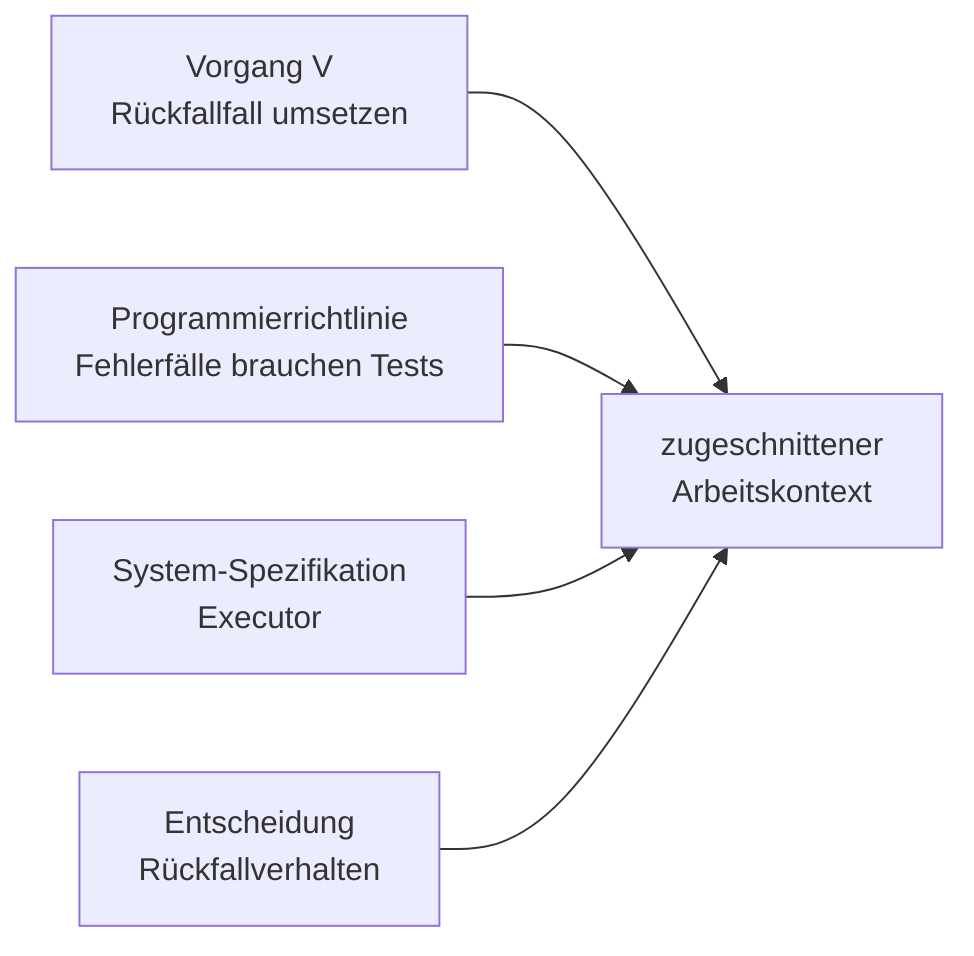

Der Agent bekommt also nicht einfach „das Projekt“, sondern die für diesen
Schritt relevante Hand.

---

## Warum ein „Spiel“?

Ein guter Agent sollte nicht gleichzeitig

1. die Fachaufgabe lösen,
2. den Projektzustand zusammensuchen,
3. den Arbeitsablauf verwalten,
4. Wiederholungen zählen,
5. Nachrichtenformate erraten,
6. Änderungen rekonstruieren und
7. entscheiden, welche Übergänge erlaubt sind.

Viele dieser Dinge sind keine KI-Aufgabe.

`ki-dev` behandelt einen Agentenlauf deshalb wie ein **begrenztes Spiel**:

- Die Maschine kennt den Zustand.
- Die Maschine kennt die erlaubten Züge.
- Die Maschine zeigt dem Agenten die gerade wichtigen Karten.
- Der Agent wählt oder bearbeitet nur den nichtdeterministischen Teil.
- Die Maschine prüft anschließend wieder die Grenzen.

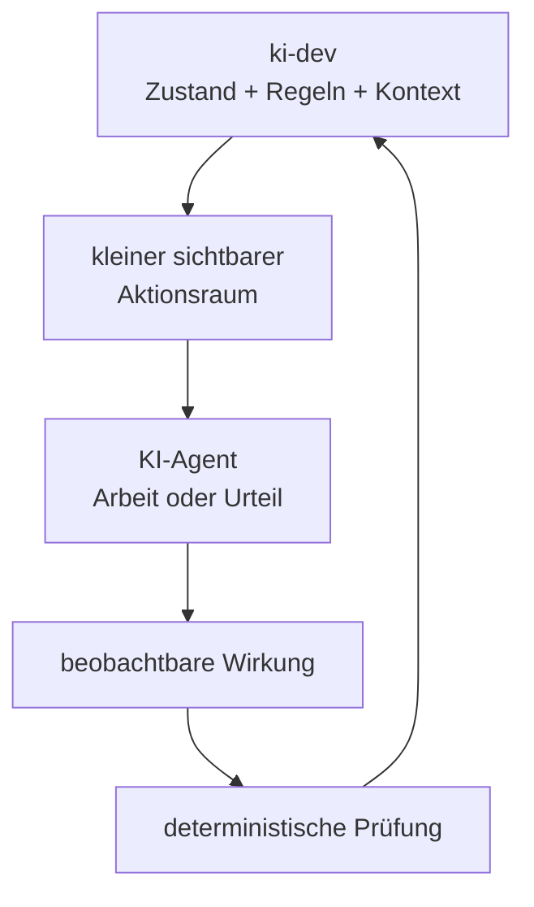

Beim Vorgang V kann ein Controller beispielsweise nicht beliebig irgendetwas
antworten, sondern erhält sinngemäß:

```text
Vorgang: Rückfallfall im Executor

Runde: 2 von 5

Offene Beanstandung:
Test für den Rückfallfall fehlt.

Aktuelle Änderung:
<Delta der letzten Worker-Runde>

Zulässige Urteile:
- PASS
- CHANGES
- NEEDS_DECISION
- ESCALATE
```

Die Auswahl hilft der KI beim Denken. Die Maschine prüft sie trotzdem erneut.

---

## Drei Ebenen: Repository, Pages PM, ki-dev

Langfristig gehören drei verschiedene Ebenen zusammen, ohne dieselbe Aufgabe zu
haben.

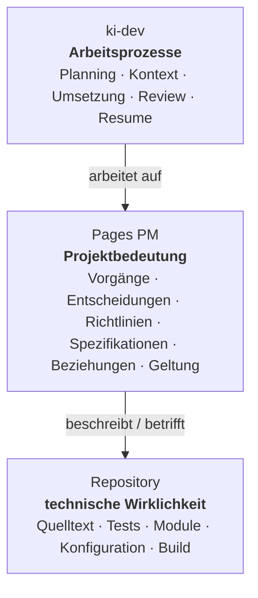

### Repository

Das Repository bleibt die technische Wirklichkeit:

```text
src/executor.py
tests/test_executor.py
pyproject.toml
...
```

Dort liegt, **was gebaut ist**.

### Pages PM

Pages PM ist langfristig die strukturierte Projektbedeutung darüber:

```text
Vorgang V
  betrifft → Executor

Richtlinie G
  gilt für → Entwicklung

Entscheidung D
  betrifft → Executor
```

Pages PM beantwortet damit Fragen wie:

- Welche Gegenstände gibt es?
- Wie hängen sie zusammen?
- Was gilt für was?
- Welche Entscheidung ist noch gültig?
- Welche Herkunft und welcher Verlauf gehören dazu?

### ki-dev

`ki-dev` verwendet diese Bedeutung im konkreten Arbeitsablauf:

```text
Welche Arbeit läuft jetzt?
→ welcher Kontext gilt dafür?
→ welche Rolle arbeitet?
→ was wurde tatsächlich geändert?
→ was prüft der Controller?
→ welcher Übergang ist jetzt erlaubt?
```

Für Vorgang V könnte die spätere Arbeitsteilung so aussehen:

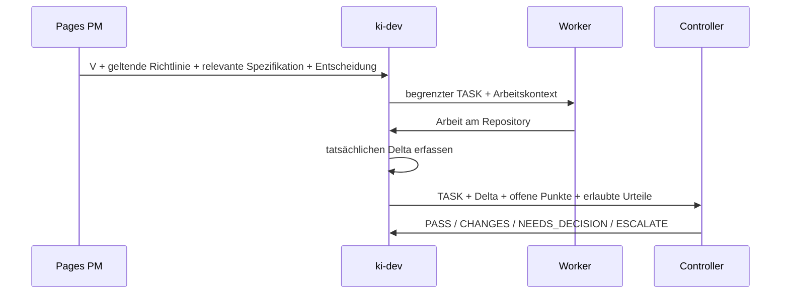

Wichtig ist die Grenze:

> **Pages PM bestimmt langfristig, was im Projekt gilt.  
> `ki-dev` bestimmt, wie ein konkreter KI-gestützter Arbeitsprozess darauf
> abläuft.**

`ki-dev` ist daher kein Ersatz für das Repository und langfristig auch kein
zweites Projektinformationssystem neben Pages PM.

---

## Kontext ist ein Graph, kein großer Prompt

Die Beziehungen im Projekt sind nicht nur Dokumentationsschmuck. Sie können
bestimmen, welcher Kontext für eine Tätigkeit relevant ist.

Für unser Beispiel:

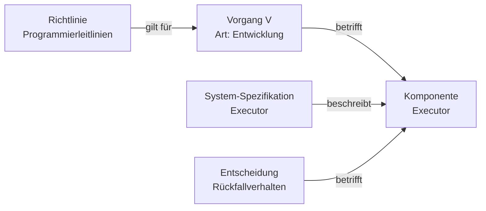

Daraus kann später regelhaft folgen:

```text
Kontext für Vorgang V
=
Vorgang
+ geltende Programmierrichtlinien
+ relevanter Teil der Executor-Spezifikation
+ maßgebliche Entscheidung
```

Das ist das Bild der **Karten auf der Hand**:

Ein Pokerspieler erhält nicht das ganze Kartenspiel und soll sich merken,
welche Karten wahrscheinlich gelten. Er bekommt genau die Karten, mit denen
dieser Zug gespielt wird.

Für KI-Agenten bedeutet das:

- weniger Sucharbeit;
- weniger wiederholter Kontext;
- weniger versteckte Ablaufregeln;
- weniger Abhängigkeit davon, ob eine wichtige Information gerade beachtet
  wurde.

---

## Deterministische Umgebung, nicht deterministische Facharbeit

`ki-dev` versucht nicht, KI deterministisch zu machen.

Es trennt vielmehr zwei Arten von Arbeit.

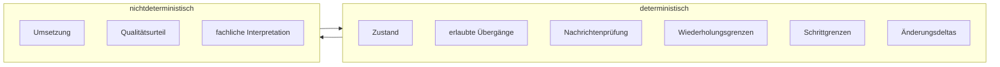

Die Maschine kann beispielsweise sicher wissen:

```text
- dies ist Runde 2 von höchstens 5;
- der nächste Schritt ist Controller-Review;
- CHANGES ist noch zulässig;
- der Worker-Schritt ist beendet;
- Git hat sich von Commit B nach C verändert;
- Test X schlägt fehl.
```

Der Controller muss dagegen urteilen:

```text
- erfüllt die Änderung den Auftrag?
- ist die Lösung technisch passend?
- behebt sie die offene Beanstandung?
- ist der Vorgang selbst noch sinnvoll geschnitten?
```

Genau dort soll die KI ihre Stärke einsetzen.

---

## Controller und Worker

Der kleinste Arbeitskern besitzt zwei Rollen.

**Worker**

- führt einen begrenzten Auftrag aus;
- verändert Quelltext, Tests oder den Arbeitsbestand;
- meldet nur außergewöhnliche Situationen semantisch, etwa fehlende
  Entscheidungen oder notwendige Eskalation.

**Controller**

- bestimmt oder prüft den begrenzten Auftrag;
- beurteilt die tatsächlich entstandene Wirkung;
- fordert Änderungen an oder nimmt den Stand an;
- prüft auch, ob der Arbeitsgegenstand selbst noch sinnvoll ist.

Ein typischer Ablauf für Vorgang V:

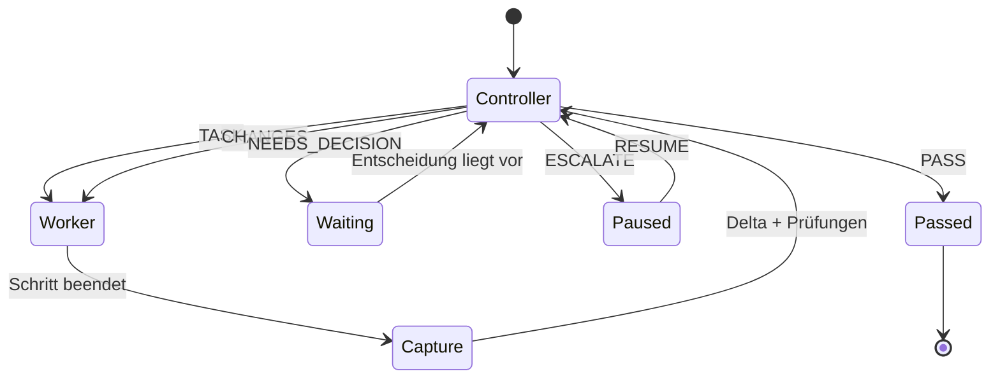

Jeder rückführende Weg besitzt eine feste Grenze. Eine Agentenschleife darf
nicht unbemerkt zehn, fünfzig oder fünfhundert Korrekturrunden verbrauchen.

---

## Die Wirkung zählt, nicht die Selbstauskunft des Agents

Ein Worker soll im Normalfall nicht erklären müssen:

> „Ich habe Datei A geändert und Test B ergänzt.“

`ki-dev` kann die tatsächliche Wirkung selbst beobachten.

Für Git:

```text
Commit B
→ Worker-Schritt
→ Commit C
→ git diff B..C
```

Für den derzeit verwendeten Arbeitsgraphen `bd` kann die vorhandene
Dolt-Versionierung entsprechend Zustandsgrenzen und Deltas liefern.

Der Controller erhält damit vorzugsweise Tatsachen:

```text
TASK
+ Git-Schrittdelta
+ Arbeitsgraph-Delta
+ relevante Tests
+ offene Beanstandung
+ Rundenstand
+ zulässige nächste Urteile
```

Das spart nicht nur Kontext. Es trennt auch sauber:

```text
Worker behauptet etwas
≠
System beobachtet eine Änderung
```

---

## Planning und Dokumentation

`ki-dev` soll nicht nur fertige Umsetzungsvorgänge ausführen.

Zum Zielbild gehört ein kontrollierter Weg von menschlich geführter Planung zu
dauerhafter Projektinformation.

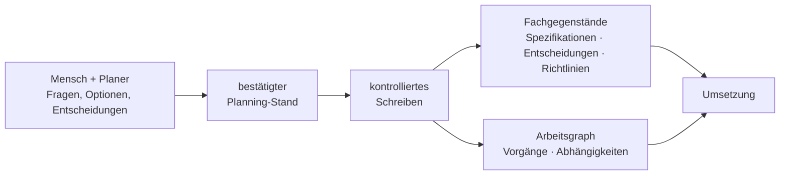

Die Planung darf dabei offen und dialogisch sein. Die Materialisierung soll es
nicht sein.

Aus einem Gespräch wie

```text
„Wir brauchen einen Rückfallweg.
Er darf nur bei Fehler X greifen.
Dafür brauchen wir einen Test.“
```

können unterschiedliche dauerhafte Aussagen entstehen:

```text
System-Spezifikation
→ welches Verhalten das System besitzen muss

Entscheidung
→ warum genau dieser Rückfallweg gewählt wurde

Richtlinie
→ welche allgemeine Entwicklungsregel gilt

Vorgang
→ welche Arbeit konkret auszuführen ist

Nachweis
→ welche Umsetzung und welcher Test die Anforderung belegen
```

Damit muss ein einzelnes großes „Planungsdokument“ nicht für immer gleichzeitig
Architektur, Entscheidungssammlung, Ablaufbeschreibung und Aufgabenliste sein.

---

## Was `ki-dev` heute absichtlich noch kleiner macht

Das langfristige Ziel braucht Pages PM nicht als Voraussetzung für den ersten
nutzbaren `ki-dev`-Stand.

Der Bootstrap verwendet zunächst vorhandene, einfachere Wahrheiten:

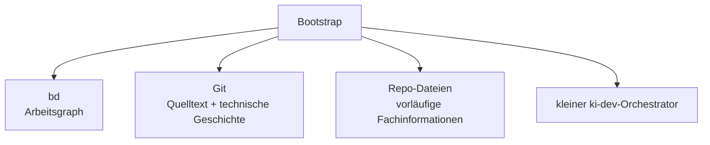

Der heutige Weg ist bewusst pragmatisch:

- `bd` führt den Arbeitsgraphen;
- Git führt Quelltext und technische Änderungen;
- kleine Fachdateien können normative Aussagen vorläufig im Repository halten;
- Claude- und Codex-CLI werden lokal verwendet;
- `ki-dev` automatisiert zuerst die Controller↔Worker-Kontrollschleife;
- Pages-PM-Integration, vollständiges Planning und weitergehende
  Kontextableitung folgen später.

Das ist keine zweite Zielarchitektur, sondern eine Bootstrap-Grenze.

---

## Weg vom Bootstrap zum Zielsystem

Die Entwicklung folgt dem Grundsatz:

> **Kein allgemeines Agentensystem auf Vorrat bauen.  
> Jeden nächsten deterministischen Baustein aus einem echten Arbeitsproblem
> ableiten.**

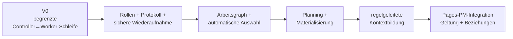

Diese Reihenfolge ist nicht als starre Versionsliste zu verstehen. Entscheidend
ist die Richtung:

```text
heutige manuelle Kopierarbeit
→ kleine ausführbare Kontrollmaschine
→ mehr deterministische Projektarbeit
→ strukturierte Kontextbildung
→ gemeinsames Projektinformationsmodell mit Pages PM
```

Reale `ki-dev`-Abläufe dienen dabei zugleich als Erprobung für Pages PM:
Welche Beziehungen braucht Kontextbildung wirklich? Welche Aussage braucht eine
eigene Identität? Wo reicht ein Feld? Welche Richtlinie muss automatisch in
welchem Vorgang gelten?

---

## Was `ki-dev` nicht sein soll

`ki-dev` ist nicht:

- ein Chatbot, der selbstständig „irgendwie das Repository erledigt“;
- eine zweite Quelltextwahrheit neben Git;
- eine zweite dauerhafte Projektmanagement-Datenbank neben Pages PM;
- ein System, das jeden Gedanken eines Agents protokollieren muss;
- ein Versuch, fachliche Entscheidungen durch Zustandsmaschinen zu ersetzen;
- ein Vorwand, große Mengen Projektkontext in jeden Prompt zu laden;
- ein unbegrenzter Agentenloop, der bis zum Erfolg weiterläuft;
- ein Anbieter-spezifischer Workflow, dessen Fachlogik von einer bestimmten
  Claude- oder Codex-Sitzung abhängt.

---

## Der Kern in einem Bild

Unser Vorgang V begann als einfache Aufgabe:

> Rückfallfall im Executor umsetzen.

Im Zielbild wird daraus kein riesiger Prompt, sondern eine nachvollziehbare
Kette:

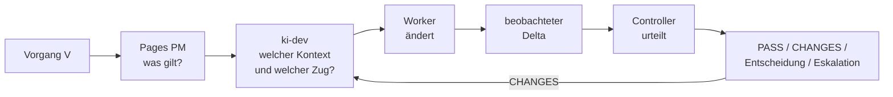

Die Projektstruktur bleibt außerhalb des Agentengedächtnisses greifbar.
Deterministische Regeln bleiben als Regeln sichtbar. Änderungen werden
beobachtet statt nur beschrieben. Die KI bekommt den für ihren jeweiligen Zug
nötigen Zusammenhang.

Das ist die Leitidee von `ki-dev`:

> **Nicht mehr KI für die Verwaltung von KI-Arbeit einsetzen als nötig.  
> Struktur, Zustand und Kontext maschinell begrenzen – und die KI für die
> eigentliche Entwicklungs- und Prüfarbeit verwenden.**
