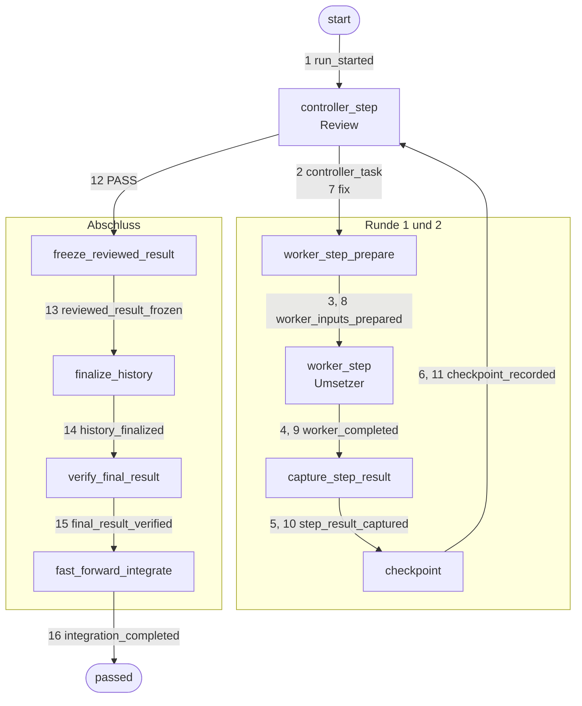
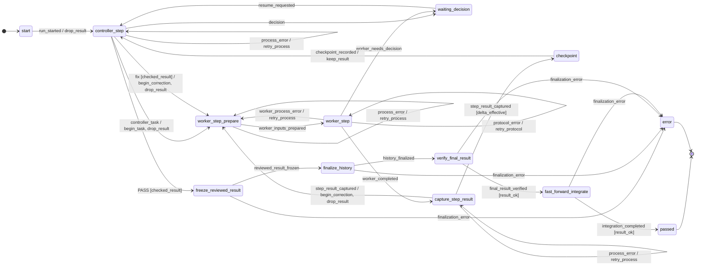
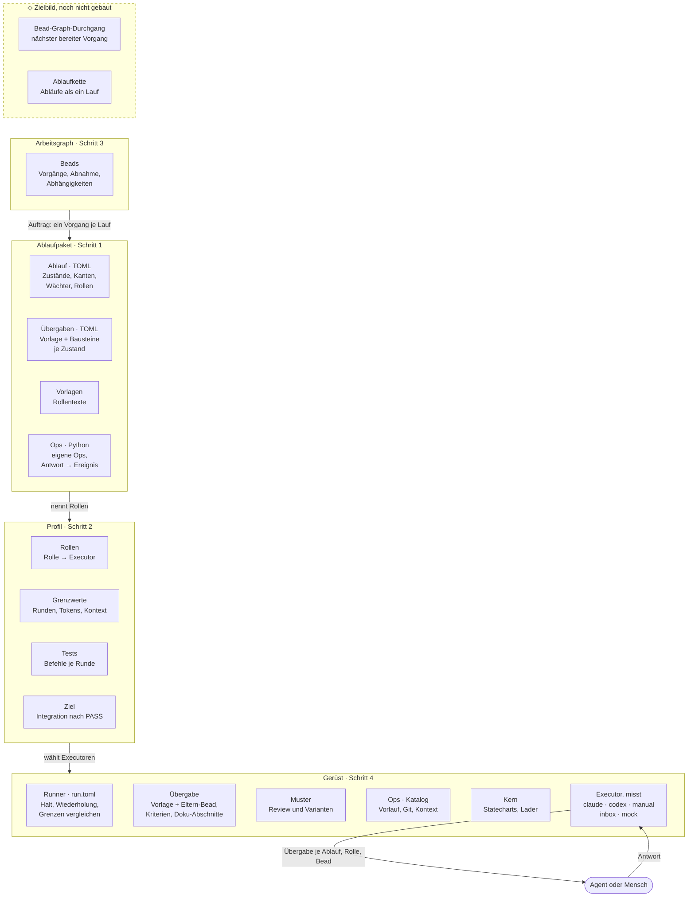
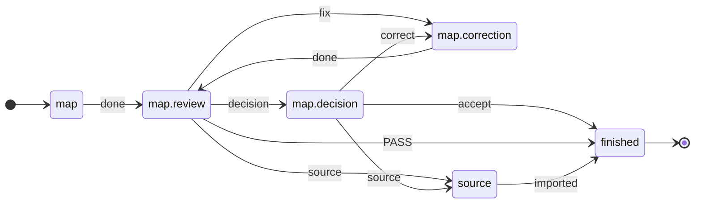

<p align="right">Deutsch | <a href="README.en.md">English</a></p>

# ki-dev

**KI-Agenten arbeiten, ein [Ablauf aus TOML](#1-ablauf-modellieren) entscheidet, was danach passiert.**
Der Ablauf modelliert ein Arbeitsverfahren, etwa Umsetzung mit getrenntem
Review oder [Planung](#nicht-nur-code). Die [Rollen](#2-rollen-besetzen)
besetzt ein Profil, der [Auftrag](#3-auftrag-wählen) ist ein beliebiger
Vorgang. Kein Agent beauftragt den nächsten, kein Mensch reicht jede Antwort
von Hand weiter.

Gedacht für knappe Token-Budgets: Den nächsten Schritt wählt Code, kein
Aufseher-Modell ([Warum](#warum)).

🚧 **In Entwicklung, noch nicht betriebsbereit.** Ablaufsteuerung,
Korrekturschleife und Adapter für Claude Code und Codex laufen. Es fehlen
noch das Test-Tor vor der Integration und Budgetgrenzen auf allen Pfaden:
[Stand](#stand) · [Roadmap](#roadmap).

## Inhalt

1. [Warum](#warum)
2. [Beispiel: Umsetzer und Reviewer als Ablauf](#beispiel-umsetzer-und-reviewer-als-ablauf)
   1. [Ablauf modellieren](#1-ablauf-modellieren)
   2. [Rollen besetzen](#2-rollen-besetzen)
   3. [Auftrag wählen](#3-auftrag-wählen)
   4. [Starten](#4-starten)
3. [Was im Lauf passiert](#was-im-lauf-passiert)
4. [Ausprobieren ohne Agenten](#ausprobieren-ohne-agenten)
5. [Ebenen](#ebenen)
6. [Nicht nur Code](#nicht-nur-code)
7. [Stand](#stand)
8. [Roadmap](#roadmap)
9. [Mitmachen](#mitmachen)

## Warum

Wer mit Coding-Agenten arbeitet, wird zum Boten: Kontext geben, Ergebnis
prüfen, Nachbesserung zurückreichen. Dazu melden Agenten „fertig“, auch
wenn es nicht stimmt.

**Für wen:** für alle, die mit begrenzten Tokens arbeiten. Ein
Aufseher-Modell, das jede Ausgabe liest, kostet zusätzlich; wer das nicht
bezahlen kann, legt die Steuerung in Dateien. In ki-dev sind Kantenwahl,
Formatprüfung und Grenzvergleich Code, Modelle machen die Arbeit und das
fachliche Review. Später darf KI Parameter steuern und Abläufe kalibrieren
([Roadmap](#roadmap)), als Option, nicht als Voraussetzung. Gemessen ist
die Ersparnis noch nicht.

Hintergrund: Workflows mit Prüfstellen statt frei steuernder Agenten
([Anthropic](https://www.anthropic.com/engineering/building-effective-agents));
vorzeitiger Abschluss und fehlende Verifikation als typische Fehler von
Mehr-Agenten-Systemen ([MAST](https://arxiv.org/html/2503.13657v3)).

<sub>[↑ Inhalt](#inhalt)</sub>

## Beispiel: Umsetzer und Reviewer als Ablauf

Modelliert wird ein Verfahren, keine einzelne Aufgabe: Ein Agent setzt um,
ein zweiter prüft in eigener Sitzung, `fix` führt zurück, nach drei Runden
entscheidet der Mensch. Jeder Schritt gehört zu einer eigenen
[Ebene](#ebenen).

### 1. Ablauf modellieren

**Ebene Ablaufpaket.** Der mitgelieferte Ablauf `implement` legt fest, was
nach welchem Urteil passiert. Die Korrekturschleife, aus
[`implement.toml`](src/ki_dev/flow/implement.toml):

```toml
# Review sagt „fix“, keine Runde mehr übrig → Halt, der Mensch entscheidet
[[statechart.states.active.states.controller_step.transitions]]
event = "fix"
cond = "checked_result"
unless = "changes_rounds_left"
on = [{ raise = { event = "escalation.changes_rounds_exhausted" } }]

# sonst → zurück zur Umsetzung, Rundenzähler +1
[[statechart.states.active.states.controller_step.transitions]]
event = "fix"
cond = "checked_result"
target = "worker_step_prepare"
on = ["begin_correction", "drop_result"]
```

Was ein Zustand nach außen tut, bindet der Ablauf an eine Op; ihr Ergebnis
kommt als Ereignis zurück. Gekürzt:

```toml
[op.review]                       # Wirkung des Zustands controller_step
role = "review"                   # eine Rolle, kein Agent: den wählt das Profil
do = "review.decide"              # Eintrag im Ops-Katalog
events = ["PASS", "fix", "decision", "escalate"]   # erlaubte Urteile
```

Der Agent liefert nur sein Urteil; welche Kante folgt, entscheidet ki-dev.
Die erste passende Kante gewinnt. Wächter (`checked_result`,
`changes_rounds_left`) und Aktionen (`begin_correction`) sind Python im
Paket ([`machine/model.py`](src/ki_dev/flow_ops/implement/machine/model.py))
und lesen oder ändern nur Laufdaten. Ops-Schnittstelle:
[Bindungen](docs/ablaufpakete.de.md#eine-bindung); die Ops von `implement`
liegen in [`flow_ops/implement/ops.py`](src/ki_dev/flow_ops/implement/ops.py),
gemeinsame Ops des Gerüsts in [`ops/`](src/ki_dev/ops/).

<sub>[↑ Inhalt](#inhalt)</sub>

### 2. Rollen besetzen

**Ebene Profil.** Wer die Rollen übernimmt und mit welchen Grenzen, steht
in `.ki-dev/profiles/default.toml`; der Ablauf bleibt derselbe:

```toml
workdir = "/home/me/rechner-arbeit"     # Arbeits-Worktree der Agenten
access_profile = "write"

[worker]                                # setzt um
executor = "codex"                      # Executor aus dem Gerüst
session_id = "019a…"                    # bestehende Codex-Sitzung
model = "gpt-5.6-terra"
effort = "high"

[review]                                # prüft, in eigener Sitzung
executor = "claude"
session_id = "b3f1…"                    # bestehende Claude-Code-Sitzung
model = "sonnet"
effort = "high"

[[tests]]                               # läuft je Runde, Ergebnis ans Review
name = "pytest"
argv = [".venv/bin/python", "-m", "pytest", "-q"]

[limits]
changes_rounds = 3                      # danach fragt ki-dev den Menschen

[finalization]                          # wohin ein akzeptiertes Ergebnis geht
target_workdir = "/home/me/rechner"
target_ref = "refs/heads/main"
commit_message = "add() korrigiert"
data_mode = "file_proposal"
```

Ein Mensch (`manual`), ein Mock oder ein anderes Modell: Es wechselt nur
`executor` ([Executoren](docs/ausfuehrer.de.md#executoren)).

<sub>[↑ Inhalt](#inhalt)</sub>

### 3. Auftrag wählen

**Ebene Arbeitsgraph** ([Beads](https://github.com/steveyegge/beads)).
Der Ablauf passt zu jedem Vorgang mit Abnahmekriterien, hier ein kleiner
Bug: `add(a, b)` liefert `a - b`.

```bash
bd create "add() addiert nicht" \
  --description "add(2, 3) liefert -1" \
  --design "add.py korrigieren; test_add.py nicht ändern" \
  --acceptance "add(2, 3) == 5 und add(-1, 1) == 0"
# → rechner-7k2, die ID des Auftrags
```

Welchen Vorgang ein Lauf bekommt, wählt heute der Mensch; einen Durchgang
durch den Bead-Graphen gibt es noch nicht ([Roadmap](#roadmap)).

<sub>[↑ Inhalt](#inhalt)</sub>

### 4. Starten

**Ebene Gerüst.** Der Runner fährt den Ablauf bis zum nächsten Halt, die
Executoren reichen die Übergaben an Codex und Claude Code. Halt und
Fortsetzen regelt [`run.toml`](src/ki_dev/runner/run.toml) für jeden
Ablauf gleich; die Schutzgrenzen hat heute nur `implement`
([Ebenen](#ebenen)).

```bash
ki-dev -f implement rechner-7k2      # Ablauf implement, Profil default
ki-dev -f implement status RUN_ID    # wo steht der Lauf?
ki-dev -f implement resume RUN_ID    # nach einem Halt weiter
```

**Stand dieses Beispiels:** Ablauf, Profilformat und Befehle sind echt,
die Adapter für Codex und Claude Code gebaut. Noch offen: ein abgenommener
Lauf mit echten Agenten, und rote Tests halten die Integration noch nicht auf.

<sub>[↑ Inhalt](#inhalt)</sub>

## Was im Lauf passiert

Der Mock-Lauf aus [Ausprobieren](#ausprobieren-ohne-agenten) (`make demo`:
Ablauf `implement`, Review erst `fix`, dann `PASS`) schreibt je Übergang
eine Zeile nach `events.jsonl`, hier 47
([ganze Datei](docs/beispiele/demo-lauf.events.jsonl)). Zeile 16 ist die
Rückkante aus [Schritt 1](#1-ablauf-modellieren), umbrochen:

```json
{"line": 16, "region": "ablauf", "seq": 7,
 "ts": "2026-10-17T09:47:00.737137+00:00",
 "flow": "implement", "run": "demo",
 "state": "controller_step", "event": "fix",
 "target": "worker_step_prepare", "cond": ["checked_result"],
 "actions": ["begin_correction", "drop_result"], "escalation": null,
 "actor": "Controller (Review-Sitzung)", "adapter": "mock"}
```

`region` `ablauf`: eine Kante der Ablauf-TOML, `seq` zählt sie;
`operation` und `halt`: 31 Kanten des Runners aus
[`run.toml`](src/ki_dev/runner/run.toml), je Op
`hold → start → artifact_saved`. `adapter`: wer antwortete, mit
dem Profil aus [Schritt 2](#2-rollen-besetzen) `claude-cli`
([Format](docs/ausfuehrer.de.md#ereignisprotokoll-je-übergang)).

Die 16 Ablaufzeilen als Pfad, von Hand übertragen, Nummer = `seq`:



Jeder Zwischenstand liegt als Artefakt im Laufverzeichnis; ein Halt lässt
sich mit `resume` fortsetzen.

<details>
<summary>Ganzer Ablauf als Diagramm, aus der TOML erzeugt</summary>

`ki-dev flow show implement --without-escalations`, ohne Grenz- und Schutzhalte:

<!-- ki-dev flow show implement --without-escalations -->


</details>

<sub>[↑ Inhalt](#inhalt)</sub>

## Ausprobieren ohne Agenten

<!-- readme-script: readme-scripts/1-setup.sh -->
> nicht ausgeführt · selbst prüfen: make readme-check

Die Demo legt ein Wegwerf-Repo mit Auftrag und Profil an; Mock-Umsetzer
und Mock-Review (`fix`, dann `PASS`) spielen das Beispiel ohne
Anbieterzugang durch. Die Statuszeile oben gilt der Einrichtung im
leeren Container.

Braucht Python ≥ 3.12, git ≥ 2.32, make, Go und einen C-Compiler:
`make setup` baut [Beads](https://github.com/steveyegge/beads) `bd` aus
dem Quellcode ins Projekt-venv (beim ersten Mal einige Minuten, mit Netz).
`$REPLACE_WITH_REPOSITORY_URL` = Klon-Adresse dieses Repos.

```bash
git clone "$REPLACE_WITH_REPOSITORY_URL" ki-dev
cd ki-dev
make setup
make demo
```

Ausgabe (gekürzt, Hashes wechseln):

```text
{
  "run_id": "demo",
  "status": "passed",
  "round_id": 2,
  "detail": "Fast-forward integriert"
}

ad543c6 Geprüfter Abschluss (Demo)
091d542 start
```

`round_id: 2`: eine Korrekturrunde. `passed`: das Mock-Review hat
akzeptiert, das Ergebnis liegt per Fast-Forward auf `main`. Die Mocks
schreiben nur eine Textzeile; die Demo zeigt die Steuerung, nicht die
Arbeit eines Agenten.
<!-- /readme-script -->

<sub>[↑ Inhalt](#inhalt)</sub>

## Ebenen

Jeder Schritt des Beispiels liegt auf einer eigenen Ebene, von oben nach
unten:



Schritte im Beispiel: [1](#1-ablauf-modellieren) · [2](#2-rollen-besetzen) ·
[3](#3-auftrag-wählen) · [4](#4-starten); ◇ gibt es noch nicht
([Roadmap](#roadmap)).

Das Bild zeigt die vereinbarte Architektur
([Schichten und Regeln](docs/ausfuehrer-luecken.de.md#schichten-und-orte)):
Fachliches entscheidet der Ablauf, Schutz für jeden Ablauf gleich das
Gerüst; Grenzwerte setzt das Profil, der Executor misst, ein Wächter
vergleicht. Abhängigkeit nur Paket → Gerüst, das Gerüst kennt keine Rollen
([Test](tests/test_schichten.py)). Tests: welche Befehle, sagt das Profil
(Review-Muster: `pyproject.toml`); wann und was danach, der Ablauf.

**Heute abweichend**, Umbau nach der Veröffentlichung, als Beads geschnitten:

- `implement`: eigener Ausführer im Paket, Grenzen in Python (`ige.6.4.13`)
- `run.toml`: noch ohne Schutzhalt, Messung, Budget, Wiederholung
  (`ige.6.4.2`–`ige.6.4.5`)
- Git-Abschluss: Paket-Ops statt Gerüst-Katalog (`ige.6.4.10`)
- Review-Muster: ohne Rundengrenzen (`ige.6.4.7`)
- Abläufe und Vorlagen: noch im Gerüst-Repo (`cak`, `ige.6.4.16`)

Weitere Trennungen:

- **Op ≠ Aktion:** eine Op wirkt nach außen und endet in einem Ereignis;
  eine Aktion ändert beim Übergang nur Laufdaten, ein Wächter liest sie.
- **Ablauf ≠ Ablaufkette:** ein Ablauf ist ein Verfahren; die Kette
  `map` → `graph` → `materialize` → `implement` verbindet mehrere, heute
  von Hand.
- **Lauf ≠ Durchgang durch den Bead-Graphen:** ein Lauf bearbeitet einen
  Vorgang; welcher als Nächstes dran ist, wählt heute der Mensch.
- **Mensch als Bote ≠ Mensch als Entscheider:** als Rolle (`manual`) trägt
  er Übergaben weiter, im Zustand `waiting_decision` entscheidet er.
- **Arbeitsgraph ≠ Ereignisprotokoll:** Beads hält, was zu tun ist,
  `events.jsonl`, was wann passiert ist.

<sub>[↑ Inhalt](#inhalt)</sub>

## Nicht nur Code

Schreiben, getrennt prüfen, korrigieren, entscheiden: Dieses Verfahren liegt
einmal als Muster im Gerüst
([`patterns/review.toml`](src/ki_dev/flow/patterns/review.toml), Ops in
[`flow_ops/review/`](src/ki_dev/flow_ops/review/)). Die Planungsabläufe
`map`, `graph` und `materialize` setzen nur Parameter darauf, etwa die
Kartierung von Anforderungen ([`map.toml`](src/ki_dev/flow/map.toml),
gekürzt):

```toml
pattern_catalog = ["ki_dev:review"]   # Muster und seine Ops aus dem Gerüst
start = "map"

[[phase]]
id = "map"
use = "write_review"                  # schreiben → Review → Korrektur → Entscheidung
next = "finished"

[phase.role]                          # dieselben Rollen wie in implement
write = "worker"
review = "review"
correction = "worker"
```

<!-- ki-dev flow show map -->


Ohne Agenten von Hand durchspielen:

```bash
ki-dev flow show map                                    # Ablauf als Mermaid
ki-dev -f map step BEAD map                             # Übergabe an den Kartierungsagenten
ki-dev -f map step BEAD map.review map.review=urteil.json  # Urteil zurück, nächste Übergabe
```

Nächster Ablauf dieser Art, schon als Beads geschnitten: Planungssitzungen
und Designnotizen in die Gesamtplanung einarbeiten ([Roadmap](#roadmap)).
Beide Ablaufdiagramme erzeugt `ki-dev flow show` aus der Quelle; ein Test
vergleicht sie mit diesem README.

<sub>[↑ Inhalt](#inhalt)</sub>

## Stand

**Läuft**

- Abläufe als TOML-Statecharts auf
  [python-statemachine](https://python-statemachine.readthedocs.io/).
  In `implement` verbraucht jede Rückkante einen Zähler; ein
  [Test](tests/machine/test_reachability.py) zählt den Zustandsraum durch:
  kein Zyklus ohne Mensch läuft unbegrenzt.
- `implement` vom Auftrag bis zur Fast-Forward-Integration, mit Halt und
  `resume`; vorgeführt mit Mock-Agenten.
- Adapter: Claude Code, Codex, Mensch (`manual`, `inbox`), Mock.
- Schutzhalt bei Kontext-, Kontingent- und Budgetgrenze für `claude`;
  `codex` ohne Kontextmessung.
- `step`: zeigt für jeden Zustand die Übergabe an einen Agenten, ohne
  einen zu starten.
- Abläufe aus einem Paketverzeichnis außerhalb des Gerüsts laden
  (`KI_DEV_FLOW_PATH`).

**Fehlt noch:** das Test-Tor (unten), ein Runner für alle Abläufe, damit
die Grenzen überall greifen, und ein abgenommener Lauf mit echten Agenten
([Roadmap](#roadmap)).

<!-- readme-script: readme-scripts/3-review-gate.sh -->
> ❌ rot, erwartet (Spezifikation) · 2026-10-17 · selbst prüfen: .venv/bin/pytest -q --runxfail tests/test_review_gate_cli.py · [Stand](#stand)

**Wann ist das Test-Tor fertig?** Wenn dieser Test grün ist. Er startet
`ki-dev -f implement` gegen ein Wegwerf-Repo mit falschem `add.py`
(`a - b`); die Tests sind rot, das Mock-Review sagt trotzdem `PASS`.

```bash
.venv/bin/pytest -q --runxfail tests/test_review_gate_cli.py
```

```text
E   tests.test_review_gate_cli.IntegratedDespiteRedTests: 3e696bb -> d14aedd: Fast-forward integriert
FAILED tests/test_review_gate_cli.py::test_red_tests_and_review_pass_do_not_integrate
1 failed, 4 passed
```

Heute landet das Ergebnis trotz roter Tests auf `main`. Die vier grünen
Fälle prüfen den Test selbst, etwa: grüne Tests plus `PASS` integrieren.
<!-- /readme-script -->

<sub>[↑ Inhalt](#inhalt)</sub>

## Roadmap

◆ als Beads geschnitten, mit Abnahmekriterien · ◇ Zielbild, noch nicht
geschnitten · **V1** erste Ausgabe. Bead-IDs stammen aus der
projektinternen Datenbank; ein öffentliches Journal folgt.

**V1: Gerüst und Ablaufpakete getrennt.** ki-dev bringt Runner, Adapter,
gemeinsame Muster und Ops; Abläufe mit ihren Ops, Vorlagen und Profilen
liegen in eigenen Paket-Repos
([Paket außerhalb des Gerüsts](docs/ablaufpakete.de.md#paket-außerhalb-des-gerüsts)).

Nach [Ebenen](#ebenen), von oben nach unten:

**Neue Oberebenen**

- ◇ Ablaufkette: mehrere Abläufe als ein Lauf; in V1 von Hand verkettet
- ◇ Bead-Graph-Durchgang: nächster bereiter Vorgang, Reihenfolge nach
  Abhängigkeiten

**Arbeitsgraph und Ablauf**

- ◇ adaptive Schnitte: der Reviewer teilt einen Vorgang in Schritte, ein
  Größen-Gate vor dem Umsetzer ([Zielbild](docs/zielbild.de.md))

**Ablaufpakete**

- ◆ **V1** vier Einzelabläufe `map` → `graph` → `materialize` →
  `implement`; Rundengrenzen auch im Review-Muster (`ige.6.4.7`)
- ◆ **V1** Paket-Repo ohne kopierten Runner, Gerüst ohne Ablaufkopien
  (`cak`, `ige.6.4.16`)
- ◆ Planungs-Abflachung: Planungssitzungen und Designnotizen in die
  Gesamtplanung einarbeiten, als eigener Ablauf mit Review (`urq`,
  8 Aufträge)

**Ablauf und Ops**

- ◆ **V1** Test-Tor: rote Tests halten die Integration auf (`ek1`)
- ◆ adaptive Parameter, KI steuert, Code begrenzt: der Reviewer wählt den
  Testumfang der nächsten Runde, `PASS` nur nach Volllauf; in `step`
  vorhanden ([Prüfsteuerung](docs/step.de.md#antworten-im-review-muster)),
  im Lauf mit Agenten mit `ige.6.4.12`

**Ablauf und Profil**

- ◆ erwarteter Verbrauch je Op gegen die Grenzen beim Binden prüfen
  (`asr`); Parameter je Ebene aus TOML statt Python (`7z3`)
- ◇ Kalibrierung der Ablaufparameter aus Ist-Läufen, auch KI-gestützt;
  optional, die Steuerung bleibt deterministisch

**Runner**

- ◆ **V1** ein Runner für alle Abläufe: `implement` auf dem Review-Muster,
  Grenzen und Wiederholung im Gerüst (`ige.6.4`, 17 Aufträge)
- ◆ **V1** Verbrauchsschutz: eigene Tokenmessung, Budgetreservierung,
  durchgesetzter Stop (`wu0.10`, 22 Aufträge)
- ◆ adaptive Budgetprognose: mehrere Modelle schätzen einen Auftrag,
  Schätzfehler aus dem Ist-Verbrauch lernen (`wu0.4`–`wu0.7`)

<sub>[↑ Inhalt](#inhalt)</sub>

## Mitmachen

Gute Einstiege, je mit klarer Abnahme:

- **Test-Tor bauen**: fertig, wenn der rote Test oben grün ist.
- **Rundenzähler im Review-Muster**: `map`, `graph`, `materialize` zählen
  ihre Korrekturrunden noch nicht.
- **Ein Runner**: `implement` auf den gemeinsamen Runner umstellen.

Mehr dazu: [Was in der Architektur fehlt](docs/ausfuehrer-luecken.de.md).

```bash
make test           # pytest und ruff
make spec-test      # Anforderungstests; rote Ergebnisse sind zulässig
make readme-check   # README-Einrichtung im Wegwerf-Container, braucht Docker
```

<!-- readme-script: readme-scripts/2-runtime.sh -->
> nicht ausgeführt · selbst prüfen: make setup-runtime

Wer ki-dev mit ki-dev weiterentwickelt, installiert es getrennt vom
Quellbaum: eigenes venv, Symlink in `~/.local/bin`. Vor einem Update
laufende Läufe abschließen ([Details](docs/self-development.de.md)).

```bash
make setup-runtime
export PATH="$HOME/.local/bin:$PATH"
ki-dev --help
```
<!-- /readme-script -->

Weiterlesen: [Ausführer und Profile](docs/ausfuehrer.de.md) ·
[`step` und Übergaben](docs/step.de.md) ·
[Ablaufpakete](docs/ablaufpakete.de.md) ·
[CLI-Adapter](docs/cli-adapters.md) ·
[Zielbild](docs/zielbild.de.md)

Fragen, Ideen, Zusammenarbeit: ein Issue öffnen oder
[@blaumohn](https://github.com/blaumohn) direkt ansprechen.
Lizenz: [MIT](LICENSE).

<sub>[↑ Inhalt](#inhalt)</sub>
