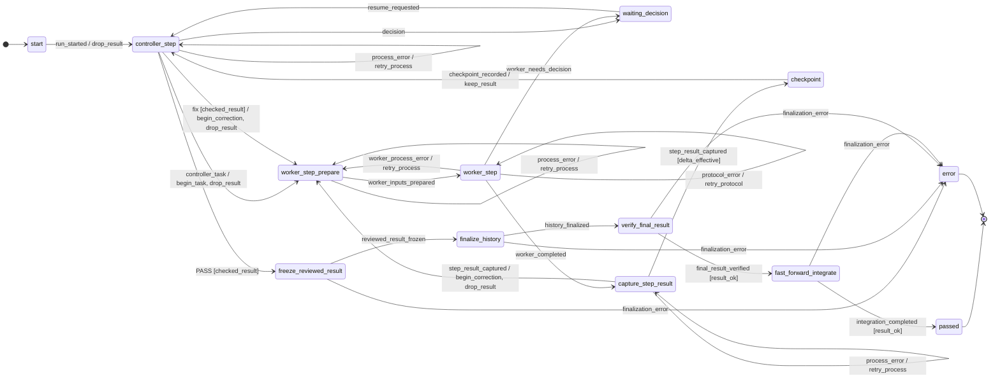
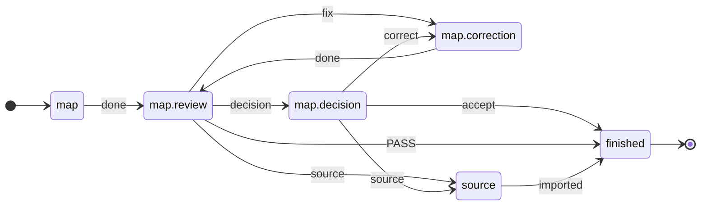

<p align="right">Deutsch | <a href="README.en.md">English</a></p>

# ki-dev

**Agentenarbeit als deklarativer Ablauf: Zustände und Übergänge stehen in
TOML, ein Ausführer fährt sie, Adapter sprechen mit Claude, Codex oder einem
Menschen.**

Die KI schreibt Code und urteilt über Ergebnisse. Was danach gilt (noch eine
Korrekturrunde, Halt für eine Entscheidung, geprüfte Integration), steht nicht
im Prompt und nicht im Python-Code, sondern im Ablauf.

Die drei Bausteine teilen sich die Verantwortung:

| Baustein | Legt fest | Inhalt / Aufgabe |
| --- | --- | --- |
| `flow/*.toml` (`implement`, `map`, `graph`, …) | **Was** passieren darf | Daten: Zustände, Übergänge, Wächter und Aktionen |
| `runner/` | **Wie** der Ablauf ausgeführt wird | Formale Antwort → Ereignis → Kante wählen (python-statemachine) → nächste Eingabe; Datensatz je Schritt, Halt beendet den Prozess |
| `adapter/` | **Wer** die Eingabe bearbeitet | Anbindung von Claude, Codex, einem Menschen (`manual`) oder einer Simulation (`mock`) |

Der Ausführer (`runner/`) liest die Ablaufdatei und ruft den jeweiligen
Adapter auf. Bei `ki-dev -f implement BEAD` geschieht das automatisch.

`ki-dev step` ist dieselbe Idee von Hand: genau ein Übergang des
Planungsablaufs, die Übergabe trägt der Mensch als Bote weiter.

---

## Eine Schleife ist eine Kante, kein Baustein

Bau, Review, Korrektur, erneutes Review: das ist keine eigene „Loop“-Schicht,
sondern eine Rückkante im Ablauf. Wann sie endet, entscheiden Wächter, und
jede Rückkante verbraucht einen Zähler. Auszug aus
[`src/ki_dev/flow/implement.toml`](src/ki_dev/flow/implement.toml):

```toml
# controller_step --fix [cond] / on--> target   (UML-Kante)

# Korrekturbudget erschöpft → Mensch (ohne Ziel: der Lauf hält an,
# der Ablauf bleibt hier)
[[statechart.states.active.states.controller_step.transitions]]
event = "fix"
cond = "checked_result"
unless = "changes_rounds_left"
on = [{ raise = { event = "escalation.changes_rounds_exhausted" } }]

# sonst: neue Runde, Zähler +1
[[statechart.states.active.states.controller_step.transitions]]
event = "fix"
cond = "checked_result"
target = "worker_step_prepare"
on = ["begin_correction", "drop_result"]
```

`[statechart]` ist das native Format von
[python-statemachine](https://python-statemachine.readthedocs.io/)
(SCXML-Semantik): Kanten werden in Dateireihenfolge geprüft, die erste passende
gewinnt; passt keine, ist das Ereignis dort nicht erlaubt. Kantenwahl und
`raise` übernimmt die Bibliothek; der Ausführer kennt nur die Namen der Wächter
und Aktionen, nicht die Topologie. Eine Pause ist Sache des Laufs
(`runner/run.toml`): der Ablauf bleibt, wo er eskaliert hat.

---

## In einer Minute ausprobieren

<!-- readme-script: readme-scripts/1-setup.sh -->
Ohne Anbieterzugang, mit Mock-Adaptern. Voraussetzungen: Python ≥ 3.12
(mit `venv`), git ≥ 2.32, make, Go und ein C-Compiler. `make setup` legt
venv, ki-dev und [Beads](https://github.com/steveyegge/beads) `bd` (Version
aus `src/ki_dev/tool-versions.json`) im Projekt an, außerhalb ändert es
nichts. `$REPLACE_WITH_REPOSITORY_URL` steht für die Klon-Adresse dieses
Repositorys; sie steht nach der Veröffentlichung fest.

```bash
git clone "$REPLACE_WITH_REPOSITORY_URL" ki-dev
cd ki-dev
make setup
make demo
```

```text
{
  "run_id": "demo",
  "status": "passed",
  "phase": "passed",
  "round_id": 2,
  "detail": null,
  "operation_id": null
}

8ef6356 Geprüfter Abschluss (Demo)
5c02782 start
```

Der Mock-Reviewer antwortet erst `fix` (Urteil `CHANGES`), dann `PASS`.
Der Lauf nimmt also die Rückkante einmal (`round_id: 2`), friert das
geprüfte Ergebnis ein und integriert es per Fast-forward. Bead und
Profil (`profil.toml`) legt das Demo-Skript selbst an.
<!-- /readme-script -->

---

## Zwei Befehle

### `ki-dev -f implement`: einen Bead bis zum nächsten Halt fahren

```bash
ki-dev -f implement BEAD                     # Profil .ki-dev/profiles/default.toml
ki-dev -f implement BEAD --profile lokal     # anderes Profil
ki-dev -f implement BEAD --adapter manual    # beide Rollen von Hand
ki-dev -f implement resume -v RUN_ID         # nach Halt; Zustandswechsel live
ki-dev -f implement status RUN_ID            # nur lesen
```

`-f NAME` sucht wie `make -f`: `./NAME.toml`, `$KI_DEV_FLOW_PATH`, dann das
mitgelieferte Paket. Die Ablaufdatei nennt in `ops` das Modul mit ihren
Befehlen. Den Auftrag liefert der Bead, Rollen, Prüfungen und Grenzen das
Profil ([Ausführer](docs/ausfuehrer.de.md)).

Je Rolle wählt das Profil einen Adapter, `--adapter` ersetzt ihn für
`manual` oder `mock`:

| Adapter | Profil | Wer antwortet |
| --- | --- | --- |
| `claude`, `codex` | `executor = "codex"`, `session_id`, `model`, `effort` | vorbereitete Agentensitzung |
| `manual` | `executor = "manual"` | du: Eingabe auf stdout, Antwort auf stdin |
| `mock` | `executor = "mock"`, `answers = ["fix", "PASS"]` | vorgegebene Antworten |

Beim Adapter `manual` antwortest du im selben Prozess; eine leere Antwort
(Strg-D) hält den **Ausführer**, nicht den Ablauf (`awaiting_input`), und
`ki-dev -f implement resume` fragt erneut. Die Antwort durchläuft dieselbe
Prüfung wie bei einem Agenten.

Der Mensch hat damit zwei getrennte Rollen: **Bote** (Adapter `manual`) und
**Entscheider** (Zustände der Art `wait`, z. B. nach `NEEDS_DECISION`).

### `ki-dev step`: ein Übergang des Planungsablaufs von Hand

```bash
ki-dev step BEAD --step map | graph | materialize | implement | review
ki-dev step BEAD --step review --next-turn --decision-file antwort.json
```

Echte Ausgabe (gekürzt) für einen Bead dieses Repositorys:

```text
Schritt: materialize
Bead: ki-dev-ablauf-5we - Vor GitHub: begrenzte Reviewer-Prüfsteuerung in step anschließen
…
Hinweis für den Menschen: Zustand materialize; Folgeschritte laut materialize.toml (Adapter manual, du trägst sie weiter):
- done → materialize.review: `ki-dev step ki-dev-ablauf-5we --step review --review-of materialize`
```

Ein Review vergibt je Befund eine Klasse. Die stärkste Klasse bestimmt die
Kante:

| Klasse | Urteil | Weiter |
| --- | --- | --- |
| `fix` | `CHANGES` | derselbe Schreibagent korrigiert |
| `source` | `NEEDS_DECISION` | Planungssitzung, dann **bestehende** Karte ergänzen |
| `decision` | `NEEDS_DECISION` | der Mensch entscheidet |

---

## Die zwei Abläufe

Jeder Ablauf lässt sich als Diagramm ausgeben:
`ki-dev flow show implement --without-escalations` (Mermaid).

**Umsetzungsablauf** ([`implement.toml`](src/ki_dev/flow/implement.toml), ohne
Grenz- und Schutzhalte, also ohne Kanten mit `escalation`):

<!-- ki-dev flow show implement --without-escalations -->


**Kartierung** ([`map.toml`](src/ki_dev/flow/map.toml), vollständig;
`graph` und `materialize` sind gleich gebaut, `implement_review` hat
vor jedem Review den Vorlauf `implement.preflight`):

<!-- ki-dev flow show map -->


Beide Diagramme sind aus der Quelle erzeugt (`ki-dev flow show`,
`scripts/render-flow-diagrams.py`); ein Test vergleicht sie mit der Ausgabe.

---

## Was die Tests belegen

| Behauptung | Nachweis |
| --- | --- |
| Kein Zyklus ohne Mensch läuft unbegrenzt | `tests/machine/test_reachability.py` zählt den ganzen Zustandsraum auf |
| … und das schon an den Daten | `tests/test_flow_implement.py`: jeder Zyklus hat eine zählende Kante |
| `PASSED` nur über die geprüfte Integration | `tests/machine/test_reachability.py` |
| Ablauf und Ausführer sprechen dasselbe Vokabular | `ki_dev.fsm.bind` prüft beim Import; `tests/test_flow_implement.py`, `tests/test_fsm.py` |
| Schichten importieren nie rückwärts | `tests/test_schichten.py` (transitiv, per AST) |
| Der Bote hält den Ausführer, nicht den Ablauf | `tests/test_runner_runtime.py`, `tests/test_runner_cli.py` |

```bash
.venv/bin/pytest -q && .venv/bin/ruff check .
```

---

## Installation

Voraussetzungen und Einrichtung: siehe [oben](#in-einer-minute-ausprobieren);
das `Makefile` ist kurz und lesbar.

```bash
make test           # pytest und ruff
make readme-check   # README-Einrichtung im Wegwerf-Container (braucht Docker)
```

Oder der Agent-Container mit bd, Codex und Claude Code:
`./scripts/agent-container shell` ([docker/agent/README.md](docker/agent/README.md)).

---

## Aufbau

```text
src/ki_dev/
  fsm.py       Gerüst auf python-statemachine: Namen prüfen, strikt,
               Datensatz (Konfiguration, History)
  flow/        model.py (Schema, Prüfung), statechart.py ([statechart] ↔
               flache Sicht), pattern.py (Muster), diagram.py (Mermaid),
               templates/ (Rollentexte), patterns/ (gemeinsame Muster),
               implement.toml, map.toml, graph.toml, materialize.toml,
               implement_review.toml
  runner/      machine/ (Ops des Umsetzungsablaufs, advance), run.toml +
               run_machine.py (Lauf: Regionen ablauf, operation, halt),
               runtime.py (Schleife,
               Datensatz je Schritt), planning.py (Lauf je Bead mit
               Halt bei turn/ask),
               turns.py (jede Übergabe aus ihrer
               Deklaration), implement_turns.py (Felder des Umsetzungsablaufs),
               events.py (Protokoll), cli.py,
               safety.py (Kontext-, Kontingent-, Aufrufgrenzen)
  ops/         checks/ (Vorlauf), context/ (Bead-Eingabe, Leitlinien,
               Grenzen, Kontextbausteine); kennt weder runner noch adapter
  adapter/     contract.py, agent.py, manual.py, mock.py (transportieren nur),
               executors.toml + registry.py (Executor = Transport + measures),
               executors/ (Claude- und Codex-CLI, Transkripte, Messung)
  step/        ein Turn eines Paketablaufs mit dem Executor manual:
               Bedienung, Laufzustand je Bead, Quellenimport
  pilot/, safety_profile/   abgelegt, noch nicht angebunden (urq, wu0.10.5)
```

Weiterführend: [Ausführer und Laufzeit](docs/ausfuehrer.de.md) ·
[Bindungen und Muster](docs/ablaufpakete.de.md) ·
[`ki-dev step` im Detail](docs/step.de.md) ·
[CLI-Adapter](docs/cli-adapters.md) ·
[Sitzungen lesen](docs/session.de.md) ·
[Zielbild und Hintergrund](docs/zielbild.de.md)

---

## Stand und offene Punkte

- **Benutzbar:** `ki-dev step` (ein Turn eines Ablaufs von Hand), `ki-dev -f implement` mit
  allen vier Adaptern (Bauablauf).
- **Abläufe von Hand:** `step` fährt den gewählten Ablauf (`map`,
  `graph`, `materialize`, `implement_review`) als Lauf je Bead
  (`runner/planning.py`, auf python-statemachine wie `run`) bis zum
  nächsten `turn`/`ask`; nur `implement_review` bindet den Vorlauf
  `implement.preflight`. `implement_review` und `implement` werden ein
  Ablauf (ki-dev-ablauf-ige.6).
- **Laufzustand je Bead:** `ki-dev step BEAD_ID` ohne `--step` setzt den
  gespeicherten Halt fort (`.local/handoff/steps/`), je Übergang steht eine
  Zeile in `events.jsonl`.
- **Beobachtbar:** `ki-dev -f implement` schreibt je Übergang eine Zeile nach
  `events.jsonl`, für Ablauf und Lauf (Operation, Halt) je mit ihrer Region
  ([Ausführer](docs/ausfuehrer.de.md#ereignisprotokoll-je-übergang)).
- **Geprüfter Stand bei step:** Ein PASS gilt nur, wenn Arbeitsbaum und
  Bead seit dem Vorlauf unverändert sind; sonst läuft der Vorlauf erneut
  (Wächter `unchanged`, wie `freeze` bei `run`).
- **Grenzen, genau genommen:** `runner/safety.py` prüft Aufruf-, Token- und
  Kostengrenzen *vor dem nächsten* Aufruf; ein einzelner Aufruf kann
  `max_total_tokens` überschreiten, Cache-Lesen zählt voll. Innerhalb eines
  Aufrufs begrenzt nur Claude (`--max-budget-usd`, `--max-turns`), Codex
  nicht. `step` (Adapter manual) misst keine Token. Das Zugriffsprofil im
  Auftrag ist Prompttext, keine Sperre; isoliert wird im
  [Agent-Container](docker/agent/README.md).
- **Zur Kartierung offen:** Sitzungsbindung als Ablaufdatum
  (`neu | wie:<zustand>`), adaptive Schnitte des Controllers
  ([Zielbild](docs/zielbild.de.md)).

## Einordnung und Nicht-Ziele

Claude Code und Codex führen die Arbeit aus, python-statemachine wählt die
Kanten, Beads tragen den Arbeitsgraphen. Der eigene Beitrag ist der Ablauf als Daten
und ein Ausführer ohne eigene Topologie.

Nicht das Ziel: ein Chatbot, der „irgendwie das Repository erledigt“; eine
unbegrenzte Agentenschleife; große Mengen Kontext in jedem Prompt; eine zweite
Quelltextwahrheit neben Git; Fachlogik, die an einer bestimmten Claude- oder
Codex-Sitzung hängt.

> **Nicht mehr KI für die Verwaltung von KI-Arbeit einsetzen als nötig.**
