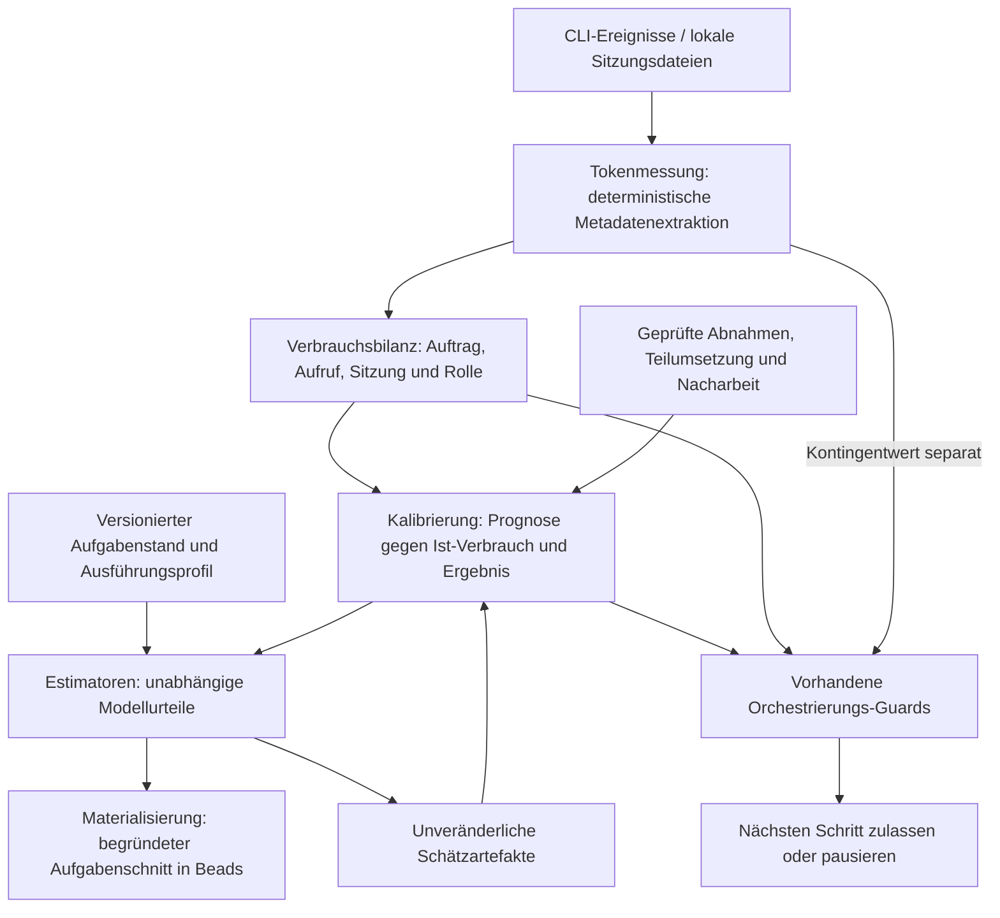

# Tokenmessung, Aufgabenschnitt und Verbrauchsprognose

Stand: 2026-09-17. Materialisierung des Nutzerauftrags zur Verbrauchsmessung
und Mehrmodell-Einschätzung. Dieser Systementwurf ergänzt den normativen
[Orchestrator-Vertrag](../pending/design-notes.de.md#orchestrator).
Die Umsetzung wird in Beads unter **ki-dev-ablauf-wu0** geführt. Dieses
Dokument beschreibt das Zielbild; es behauptet keine implementierten
Estimatoren, bestandenen manuellen Tests oder nachgewiesene Einsparung.

## Zweck und bestehende Grundlage

Tokenverbrauch ist ein Betriebssignal des Orchestrators. Zusammen mit
fachlichem Fortschritt und Ergebnisqualität macht er teure Reparaturschleifen,
übermäßigen Kontextaufbau und ungünstige Aufgabenverteilung sichtbar. Hoher
Verbrauch allein beweist keinen Fehler; niedriger Verbrauch bei unvollständiger
Umsetzung ist kein Erfolg.

Die ohnehin nötige Einschätzung bei der Materialisierung von Beads-Vorgängen
wird für mehrere unabhängige Modellurteile genutzt. Ihr erster Zweck ist ein
guter Aufgabenschnitt: vollständig überprüfbare Ergebnisse, beherrschbare
Unsicherheit und sinnvoll geteilter Kontext. Zu große Aufgaben riskieren
Teilumsetzung und Nacharbeit; zu kleine Aufgaben wiederholen Kontextaufnahme,
Schätzung und Übergaben. Die Verbrauchsprognose entsteht aus derselben Arbeit
und wird anschließend gegen wirklichen Verbrauch kalibriert.

Vorhanden sind bereits:

- `src/ki_dev/executors/metering.py`: strukturierte CLI-Verbrauchsergebnisse,
  Claude-Kontextmessung und lokale Codex-Kontingentmessung.
- `scripts/analyze_claude_usage.py`: deterministische Auswertung eines
  vorhandenen Claude-Laufs, einschließlich Deduplizierung von Modellantworten.
- `CallLedger` und `QuotaBaseline` in `src/ki_dev/loop_safety.py`: persistierte
  Laufbilanz, Aufrufreservierungen und Kontingentbasislinien.
- Guards in `src/ki_dev/loop_runtime.py`: technische Freigabe/Pause, getrennte
  Aufgabenbudgets und Kontingentreserve sowie Kontextprüfung.

Diese Grundlagen werden erweitert. Der vorhandene Analyseskript ist eine
Ausgangsbasis, noch kein allgemeiner versionssicherer Messvertrag. Die heutigen
Grenzen sind in [loop-runtime.de.md](../loop-runtime.de.md) beschrieben;
insbesondere ersetzt eine neue Prognose keinen fehlenden Kontingentnachweis.

## Systemskizze und Modulgrenzen



Die Bezeichnungen sind fachliche Modulgrenzen. Neue Python-Dateinamen sind
Vorschläge; ihr Zuschnitt folgt den vorhandenen Verträgen und der tatsächlichen
Komplexität. Es entstehen kein zusätzlicher Dienst und keine zweite Safety-Bilanz.

| Modul | Verantwortung und Grenze | Anschluss im Repository |
| --- | --- | --- |
| Tokenmessung | Quellen lesen, Tokenkategorien normalisieren, Herkunft/Vollständigkeit ausweisen; keine Modellaufrufe oder Freigabeentscheidung | `executors/metering.py` und bestehender Analyseskript; bei Bedarf gemeinsame Verträge in `usage.py` |
| Verbrauchsbilanz | Ereignisse genau einmal einem Auftrag/Aufruf zurechnen, Gesamtsummen abgleichen, Sitzungswechsel und Teilaufgaben zusammenführen | `CallLedger`/`RunStore` erweitern |
| Estimatoren | Aufgabengröße, Unsicherheit, Kontextbedarf, Schnittvorschläge und Verbrauchsintervalle beurteilen | vorgeschlagenes `estimation.py`; bestehende Executor-Verträge und Materialisierung nutzen |
| Kalibrierung | Schätzfehler und Token-Kontingent-Beziehung getrennt lernen, Modellstände und Gültigkeit versionieren | vorgeschlagenes `calibration.py`; rein datenbasierte Auswertung ohne Modellpflicht |
| Budgetsteuerung | Prognose und Messung gegen wirksame Grenzen prüfen, Reservierungen koordinieren, Pause/Handoff begründen | vorhandene `loop_safety.py`/`loop_runtime.py` |

Beads bleibt die Wahrheit für Aufgaben, Abhängigkeiten und Zustand. Messreihen,
Schätzungen und Kalibrierungsstände sind strukturierte versionierte Artefakte
mit Referenz aus Beads. Das Beads-Feld `estimate` bezeichnet Minuten und wird
nicht für Tokens oder eine fachliche Größenskala umgedeutet.

## Messvertrag und sparsame Extraktion

**Entwicklungsregel: Roh-Sitzungsdateien niemals vollständig in den
Agentenkontext laden.** Ein deterministischer Parser darf Dateien vollständig
durchlaufen, gibt aber ausschließlich gezielt freigegebene JSON-Metadaten aus.
Das gilt auch für Diagnose, Fehlermeldungen und Fixture-Erzeugung. Keine
Gesprächsinhalte, Prompts, Werkzeugausgaben, Zugangsdaten oder unbeschränkten
Ereignis-Dumps ausgeben. Eine Ausgabegrenze muss ihre Kürzung erkennbar machen.

Die Messung benötigt, soweit die Quelle sie tatsächlich bereitstellt:

| Daten | Bedeutung |
| --- | --- |
| Schema-/Parser-/CLI-Version und Quellenreferenz | Reproduzierbare Interpretation; unbekannte Version ist kein implizit gültiger Messwert |
| Provider, Konto-/Kontingentbezug und tatsächlich verwendetes Modell | Zusammenpassende Messungen identifizieren; angefordertes Modell getrennt vom bestätigten Modell halten; keine Credentials speichern |
| Bead-ID und Auftragsrevision, Lauf-, Aufruf-, Request-, Sitzungs- und Rollenkennung | Verbrauch zurechnen; fehlende Bindung ausdrücklich kennzeichnen |
| Ereigniszeit, Beobachtungszeit und Zählerbereich | Messalter, kumulative Zähler und einzelne Requests unterscheiden |
| Input, Cache-Lesen/-Schreiben, Output und verfügbare Unterkategorien | Providersemantik erhalten; enthaltenes Reasoning oder Cache nicht nochmals addieren |
| Messstatus und Vollständigkeit | Gemessen, teilweise vorhanden, nicht verfügbar oder nicht unterstützt unterscheiden; unbekannt ist nicht null |
| Kontingent-ID, Fensterdauer, Reset und verbrauchte Prozentpunkte | Separater kontoweiter Messwert, keine automatisch aufgabengenaue Tokenbuchung |

Aus Rohzählern entsteht ein normalisierter Verbrauch, bei dem jede Tokenmenge
genau einmal enthalten ist. Eine nicht vorhandene Kategorie ist nur dann null,
wenn der verifizierte Quellvertrag dies rechtfertigt. Kontextbelegung eines
Requests, kumulierte Eingabetokens über viele Requests und Kontingentprozent
sind unterschiedliche Messgrößen. Die physische Tokenzahl ist keine universelle
Kosten- oder Kontingenteinheit.

Streaming-Duplikate werden anhand geeigneter Request-/Antwortidentitäten
zusammengeführt. Kumulative Snapshots werden nicht summiert, sondern innerhalb
ihres belegten Zählerbereichs differenziert. Negative Differenzen, Compaction,
Sitzungsfortsetzung und Zählerwechsel verlangen eine explizite Behandlung;
unbekannte Vorgeschichte darf nicht zu null werden. CLI-Gesamtsummen und darin
enthaltene Einzelrequests dienen dem Abgleich, nicht einer doppelten Buchung.
Bei Abbruch bleiben bekannter Verbrauch und offene Restwirkung erhalten.

Ein unvollständiger letzter JSONL-Eintrag wird nach weiterem Schreiben erneut
gelesen. Fehler im Inneren einer Datei und Lücken bleiben sichtbar. Ein
inkrementeller Index darf später den Scan beschleunigen, muss aber Rotation,
Trunkierung, Kopien, mehrfach vorhandene Ereignisse und Neustart beherrschen.
Dateiänderungszeit und Zeilenreihenfolge garantieren keine Ereignisreihenfolge.
Die bestehende Suche nach dem neuesten Kontingentereignis wird nicht durch
eine unbelegte Dateiauswahl verkürzt.

## Manueller Messabgleich vor dem nächsten Loop

Der manuelle Smoke-Nachweis **ki-dev-ablauf-wu0.1** ist eine zusätzliche
Voraussetzung für **ki-dev-ablauf-uar.2**. Der vollständige Estimator-Ausbau ist
keine Voraussetzung für diesen Nachweis. Die Testregel aus
**ki-dev-ablauf-him** bleibt maßgeblich: Softwaretests starten keine echten
Modellanfragen; die dort verschobene technische Sperre hebt diese Regel nicht auf.

1. Konto/Kontingent, CLI-Version, Messdefinition, Fenster, Zeitpunkte und
   Vergleichstoleranz vorab festhalten. „Verbleibend“ aus `/status` und
   „verbraucht“ aus der Messquelle auf dieselbe Darstellung bringen.
2. Benutzerwert aus `/status` und kompakten `ki-dev`-Messwert möglichst zeitnah
   paaren; Messquelle und Alter mit ausgeben.
3. Vorher/Nachher-Werte aus ohnehin stattfindender Benutzerarbeit oder bereits
   vorhandenen passenden Belegen vergleichen. Keine zusätzlichen Modellläufe
   zum Erzeugen von Testverbrauch. Ohne solche Belege bleibt der Nachweis offen.
4. Wiederholtes Auslesen darf keinen Modellaufruf auslösen. Tokenzähler getrennt
   gegen bekannte strukturierte Ereignisse prüfen; Prozentübereinstimmung
   beweist noch keine exakte Tokenzählung.
5. Rundung, verzögerte Aktualisierung, Reset und fremde Kontonutzung dokumentieren.
   Für die spätere Verhältnis-Kalibrierung ungeeignete Intervalle ausschließen.

Der Nachweis gilt nur für die geprüfte Quelle und Konfiguration. Ein erfolgreicher
Codex-Abgleich behebt keine fehlende Claude-Kontingentquelle. Fehlende/veraltete
Messwerte geben keinen Lauf frei. Es werden keine bestandenen Tests vorweggenommen.

## Einschätzung als Teil der Materialisierung

Jeder Schätzer erhält denselben eingefrorenen Aufgabenstand: Ziel, begrenzten
relevanten Kontext, Abnahmekriterien, Abhängigkeiten und vorgesehenes
Ausführungsprofil. Zunächst sind zwei unterschiedliche Modelle als Vergleich
vorgesehen; Modellzahl, Eingabeumfang, Aufrufzahl und Budget sind begrenzt.
Die Modelle sehen die anderen Einschätzungen erst nach ihrer eigenen Abgabe.
Verschiedene Modelle sind deshalb noch nicht statistisch unabhängige Schätzer.

Eine Schätzung enthält getrennt:

- Umfang auf einer versionierten Skala mit Referenzaufgaben;
- Unklarheiten, Kontextbedarf und Vollständigkeitsrisiken;
- begründetes Schnitturteil mit prüfbaren Ergebnissen und Übergaben;
- erwarteten Tokenverbrauch und vorsichtige Obergrenze samt Annahmen zu
  Implementierung, Tests, Review und Reparatur;
- Schätzer-/Promptversion, tatsächliches Schätzmodell und Zielprofil der
  Ausführung, einschließlich Modell, Effort und Arbeitsablauf, soweit bekannt.

Die Ergebnisse verbessern dieselbe Materialisierung; es arbeiten nicht mehrere
Materialisierer konkurrierend schreibend am Beads-Graphen. Unterschiedliche
Urteile werden anhand ihrer Annahmen ausgewertet. Ein bloßer Mittelwert kann
einen wichtigen Hinweis auf fehlende Klärung verdecken. Fachliche Entscheidungen
und Auftragsänderungen bleiben im bestehenden Planungs-/Freigabevertrag.

Der Aufwand der Schätzer wird einschließlich Kontextaufnahme verbucht. Die
Schätzung wird vor der Ausführung gespeichert. Ein neuer Auftragsstand oder
Zuschnitt erhält neue Prognosen; die alten bleiben für den späteren Vergleich
erhalten. Familienbezug und ursprünglicher Gesamtumfang verbinden Eltern- und
Teilaufgaben. Gemeinsamer Planungsaufwand wird genau einmal zugerechnet.

## Kalibrierung und Bewertung

Zwei verschiedene Beziehungen werden gelernt: **Aufgabe → erwarteter
Verbrauch** und **Tokenverbrauch → Kontingentänderung**. Eine brauchbare
Tokenprognose setzt keine stabile Kontingentumrechnung voraus.

Für ein geeignetes Intervall ohne Reset und unbekannten Parallelverbrauch ist
`100 × ΔTokens / ΔProzentpunkte` ein Kandidat für die effektive Kapazität des
beobachteten Profils. 40.000 Tokens bei 2 Prozentpunkten ergeben rechnerisch
2 Millionen Tokens für 100 Prozent. Das ist eine empirische Hochrechnung,
keine feste Anbieterzusage. Kleine Prozentdifferenzen, Rundung und zeitlich
versetzte Messwerte können das Ergebnis stark verzerren.

Provider, Kontingent, Modellprofil und Tokenmix werden getrennt betrachtet.
Cache-/Output-Anteile und Betriebsänderungen können das Verhältnis verschieben.
Ungewichtete Tokens, empirisch gewichtete Kategorien und eine direkte Prognose
der Prozentpunkte sind zu vergleichen. Messfenster und Kontingent-ID dürfen
nicht allein aus einem Feldnamen wie „primary“ abgeleitet werden. Drift oder
instabile Verhältnisse führen zu ungültiger Prognose, nicht zu erfundener Präzision.

Für die Aufgabengröße wird der **Gesamtverbrauch gegenüber dem vorher
geschätzten, vollständig erledigten Umfang** ausgewertet. Ein Quotient setzt
eine sinnvoll teilbare, stabile Größeneinheit voraus. Bei ordinalen Klassen
wie S/M/L wird stattdessen innerhalb der Klassen verglichen. Bei einer
Aufteilung bleibt der eingefrorene Elternumfang der Vergleichsbezug; neu
summierte Kindschätzungen dürfen den Nenner nicht künstlich vergrößern.

Gesamtverbrauch umfasst Schätzung, Umsetzung, wiederholtes Kontextlesen,
Übergaben, Review, Fehlversuche und Nacharbeit. Teilumsetzungen/Abbrüche bleiben
mit Aufwand und unerfüllten Abnahmen sichtbar. Ergebnisqualität und Nacharbeit
werden neben Tokens berichtet. Ein günstiger Quotient allein ist kein Erfolg.
Die erwartete ungünstige Wirkung sowohl sehr kleiner als auch sehr großer
Schnitte ist eine Hypothese, kein schon nachgewiesenes universelles Optimum.

Begonnen wird mit historischen Vergleichsaufgaben und Korrekturfaktoren je
Schätzer/Aufgabentyp. Gewichtete Kombination oder Regression kommen erst bei
ausreichenden Daten hinzu. Ein vom Modell genanntes „P90“ ist ohne empirische
Abdeckung nur eine Behauptung; bis zur Kalibrierung heißt es Schätzobergrenze.
Fehler, deutliche Unterschätzungen, Überschreitungen der Obergrenze und deren
Breite werden auf zeitlich späteren Aufgaben ausgewertet. Auftragsfamilien
werden nicht zwischen Anpassungs- und Validierungsdaten verteilt. Mindestdaten,
Fehlergrenzen und Aktivierungskriterien werden vor der Bewertung festgelegt.
Wenig Daten, wechselnde Aufgabenmischung und Auswahlverzerrung begrenzen Aussagen.

## Vorausschauende Budgetsteuerung

Zunächst werden Prognosen nur protokolliert und gegen tatsächliche Ergebnisse
geprüft. Erst nach belegter Güte darf die vorhandene Orchestrierung sie zur
Freigabe des nächsten Schritts nutzen. Für jede Budgetdimension getrennt gilt:

```text
konservative Prognose des nächsten Schritts
+ noch nicht verbuchter reservierter Restverbrauch anderer Arbeit
+ Sicherheitsreserve
<= verfügbares Budget dieser Dimension
```

Tokens werden nur mit Tokens verglichen; eine Prozentprüfung braucht eine gültige
Umrechnung oder direkt kalibrierte Kontingentprognose. Kontingente verschiedener
Konten werden nicht addiert. Bereits im gemessenen Verbrauch enthaltene Mengen
dürfen nicht nochmals als Reservierung abgezogen werden. Eine kontoweite
Reservierung ist nur bei gemeinsamem, atomarem Speicher aller beteiligten
Orchestratoren belastbar; fremde Sitzungen und andere Geräte bleiben sonst eine
Unsicherheit. Nach jedem Schritt werden Ist-Verbrauch und Restaufwand abgeglichen.

Resume, neue Sitzung oder Modellwechsel setzen keine Bilanz zurück. Veraltete
Prognosen, geänderte Aufgaben und Drift benötigen eine explizite konservative
Behandlung. Vorhandene Token-/Kontingent-/Kontextgrenzen bleiben zusätzlich
wirksam. Eine Schätzung gestattet einem Agenten weder Budgetanhebung noch
Selbstfreigabe. Pausen benennen Ursache und Belege und verwenden den bestehenden
Handoff-Vertrag. Die Vorprüfung garantiert keine harte Echtzeitobergrenze für
einen bereits laufenden, nicht entsprechend begrenzbaren Aufruf.

## Alternativen und Bewertung

| Frage | Alternative | Bewertung / bevorzugter Einstieg |
| --- | --- | --- |
| Datenquelle | Strukturierte CLI-Ergebnisse plus gezielte lokale JSON-Extraktion | Baut auf vorhandenen Adaptern auf, modellverbrauchsfrei; Rohformate und Aktualität müssen geprüft werden. Einstieg. |
| Datenquelle | Direkte strukturierte Status-/Ereignisschnittstelle, etwa Codex App Server | Kandidat für frischere Daten und weniger Dateiformatkopplung; Verfügbarkeit, Authentifizierung und Vertrag gegen die eingesetzte CLI prüfen. Keine Voraussetzung für den ersten Abgleich. |
| Datenquelle | Agent liest vollständige Sitzungen oder schätzt Tokens aus Textlänge | Verursacht selbst Kontextkosten bzw. liefert keine exakten Verbrauchswerte. Für Messung verworfen. |
| Modulaufbau | Kleine lokale Fachmodule mit vorhandener Bilanz und Guards | Klare Zuständigkeiten ohne neuen Dienst; bevorzugt. Ein Modul pro Provider nur soweit unterschiedliche Semantik es verlangt. |
| Modulaufbau | Alles im Runtime-Guard oder eigener Telemetriedienst | Ersteres vermischt Parsing/Prognose/Entscheidung; letzteres erhöht Betrieb und Synchronisationsaufwand. Derzeit nicht erforderlich. |
| Schätzung | Ein vorhandenes Modell und historische Vergleichswerte | Günstige Vergleichsbasis; entdeckt weniger unterschiedliche Annahmen. Als Baseline erhalten. |
| Schätzung | Zwei unabhängige Modellurteile auf demselben Eingang | Bevorzugter Einstieg für die Schnittprüfung; Mehrkosten zählen mit, korrelierte Fehler bleiben möglich. |
| Schätzung | Viele Modelle für jede Kleinigkeit | Höhere Kosten und Latenz ohne garantierten Erkenntnisgewinn. Erst bei belegtem Zusatznutzen erweitern. |
| Lernen | Vergleichsaufgaben, Korrekturfaktoren, später einfache Regression/Gewichtung | Nachvollziehbar, offline auswertbar, geringer Datenbedarf gegenüber Fine-Tuning. Bevorzugter Start. |
| Lernen | Eigenes Sprachmodell-Fine-Tuning | Benötigt genügend saubere Daten und zusätzliche Pflege. Erst bei nachgewiesenem Vorteil gegenüber der Baseline ein eigener Entscheid. |
| Schutz | Feste Grenzen plus kalibrierte Prognose | Beibehaltung vorhandener Schutzwirkung und frühere Pause bei ungünstiger Erwartung. Zielbild. |
| Schutz | Ausschließlich Schätzerurteil | Kann systematisch unterschätzen und schützt nicht vor ungemessenem Verbrauch. Verworfen. |

## Herausforderungen und Prüfnachweise

| Hauptproblem | Erforderlicher Nachweis |
| --- | --- |
| Provider unterscheiden Tokenkategorien und Zählerbereiche | Kleine Fixtures mit bekannten Summen, Cache-/Reasoning-Untergruppen, Duplikaten und Zählerwechseln |
| Sitzungsdaten wachsen während des Lesens | Teilzeilen, Rotation, Trunkierung, Neustart und wiederholtes Lesen verlieren/verdoppeln keinen bekannten Verbrauch |
| Messung kann selbst Agentenkontext verschwenden | Sentinel-Inhalte erscheinen weder in Ausgabe noch Fehlerdiagnose; Ausgabe und persistierte Projektion sind begrenzt |
| Kontoweite Quota ist nicht aufgabengenaue Buchhaltung | Konto-/Fensterbindung, Messalter, Parallelverbrauch und Grenzen der Attribution ausdrücklich geprüft |
| Teilaufgaben/Resume können die Bilanz verfälschen | Bekannter Gesamtverbrauch über Eltern, Kinder, Sitzungswechsel und abgebrochene Versuche bleibt erhalten |
| Mehrere Modelle können gemeinsam falsch liegen | Vorab gespeicherte Prognosen gegen spätere Ergebnisse, Baselinevergleich und getrennte Unterschätzungsanalyse |
| Niedrige Tokens können schlechte Ergebnisse verdecken | Vollständigkeit, Regressionen und Nacharbeit neben Verbrauch ausweisen; Abbrüche nicht aus der Stichprobe entfernen |
| Gleichzeitige Freigaben können Restbudget mehrfach vergeben | Atomare Reservierung/Abgleich mit lokalen Stubs; unbekannte externe Aktivität als Grenze benennen |

Die offenen Umsetzungsschritte, ihr Zustand und ihre Abhängigkeiten stehen
ausschließlich im Beads-Epic **ki-dev-ablauf-wu0**. Der manuelle Abgleich und
die automatisierten Offline-Nachweise bleiben unterscheidbar. Die Wirkung auf
die Güte von `ki-dev` wird gemessen; dieser Entwurf behauptet sie noch nicht.
