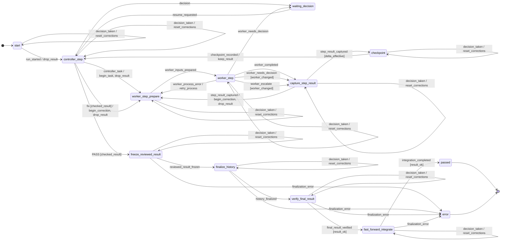
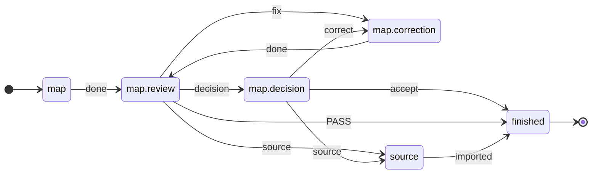

[← README](../README.md) · [English](vertiefung.en.md)

# Vertiefung zum Minimalbeispiel

Diese Seite vertieft das [Minimalbeispiel](../README.md#minimalbeispiel):
wie der Ablauf festgelegt ist, was ein Lauf protokolliert und wie die Teile
von ki-dev zusammenarbeiten. Die Befehle setzen die
[Einrichtung](../README.md#1-einrichten) voraus.

## Inhalt

<!-- readme-inhalt -->

- [Demo ohne Modellzugang](#demo-ohne-modellzugang)
- [Ablaufregeln](#ablaufregeln)
- [Ereignisprotokoll](#ereignisprotokoll)
- [Architektur](#architektur)
- [Entwurfsentscheidung](#entwurfsentscheidung)
- [Weiteres Beispiel: Planung](#weiteres-beispiel-planung)
- [Betriebsinstallation für Entwicklungsläufe](#betriebsinstallation-für-entwicklungsläufe)

<!-- /readme-inhalt -->

## Demo ohne Modellzugang

<!-- readme-script: readme-scripts/8-demo.sh -->
Im ki-dev-Klon nach der [Einrichtung](../README.md#1-einrichten). Die Demo
führt einen eigenen Auftrag mit vorgegebenen Antworten aus, ohne
Modellzugang: Ein Platzhalter ergänzt `MOCK.md`, das Review verlangt
eine Korrektur und akzeptiert Runde 2.

```bash
make demo
```

<p align="right"><sub>✓ Im leeren Container ausgeführt · <a href="../tests/readme/test_8_demo.sh">Test</a></sub></p>

```text
Demo-Verlauf (Platzhalter-Agenten mit vorgegebenen Antworten):
Lauf demo: passed nach 2 Runden
  Runde 1  Umsetzer  geändert: MOCK.md
  Runde 1  Review    fix (AC1): vorgegebene Antwort
  Runde 2  Umsetzer  geändert: MOCK.md
  Runde 2  Review    PASS
  Abschluss          Fast-forward integriert
Datei auf main: ziel/MOCK.md
  Runde 1
  Runde 2
```

Der Verlauf kommt von `ki-dev -f implement history`, wie in
[Schritt 6](../README.md#6-ergebnis-ansehen) des Minimalbeispiels. Im
ausgegebenen Laufverzeichnis liegen Protokoll und Zwischenstände. Die
Demo zeigt die Steuerung mit vorgegebenen Antworten; was ein Agent
leistet, zeigt der Lauf im Minimalbeispiel.
<!-- /readme-script -->

<p align="right"><a href="#inhalt">↑ Zum Inhalt</a></p>

## Ablaufregeln

`implement` ist bereits enthalten. Seine Rollen heißen `worker` (Umsetzer)
und `review` (Reviewer). Ein Ausschnitt aus
[`implement.toml`](../src/ki_dev/flow/implement.toml):

```toml
[op.review]
role = "review"                  # diese Rolle besetzt das Profil
do = "review.decide"             # Python-Operation für das Review
events = ["PASS", "fix", "decision", "escalate"]  # erlaubte Antworten
```

**Der Ablauf bestimmt die Reaktion auf eine Antwort.** Zum Beispiel führt
`fix` zurück zur Umsetzung, solange noch eine Runde übrig ist.
`changes_rounds = 2` im [Profil](../README.md#3-profil-speichern) erlaubt bis zu zwei
Korrekturrunden nach der ersten Umsetzung.
Ein [Test des Zustandsraums](../tests/machine/test_reachability.py) prüft,
dass jede Schleife in `implement` bis zum nächsten Halt begrenzt ist.

<details>
<summary>Die Korrekturschleife in TOML</summary>

```toml
# Review sagt „fix“, keine Runde mehr übrig → Halt, der Mensch entscheidet
[[statechart.states.active.states.controller_step.transitions]]
event = "fix"
cond = "checked_result"
unless = "changes_rounds_left"
on = [{ raise = { event = "escalation.changes_rounds_exhausted" } }]

# sonst → zurück zur Umsetzung, Rundenzähler +1
[[statechart.states.active.states.controller_step.transitions]]
event = "fix"
cond = "checked_result"
target = "worker_step_prepare"
on = ["begin_correction", "drop_result"]
```

Die erste passende Transition gilt. Bedingungen wie `checked_result`
und Aktionen wie `begin_correction` sind
[Python im Ablaufpaket](../src/ki_dev/flow_ops/implement/machine/model.py).
[python-statemachine](https://python-statemachine.readthedocs.io/)
führt die Zustandsmaschine aus.

</details>

**Eigene Abläufe:** Rollen und Übergänge definierst du in TOML, fachliche
Operationen in Python. Ein Paketverzeichnis wird über `KI_DEV_FLOW_PATH`
geladen. [Paket anlegen](ablaufpakete.de.md#paket-außerhalb-des-gerüsts)

<p align="right"><a href="#inhalt">↑ Zum Inhalt</a></p>

## Ereignisprotokoll

ki-dev speichert Übergänge und Zwischenstände im Laufverzeichnis. Damit
lässt sich etwa prüfen, warum ein Auftrag erneut beim Umsetzer gelandet ist.

Im [Protokoll eines Demo-Laufs](beispiele/demo-lauf.events.jsonl)
steht dafür in Zeile 16, hier auf die entscheidenden Felder gekürzt:

```json
{"state": "controller_step", "event": "fix",
 "target": "worker_step_prepare", "adapter": "mock"}
```

Das Review (`controller_step`) hat `fix` geliefert; ki-dev wechselt zur
Vorbereitung der nächsten Umsetzung (`worker_step_prepare`).
[Alle Protokollfelder](ausfuehrer.de.md#ereignisprotokoll-je-übergang)

<details>
<summary>Implement-Ablauf als Zustandsdiagramm</summary>

Aus `ki-dev flow show implement --without-escalations` erzeugt.
Grenz- und Schutzhalte sind in dieser Ansicht ausgeblendet.

<!-- ki-dev flow show implement --without-escalations -->


</details>

<p align="right"><a href="#inhalt">↑ Zum Inhalt</a></p>

## Architektur

**Ablauf → Runner → Operation → Executor:** Der Ablauf legt den nächsten
Schritt fest, der Runner führt ihn aus und sichert das Ergebnis. Eine
Operation erledigt die Arbeit, etwa eine Übergabe an eine Agentensitzung
über den Executor.

Die Kästen zeigen diese Steuerung. Die Zeilen **Paket** und **Gerüst**
zeigen, wo der Code hingehört: Fachliches ins Ablaufpaket, gemeinsame
Mechanik ins Gerüst. [Der Schichtentest](../tests/test_schichten.py) prüft,
dass der gemeinsame Kern keine Ablauf- oder Rollennamen kennt.

<!-- architecture-sketch -->
```text
 ◇ Bead-Graph-Durchgang   wählt den nächsten Vorgang; heute der Mensch
 ◇ Ablaufkette            verbindet Abläufe; heute von Hand

┌─ Ablauf ──────────────────────────────────────────┐
│ Paket   Zustände, Kanten, Rollen, Op je Zustand   │  Regeln
│         Wächter, Aktionen: Python, nur Laufdaten  │
│ Gerüst  Muster: Review-Muster und Varianten       │
└─────────────────────────┬─────────────────────▲───┘
                          │ Op des Zustands     │ Ereignis
┌─ Runner ────────────────▼─────────────────────┴───┐
│ Gerüst  run.toml: Halt, Wiederholung, Schutz      │  Schritt 4
│         Wächter: Messwert gegen Grenzwert         │
└─────────────────────────┬─────────────────────▲───┘
                          │ startet die Op      │ Ergebnis
┌─ Wirkung ───────────────▼─────────────────────┴───┐
│ Paket   eigene Ops, Rollenvorlagen                │
│ Gerüst  Ops-Katalog: Vorlauf, Git-Abschluss       │
│         Übergabe: Vorlage + Bausteine aus Bead    │
└─────────────────────────┬─────────────────────▲───┘
                          │ Übergabe            │ Antwort
┌─ Executor ──────────────▼─────────────────────┴───┐
│ Gerüst  claude · codex · manual · inbox · mock    │  Schritt 4
│         misst Kontext, Kontingent, Budget         │
└─────────────────────────┬─────────────────────▲───┘
                          ▼                     │
                       Agent oder Mensch ───────┘

 Eingabe je Lauf: Auftrag (Schritt 2) · dazu gewählt: Profil (Schritt 3)
```

| Ebene | Quellen |
|---|---|
| Ablauf | [implement.toml](../src/ki_dev/flow/implement.toml), [Review-Muster](../src/ki_dev/flow/patterns/review.toml) |
| Runner | [run.toml](../src/ki_dev/runner/run.toml) |
| Wirkung | [Paket-Ops](../src/ki_dev/flow_ops/implement/ops.py), [gemeinsame Ops](../src/ki_dev/ops), [Übergaben](ablaufpakete.de.md#parametrisierte-übergaben) |
| Executor | [Anbindungen und Messungen](../src/ki_dev/adapter/executors.toml) |

Die Skizze zeigt die Architektur von V1, wie sie
[vereinbart](ausfuehrer-luecken.de.md#schichten-und-orte) ist; ◇ ist
geplant. Bis V1 fehlt außerdem: `implement` läuft heute über einen
eigenen Ausführer statt über den Runner, und eigene Abläufe trägt ein
Mensch mit `ki-dev step` weiter ([Stand](../README.md#stand)).
<!-- bead: ige.6.4.13 5ch.4 cak -->

| Begriff | Aufgabe im Beispiel |
|---|---|
| Rolle | `worker` setzt um, `review` prüft; das Profil besetzt beide. |
| Operation (Op) | Führt Arbeit aus, z. B. Review oder Git-Abschluss; liefert ein Ereignis. |
| Wächter / Aktion | Prüft / ändert Laufdaten beim Übergang, z. B. den Rundenzähler. |
| Mensch | Trägt bei `manual` Übergaben weiter; entscheidet bei einem Entscheidungshalt. |

[Paketformat und Bindungen](ablaufpakete.de.md) ·
[Runner, Profile und Executoren](ausfuehrer.de.md)

<p align="right"><a href="#inhalt">↑ Zum Inhalt</a></p>

## Entwurfsentscheidung

**Prüfung und Folgeschritt werden getrennt entschieden.** Ein Modell
beurteilt das Arbeitsergebnis; ki-dev prüft das Antwortformat und wendet
die festgelegten Übergänge und Rundengrenzen an. Das zeigt die
[`fix`-Schleife](#ablaufregeln) oben.

Drei fachliche Bezugspunkte:

- [MAST](https://arxiv.org/html/2503.13657v3) beschreibt unter anderem
  vorzeitigen Abschluss und fehlende oder falsche Prüfung in
  Mehr-Agenten-Systemen. ki-dev macht Review und Korrektur zu ausdrücklichen
  Schritten; ob das mit echten Agenten hilft, ist noch zu erproben.
- [Anthropics Workflow-Ansatz](https://www.anthropic.com/engineering/building-effective-agents)
  ordnet feste Codepfade und Modellarbeit ähnlich zu. In ki-dev steht der
  Pfad in TOML. Für die Wahl des nächsten Schritts fällt so kein eigener
  Modellaufruf an; eine Token- oder Kostenersparnis ist bisher nicht gemessen.
- [ImpossibleBench](https://arxiv.org/abs/2510.20270) (ICLR 2026) zeigt,
  dass Coding-Agenten widersprüchliche Tests oft per Abkürzung grün
  machen, seltener, wenn sie an einen Menschen abgeben dürfen, und dass
  modellbasierte Prüfer solche Abkürzungen bei kleinen Aufgaben
  verlässlicher finden als bei großen. In ki-dev entsprechen dem
  Test-Tor, Halt mit `decision` und das Review in eigener Sitzung; ihre
  Wirkung ist [noch nicht gemessen](wirksamkeitsmessung.de.md).

<p align="right"><a href="#inhalt">↑ Zum Inhalt</a></p>

## Weiteres Beispiel: Planung

Mit `map` lässt sich eine Sammlung von Notizen in Anforderungen überführen:

1. Ein Agent kartiert die Notizen.
2. Ein Reviewer prüft Vollständigkeit und Quellenbezug.
3. `fix` führt zur Korrektur, `PASS` beendet den Ablauf.

`map`, `graph` und `materialize` verwenden dafür das gemeinsame
[Review-Muster](../src/ki_dev/flow/patterns/review.toml).
`map` belegt dessen Rollen so ([`map.toml`](../src/ki_dev/flow/map.toml), gekürzt):

```toml
pattern_catalog = ["ki_dev:review"]   # Muster und seine Ops aus dem Gerüst
start = "map"

[[phase]]
id = "map"
use = "write_review"                  # Schreiben und Review
next = "finished"

[phase.role]                          # dieselben Rollen wie in implement
write = "worker"
review = "review"
correction = "worker"
```

**Von Hand ausprobieren:** Die folgenden Befehle geben eine Übergabe aus
und verarbeiten danach ein vorgegebenes Review-Urteil. Sie zeigen, wie der
Befund „Abschnitt 2 fehlt“ zur Korrektur führt. Eine vollständige Kartierung
erfordert die Arbeit eines Agenten oder Menschen zwischen diesen Schritten.

<!-- readme-script: readme-scripts/6-map-step.sh -->
Für dieses separate Beispiel im ki-dev-Klon beginnen
([Einrichtung](../README.md#1-einrichten)); ki-dev und bd sind im PATH:

```bash
POLICIES="$PWD/docs/policies"  # Leitlinien für Übergaben
cd "$(mktemp -d)" && git init -q  # Wegwerf-Repo mit Beads-Projekt
bd init --quiet --prefix calc --stealth --non-interactive
mkdir docs && cp -r "$POLICIES" docs/
cat >notes.md <<'EOF'
1. add(2, 3) should return 5.
2. add(-1, 1) should return 0.
EOF
BEAD="$(bd create "Map the notes on add()" \
  --description "Source map of notes.md" \
  --acceptance "1. Every section of notes.md is mapped" \
  --metadata '{"handoff": {"source_refs": ["notes.md"]}}' \
  --silent)"  # Kartierungsauftrag mit Quelle
cat >verdict.json <<'EOF'  # Urteil des Reviews als Datei
{"event": "fix", "detail": "Section 2 is not mapped",
 "requirement_ref": "AC1"}
EOF
ki-dev flow show map            # Ablauf als Mermaid
ki-dev -f map step "$BEAD" map  # Übergabe an den Kartierungsagenten
ki-dev -f map step "$BEAD" map.review map.review=verdict.json
```

<p align="right"><sub>✓ Im leeren Container ausgeführt · <a href="../tests/readme/test_6_map_step.sh">Test</a></sub></p>

```text
Empfänger: Umsetzer (bisherige Sitzung)

Review-Befund (fix, CHANGES, AC1): Section 2 is not mapped
Bitte beheben. Melde anschließend nur zurück, was aus Diff und Prüfergebnissen nicht hervorgeht, etwa offene Entscheidungen oder Hindernisse.

Zum Schluss genau ein JSON-Objekt: {} oder {"feedback": "…"}. feedback nur, was aus Diff und Prüfergebnissen nicht hervorgeht (offene Entscheidungen, Hindernisse); sonst {}. Der Mensch gibt es als Antwort dieses Zustands an ki-dev weiter.

Hinweis für den Menschen: Zustand map.review; Folgeschritte laut map.toml (Adapter manual, du trägst sie weiter):
- fix → map.correction: Befunde an den Kartierungsagenten (bisherige Sitzung)
```

Der zweite `step` liest das Urteil `fix` aus `verdict.json` und gibt die
Übergabe an die Korrektur aus, oben ohne die Zeile mit der Bead-ID.
<!-- /readme-script -->

<details>
<summary>Map-Ablauf als Zustandsdiagramm</summary>

Aus `ki-dev flow show map` erzeugt.

<!-- ki-dev flow show map -->


</details>

Die [Diagrammprüfung](../tests/test_flow_diagram.py) vergleicht beide
Zustandsdiagramme mit ihren TOML-Quellen.
[Übergaben mit step](step.de.md)

<p align="right"><a href="#inhalt">↑ Zum Inhalt</a></p>

## Betriebsinstallation für Entwicklungsläufe

<!-- readme-script: readme-scripts/2-runtime.sh -->
Wer ki-dev mit ki-dev weiterentwickelt, installiert es getrennt vom
Quellbaum, ebenfalls im Ordner `ki-dev`; vor einem Update laufende Läufe
abschließen ([Details](self-development.de.md)).

```bash
make setup-runtime                    # venv + ~/.local/bin/ki-dev
export PATH="$HOME/.local/bin:$PATH"
ki-dev --help
```

<p align="right"><sub>✓ Im leeren Container ausgeführt · <a href="../tests/readme/test_2_runtime.sh">Test</a></sub></p>
<!-- /readme-script -->
