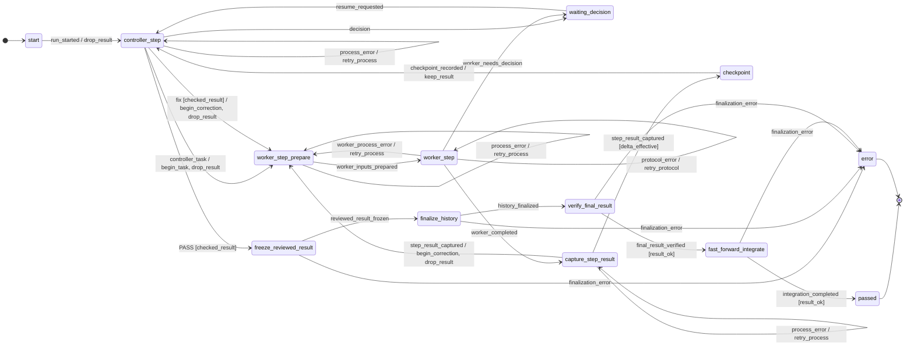
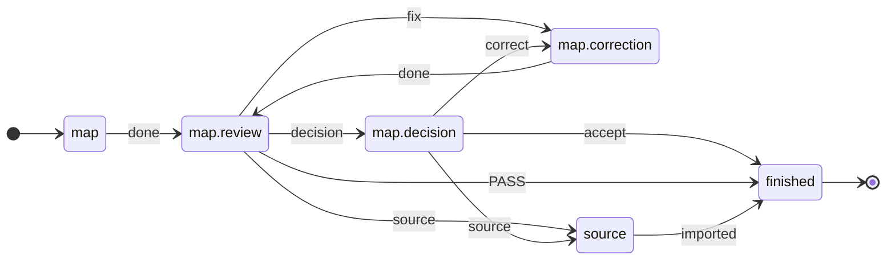

[← README](../README.en.md) · [Deutsch](vertiefung.de.md)

# Deep dive into the minimal example

This page goes deeper into the [minimal example](../README.en.md#minimal-example):
how the flow is defined, what a run records and how ki-dev's parts work
together. The commands assume the [setup](../README.en.md#1-set-up).

## Contents

- [Demo without model access](#demo-without-model-access)
- [Flow rules](#flow-rules) · [Event log](#event-log)
- [Architecture](#architecture) · [Design decision](#design-decision)
- [Another example: planning](#planning)
- [Runtime installation for development runs](#runtime-installation)

## Demo without model access

<!-- readme-script: readme-scripts/en/8-demo.sh -->
In the ki-dev clone after the [setup](../README.en.md#1-set-up). The demo
runs a separate task with scripted answers, without model access: a
placeholder appends to `MOCK.md`, the review asks for a correction and
accepts round 2.

```bash
make demo
```

> Not run in the last check · [test](../tests/readme/test_8_demo.sh)

The history comes from `ki-dev -f implement history`, as in
[step 6](../README.en.md#6-check-the-result) of the minimal example. The
printed run directory contains the log and intermediate results. The
demo shows the control flow with scripted answers; what an agent
achieves is shown by the run in the minimal example.
<!-- /readme-script -->

[↑ Contents](#contents)

## Flow rules

`implement` is included. Its roles are `worker` (implementer) and `review`
(reviewer). An excerpt from
[`implement.toml`](../src/ki_dev/flow/implement.toml):

```toml
[op.review]
role = "review"                  # the profile assigns this role
do = "review.decide"             # Python operation for the review
events = ["PASS", "fix", "decision", "escalate"]  # allowed answers
```

**The flow determines the response to an answer.** For example, `fix`
returns to implementation while another round is allowed.
`changes_rounds = 2` in the [profile](../README.en.md#3-save-the-profile) allows up to two
correction rounds after the initial implementation.
A [state-space test](../tests/machine/test_reachability.py) checks that every
loop in `implement` is bounded before requiring a human decision.

<details>
<summary>The correction loop in TOML</summary>

```toml
# review says "fix", no rounds left → halt, a human decides
[[statechart.states.active.states.controller_step.transitions]]
event = "fix"
cond = "checked_result"
unless = "changes_rounds_left"
on = [{ raise = { event = "escalation.changes_rounds_exhausted" } }]

# otherwise → back to implementation, round counter +1
[[statechart.states.active.states.controller_step.transitions]]
event = "fix"
cond = "checked_result"
target = "worker_step_prepare"
on = ["begin_correction", "drop_result"]
```

The first matching transition applies. Conditions such as `checked_result`
and actions such as `begin_correction` are
[Python in the flow package](../src/ki_dev/flow_ops/implement/machine/model.py).
[python-statemachine](https://python-statemachine.readthedocs.io/) runs
the state machine.

</details>

**Custom flows:** Define roles and transitions in TOML and domain
operations in Python. Load a package directory through `KI_DEV_FLOW_PATH`.
[Create a package](ablaufpakete.de.md#paket-außerhalb-des-gerüsts) (German)

[↑ Contents](#contents)

## Event log

ki-dev stores transitions and intermediate results in the run directory.
This lets you trace, for example, why a task returned to the implementer.

Line 16 of a [recorded demo run](beispiele/demo-lauf.events.jsonl)
shows this transition, reduced here to the relevant fields:

```json
{"state": "controller_step", "event": "fix",
 "target": "worker_step_prepare", "adapter": "mock"}
```

The review (`controller_step`) returned `fix`; ki-dev moves to preparing
the next implementation round (`worker_step_prepare`).
[All log fields](ausfuehrer.de.md#ereignisprotokoll-je-übergang) (German)

<details>
<summary>Implement flow as a state diagram</summary>

Generated by `ki-dev flow show implement --without-escalations`.
This view omits limit and safety halts.

<!-- ki-dev flow show implement --without-escalations -->


</details>

[↑ Contents](#contents)

## Architecture

**Flow → runner → operation → executor:** The flow defines the next step;
the runner executes it and saves the result. An operation does the work,
such as handing a task to an agent session through an executor.

The boxes show this control structure. Rows marked **Package** and
**Scaffold** show where code belongs: domain logic in the flow package,
shared mechanics in the scaffold. A [layer test](../tests/test_schichten.py)
checks that the shared core knows no flow or role names.

<!-- architecture-sketch -->
```text
 ◇ bead graph walk   picks the next issue; a human does it today
 ◇ flow chain        joins flows; by hand today

┌─ flow ──────────────────────────────────────────────┐
│ package   states, edges, roles, one op per state    │  rules
│           guards, actions: Python, run data only    │
│ scaffold  patterns: review pattern and variants     │
└─────────────────────────┬───────────────────────▲───┘
                          │ op of the state       │ event
┌─ runner ────────────────▼───────────────────────┴───┐
│ scaffold  run.toml: halt, retries, safety           │  step 4
│           guards: measured value against limit      │
└─────────────────────────┬───────────────────────▲───┘
                          │ starts the op         │ result
┌─ effect ────────────────▼───────────────────────┴───┐
│ package   own ops, role templates                   │
│ scaffold  ops catalog: preflight, git wrap-up       │
│           handoff: template + blocks from bead      │
└─────────────────────────┬───────────────────────▲───┘
                          │ handoff               │ answer
┌─ executor ──────────────▼───────────────────────┴───┐
│ scaffold  claude · codex · manual · inbox · mock    │  step 4
│           measures context, quota, budget           │
└─────────────────────────┬───────────────────────▲───┘
                          ▼                       │
                       agent or human ────────────┘

 inputs per run, not a layer: task (step 2) · profile (step 3)
```

| Layer | Sources |
|---|---|
| Flow | [implement.toml](../src/ki_dev/flow/implement.toml), [review pattern](../src/ki_dev/flow/patterns/review.toml) |
| Runner | [run.toml](../src/ki_dev/runner/run.toml) |
| Effect | [Package ops](../src/ki_dev/flow_ops/implement/ops.py), [shared ops](../src/ki_dev/ops), [handoffs](ablaufpakete.de.md#parametrisierte-übergaben) |
| Executor | [Connections and measurements](../src/ki_dev/adapter/executors.toml) |

◇ means planned. The sketch shows the
[agreed architecture](ausfuehrer-luecken.de.md#schichten-und-orte).
`implement` still has its own runner today; consolidation is on the
[roadmap](../README.en.md#extend-it).

| Term | Job in the example |
|---|---|
| Role | `worker` implements, `review` reviews; the profile assigns both. |
| Operation (Op) | Does work such as review or Git finalization; returns an event. |
| Guard / action | Reads / changes run data at a transition, such as the round counter. |
| Human | Carries handoffs with `manual`; decides at a decision halt. |

[Package format and bindings](ablaufpakete.de.md) ·
[Runner, profiles and executors](ausfuehrer.de.md) (German)

[↑ Contents](#contents)

## Design decision

**Reviewing the result and choosing the next step are separate decisions.**
A model judges the work; ki-dev checks the answer format and applies the
configured transitions and round limits. The
[`fix` loop](#flow-rules) above shows this division.

Three references behind this design:

- [MAST](https://arxiv.org/html/2503.13657v3) describes premature termination
  and missing or incorrect verification among failures in multi-agent
  systems. ki-dev makes review and correction explicit steps; whether
  this helps with real agents remains to be tested.
- [Anthropic's workflow approach](https://www.anthropic.com/engineering/building-effective-agents)
  makes a similar distinction between fixed code paths and model work.
  In ki-dev, the path is defined in TOML. Choosing the next step therefore
  needs no separate model call; token or cost savings have not been measured.
- [ImpossibleBench](https://arxiv.org/abs/2510.20270) (ICLR 2026) shows
  that coding agents often make contradictory tests pass through
  shortcuts, less often when they can hand over to a human, and that
  model-based monitors find such shortcuts in small tasks more reliably
  than in large ones. ki-dev's counterparts are the test gate, the
  `decision` halt and the review in its own session; their effect is
  [not yet measured](wirksamkeitsmessung.de.md) (German).

[↑ Contents](#contents)

## Planning

`map` turns a collection of notes into requirements:

1. An agent maps the notes.
2. A reviewer checks completeness and links to sources.
3. `fix` leads to correction; `PASS` ends the flow.

`map`, `graph` and `materialize` share a
[review pattern](../src/ki_dev/flow/patterns/review.toml).
`map` assigns its roles as follows
([`map.toml`](../src/ki_dev/flow/map.toml), abridged):

```toml
pattern_catalog = ["ki_dev:review"]   # shared pattern and ops
start = "map"

[[phase]]
id = "map"
use = "write_review"                  # writing and review
next = "finished"

[phase.role]                          # the same roles as in implement
write = "worker"
review = "review"
correction = "worker"
```

**Try it manually:** The following commands emit a handoff and then
process a scripted review verdict. They show how the finding “section 2
is missing” leads to correction. A complete mapping requires an agent
or human to do the work between these steps.

<!-- readme-script: readme-scripts/en/6-map-step.sh -->
By hand, without agents, in the folder `ki-dev` from
[setup](../README.en.md#1-set-up):

```bash
POLICIES="$PWD/docs/policies"  # ki-dev's guidelines, for the handoffs
cd "$(mktemp -d)" && git init -q  # throwaway repo with a Beads project
bd init --quiet --prefix calc --stealth --non-interactive
mkdir docs && cp -r "$POLICIES" docs/
cat >notes.md <<'EOF'
1. add(2, 3) should return 5.
2. add(-1, 1) should return 0.
EOF
BEAD="$(bd create "Map the notes on add()" \
  --description "Source map of notes.md" \
  --acceptance "1. Every section of notes.md is mapped" \
  --metadata '{"handoff": {"source_refs": ["notes.md"]}}' \
  --silent)"  # mapping task with a source
cat >verdict.json <<'EOF'  # the review's verdict as a file
{"event": "fix", "detail": "Section 2 is not mapped",
 "requirement_ref": "AC1"}
EOF
ki-dev flow show map            # the flow as Mermaid
ki-dev -f map step "$BEAD" map  # handoff to the mapping agent
ki-dev -f map step "$BEAD" map.review map.review=verdict.json
```

> Not run in the last check · [test](../tests/readme/test_6_map_step.sh)

The second `step` reads the verdict `fix` from `verdict.json` and prints
the handoff to the correction (German), above without the line with the
bead ID.
<!-- /readme-script -->

<details>
<summary>Map flow as a state diagram</summary>

Generated by `ki-dev flow show map`.

<!-- ki-dev flow show map -->


</details>

The [diagram check](../tests/test_flow_diagram.py) compares both state
diagrams with their TOML sources.
[Handoffs with step](step.de.md) (German)

[↑ Contents](#contents)

## Runtime installation

<!-- readme-script: readme-scripts/en/2-runtime.sh -->
To develop ki-dev with ki-dev, install it apart from the source tree,
also in the folder `ki-dev`; finish running jobs before an update
([details, German](self-development.de.md)).

```bash
make setup-runtime                    # venv + ~/.local/bin/ki-dev
export PATH="$HOME/.local/bin:$PATH"
ki-dev --help
```

> Not run in the last check · [test](../tests/readme/test_2_runtime.sh)
<!-- /readme-script -->
